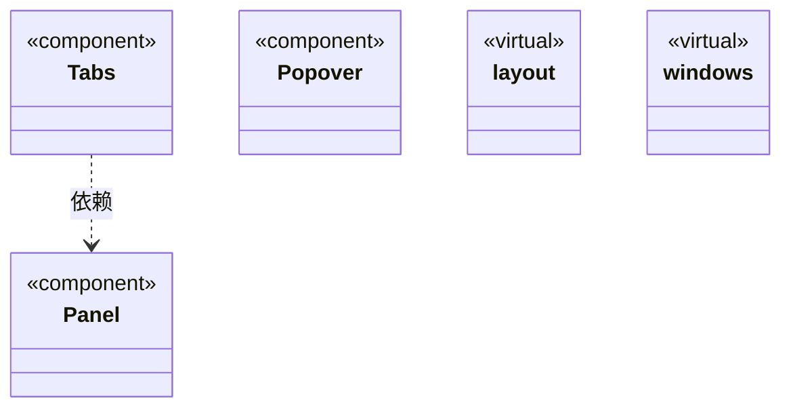

# 界面容器

## 设计意图

组织面板、页签和窗口的可见内容，不持有页面业务状态。

## 主要组成

Panel 提供活动期订阅；Tabs 协调选中项与面板；layout 和 windows 负责布局与窗口。

| Module | Role |
| --- | --- |
| [Panel](Panel.tsx) | Panel |
| [Tabs](Tabs.tsx) | Tabs |
| [Popover](Popover.tsx) | 共享原生弹出菜单与 Esc 关闭行为。 |

<!-- architecture:generated:start -->

## 架构关系

标注为 `virtual` 的节点是直接子模块的虚拟类封装；内部设计沿下方入口阅读。

## 子模块

| 虚拟封装 | 整体职责 |
| --- | --- |
| [layout](layout/ARCHITECTURE.md) | 排列三个面板，由调用方保存宽度。 |
| [windows](windows/ARCHITECTURE.md) | 统一确认操作的焦点、取消和关闭行为，调用页面负责执行已确认的操作。 |

[上层设计](../ARCHITECTURE.md)

<!-- architecture:generated:end -->
