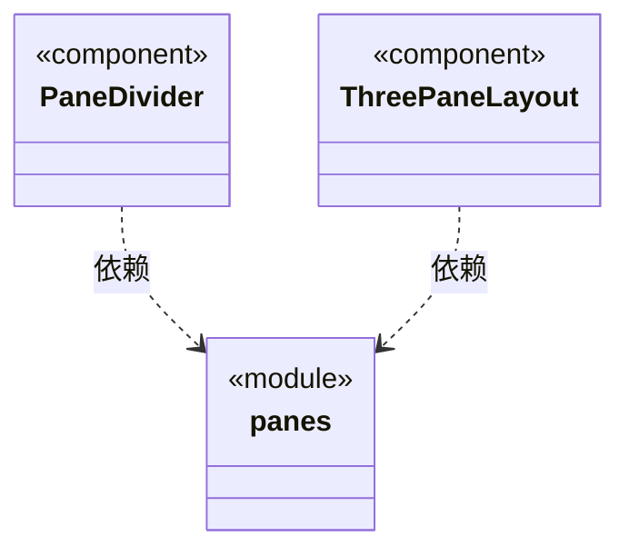

# 布局

## 设计意图

排列三个面板，由调用方保存宽度。

## 主要组成

ThreePaneLayout 计算可用宽度，PaneDivider 通过 panes 上下文提交拖动和键盘调整。

| Module | Role |
| --- | --- |
| [PaneDivider](PaneDivider.tsx) | PaneDivider |
| [panes](panes.ts) | panes |
| [ThreePaneLayout](ThreePaneLayout.tsx) | ThreePaneLayout |

<!-- architecture:generated:start -->

## 架构关系

[上层设计](../ARCHITECTURE.md)

<!-- architecture:generated:end -->
