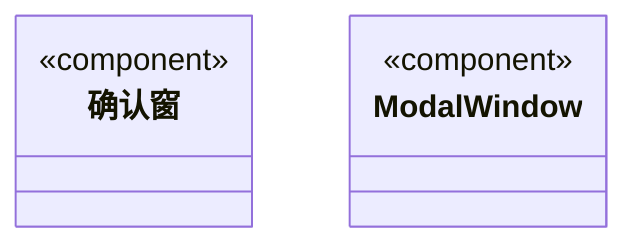

# 通用窗口

## 设计意图

统一确认操作的焦点、取消和关闭行为，调用页面负责执行已确认的操作。

## 主要组成

| 组成 | 定位 |
| --- | --- |
| [确认窗](ConfirmWindow.tsx) | 组合对话框与可配置操作按钮。 |
| [ModalWindow](ModalWindow.tsx) | 挂载时进入模态，关闭时释放焦点。 |

<!-- architecture:generated:start -->

## 架构关系

[上层设计](../ARCHITECTURE.md)

<!-- architecture:generated:end -->
