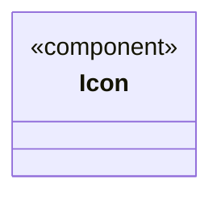

# 图标

## 设计意图

共享与业务无关的图形。

## 主要组成

Icon 按名称绘制图形，导出名称清单和类型。

| Module | Role |
| --- | --- |
| [Icon](Icon.tsx) | Icon |

<!-- architecture:generated:start -->

## 架构关系

[上层设计](../ARCHITECTURE.md)

<!-- architecture:generated:end -->
