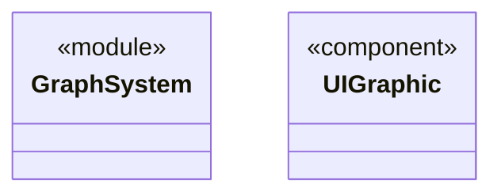

# 交互基础

## 设计意图

复用浏览器的输入与焦点语义。

## 主要组成

UIGraphic 渲染原生按钮；GraphSystem 计算组内键盘导航的目标索引。

| Module | Role |
| --- | --- |
| [GraphSystem](GraphSystem.ts) | GraphSystem |
| [UIGraphic](UIGraphic.tsx) | UIGraphic |

<!-- architecture:generated:start -->

## 架构关系

[上层设计](../ARCHITECTURE.md)

<!-- architecture:generated:end -->
