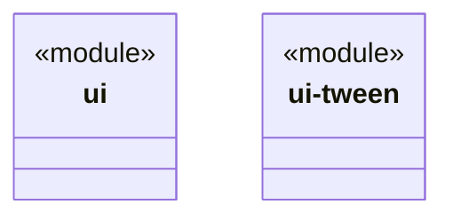

# 控件样式

## 设计意图

统一控件与动效的视觉表现。

## 主要组成

ui.css 提供控件样式并导入 ui-tween.css 的通用过渡。

| Module | Role |
| --- | --- |
| [ui-tween](ui-tween.css) | ui-tween |
| [ui](ui.css) | ui |

<!-- architecture:generated:start -->

## 架构关系

[上层设计](../ARCHITECTURE.md)

<!-- architecture:generated:end -->
