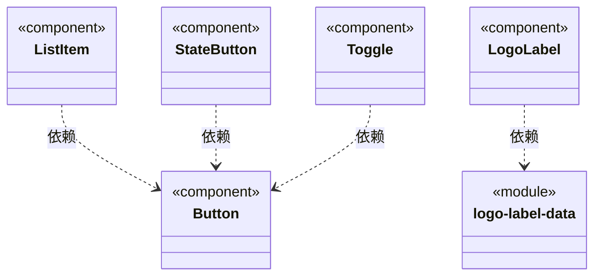
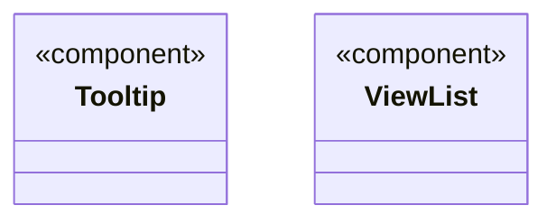

# 基础控件

## 设计意图

封装原生交互和展示，调用方提供数据与动作。

## 主要组成

Button、Toggle、StateButton 与 ListItem 共用按钮语义；ViewList 提供虚拟列表，Tooltip 与 LogoLabel 展示提示。

| Module | Role |
| --- | --- |
| [Button](Button.tsx) | Button |
| [ListItem](ListItem.tsx) | ListItem |
| [logo-label-data](logo-label-data.ts) | logo-label-data |
| [LogoLabel](LogoLabel.tsx) | LogoLabel |
| [StateButton](StateButton.tsx) | StateButton |
| [Toggle](Toggle.tsx) | Toggle |
| [Tooltip](Tooltip.tsx) | Tooltip |
| [ViewList](ViewList.tsx) | ViewList |

<!-- architecture:generated:start -->

## 架构关系

### 关系组 1：Button

### 关系组 2：Tooltip

[上层设计](../ARCHITECTURE.md)

<!-- architecture:generated:end -->
