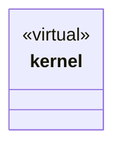

# Framework

## 设计意图

Framework 定义 CBIM 的模型能力与 Agent 引擎协议，供 Logic 装配。引擎按能力选择模型；模型目录独立于引擎。

## 主要组成

- [执行内核](kernel/ARCHITECTURE.md)

<!-- architecture:generated:start -->

## 架构关系

标注为 `virtual` 的节点是直接子模块的虚拟类封装；内部设计沿下方入口阅读。

## 子模块

| 虚拟封装 | 整体职责 |
| --- | --- |
| [kernel](kernel/ARCHITECTURE.md) | 执行内核通过统一入口提供 CBIM 的模型能力与 Agent 引擎协议，供 Logic 装配。引擎按能力选择模型；模型目录独立于引擎。 |

[上层设计](../ARCHITECTURE.md)

<!-- architecture:generated:end -->
