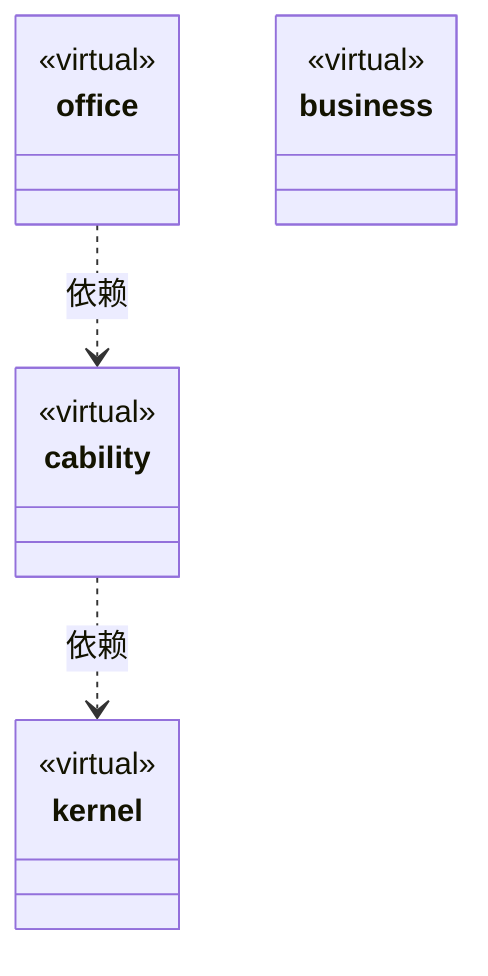

# Framework

## 设计意图

Framework 定义 CBIM 的模型能力与 Agent 引擎协议，供 Logic 装配。引擎按能力选择模型；模型目录独立于引擎。

## 主要组成

- [业务](business/ARCHITECTURE.md) 描述项目范围和业务模块树。
- [能力](cability/ARCHITECTURE.md) 封装虚拟角色和团队。
- [办公室](office/ARCHITECTURE.md) 管理子任务派发、结果回传和运行清理。
- [执行内核](kernel/ARCHITECTURE.md)

<!-- architecture:generated:start -->

## 架构关系

标注为 `virtual` 的节点是直接子模块的虚拟类封装；内部设计沿下方入口阅读。

## 子模块

| 虚拟封装 | 整体职责 |
| --- | --- |
| [business](business/ARCHITECTURE.md) | 业务与能力是对偶视图：能力树组织团队和角色，业务树以 Project 为根，其余节点均为 Workspace。每个 Workspace 在拥有子工作区的同时，承载自身业务描述及来源。Logic 从已校验的正式知识快照读取这棵树。 |
| [cability](cability/ARCHITECTURE.md) | 聚合 CBIM 的虚拟角色与团队能力。 |
| [kernel](kernel/ARCHITECTURE.md) | 执行内核通过统一入口提供 CBIM 的模型能力与 Agent 引擎协议，供 Logic 装配。引擎按能力选择模型；模型目录独立于引擎。 |
| [office](office/ARCHITECTURE.md) | 办公室调度器绑定调用身份，准备并启动子运行，等待结果，完成验收后关闭运行并释放准入。 |

[上层设计](../ARCHITECTURE.md)

<!-- architecture:generated:end -->
