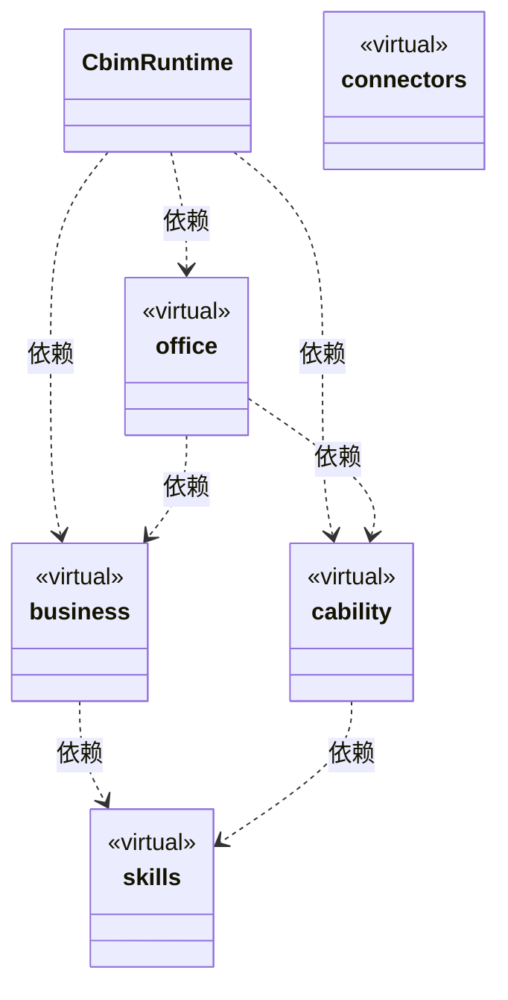
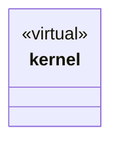

# Framework

## 设计意图

Framework 定义 CBIM 的模型能力与 Agent 引擎协议，供 Logic 装配。引擎按能力选择模型；模型目录独立于引擎。

## 主要组成

| 组成 | 定位 |
| --- | --- |
| [CbimRuntime](cbim-runtime.ts) | 应用级运行时，按工作区与主会话创建和释放 Office。 |

- [业务](business/ARCHITECTURE.md) 描述项目范围和业务模块树。
- [能力](cability/ARCHITECTURE.md) 封装虚拟角色和团队。
- [办公室](office/ARCHITECTURE.md) 管理子任务派发、结果回传和运行清理。
- [执行内核](kernel/ARCHITECTURE.md)

<!-- architecture:generated:start -->

## 架构关系

标注为 `virtual` 的节点是直接子模块的虚拟类封装；内部设计沿下方入口阅读。

### 关系组 1：business

### 关系组 2：kernel

## 子模块

| 虚拟封装 | 整体职责 |
| --- | --- |
| [business](business/ARCHITECTURE.md) | 业务与能力是对偶视图：能力树组织团队和角色，业务树以 Project 为根，其余节点均为 Workspace。每个 Workspace 在拥有子工作区的同时，承载自身业务描述及来源。Logic 从已校验的正式知识快照读取这棵树。 |
| [cability](cability/ARCHITECTURE.md) | 聚合 CBIM 的虚拟角色与团队能力。 |
| [connectors](connectors/ARCHITECTURE.md) | 描述可连接的外部服务及其身份，供宿主发现、核实和连接。现有协议覆盖插件与资源仓库。 |
| [kernel](kernel/ARCHITECTURE.md) | Kernel 是 CBIM 面向大模型厂商和 Agent 工具厂商的兼容层。模型决定一次推理使用的服务，引擎负责驱动 Agent Loop。同一引擎可以支持多种模型，具体组合由 Logic 的兼容清单决定。上层通过配置引用取得执行实例，按轮次提交任务和接收事件。Kernel 的公开类型从 [index.ts](index.ts) 导出。 |
| [office](office/ARCHITECTURE.md) | Office 是用户与团队交互的唯一对象，一个主会话对应一个办公室。产品交互目标是在同一对话中提交需求、查看任务执行过程、Agent 调度详情、成员协作记录和需求反馈；执行期间也可插入新需求或打断当前 Office 任务。 |
| [skills](skills/ARCHITECTURE.md) | 岗位 Skill 与业务 Workflow 共用文字流程声明，以名称及正文引用定位流程。 |

[上层设计](../ARCHITECTURE.md)

<!-- architecture:generated:end -->
