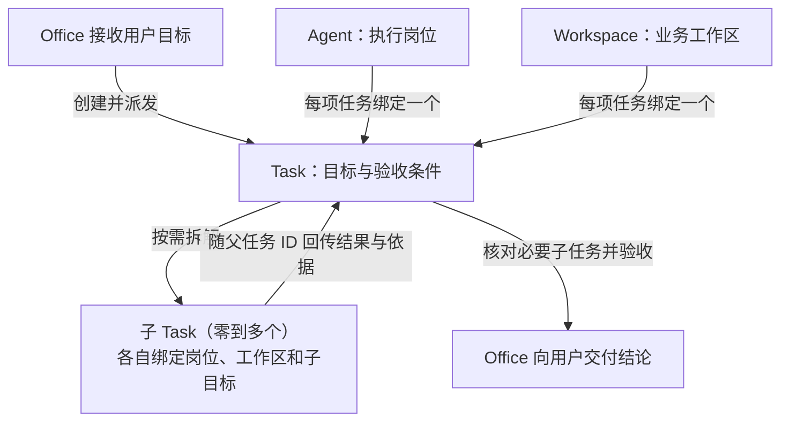
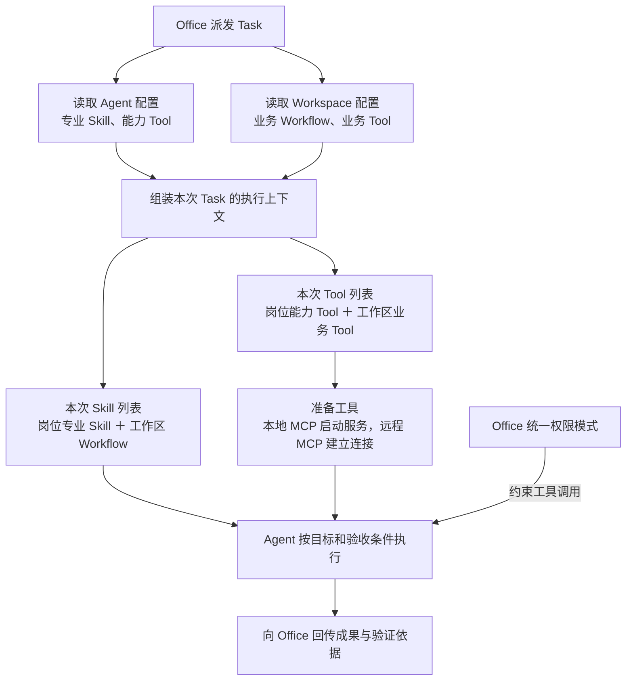

# CBIM Framework 核心设计

CBIM 将一支由 AI 驱动的团队建模为一家企业。用户通过 Office 下达目标、补充要求和收取成果。Office 把任务落实到具体工程的工作区和负责该业务的岗位。Agent 使用自己的大脑和技能，在工作区内调用工具完成任务，并按业务契约交付。

## 能力树与业务树

两棵树描述同一家企业的两个方面。能力树回答“谁具备什么能力，按什么原则工作”；业务树回答“工作在哪里进行，交付物满足什么条件”。岗位与工作区的责任关系连接这两棵树。

| 对象 | 在企业中的含义 | 核心职责 |
| --- | --- | --- |
| Kernel | 大脑 | 大模型提供推理与生成能力，Agent 引擎驱动执行循环。为岗位选择大脑时，按引擎所需的能力匹配模型。 |
| Agent | 人 | 一个岗位上的虚拟角色由特定的大脑配置、岗位职责、岗位标准、工作原则和技能构成。用户在 Office 入口为本次运行选择权限模式（只读、询问或执行），主 Agent 和所有递归派发的子 Agent 共用该模式。 |
| Team | 团队或组织 | 能力树的非叶子节点是 Team，叶子节点是岗位上的 Agent。一个团队可以同时拥有直属 Agent 和子团队。 |
| Project | 项目工程 | 业务树的唯一根，代表整个项目，组织其下的工作区。 |
| Workspace | 岗位开展业务的工作区 | 每个工作区都承载自身业务，包括工作台（本地目录或远程仓库）、适用的标准与规范，以及交付契约。一个承载业务的工作区也可以拥有子工作区。 |
| Tools | 办公工具和软件 | 提供 Agent 可实际调用的操作，来源可以是本地工具、远程工具、协同软件或服务器。技能描述岗位会怎样做事，工具提供执行这些操作的接口。 |
| Office | 用户操作 AI 企业的入口 | 接收命令，为 Agent 注入组织和业务环境，协调岗位间的派发与回报，把结果交还给发起任务的用户。Dispatcher 承担其中的派发职责。 |

**岗位原则跟随 Agent，业务契约跟随 Workspace。** 例如，退款开发岗位的工作原则是“修改资金逻辑时验证重复请求”；退款工作区的契约是“同一退款请求重复提交只产生一笔退款”。更换负责人后，新负责人仍按同一份退款契约验收。

## 依赖与运行

工程分层方向为 `Logic → Framework → Core`。Office 依赖能力和业务，通过岗位与工作区的责任关系确定任务范围。Agent 绑定 Kernel，并通过注入的接口感知当前环境、使用获准工具、向办公室请求协作。具体的模型凭据、仓库连接和工具实现由宿主装配。

一次任务交付按以下顺序运行：

1. 用户在 Office 对一个 Project 提出目标。Office 确定涉及的 Workspace 和负责岗位，提供当前任务可见的组织、业务与验收要求。
2. Agent 接受任务，用配置的大脑分析目标、感知环境、拆解步骤。属于自己职责的步骤在对应工作台执行，属于其他岗位的步骤通过 Office 转发，并等待原任务的回报。
3. 各负责岗位使用技能和获准的 Tools 完成操作，返回产物、结果和验证依据。调用方逐项核对；仍在等待或受阻的步骤保留其状态。
4. 全部必要步骤完成后，Agent 对照 Workspace 契约汇总结论，Office 将成果交还用户。需要用户补充信息时，也通过原办公室对话往返。

## Task 与派发对象

Office 用一项 Task 表达「一个 Agent 在一个 Workspace 执行一个目标」。每项 Task 记录任务 ID、执行岗位 ID、目标工作区 ID、目标、验收条件、状态和交付结果。子 Task 另存父任务 ID，用于回传成果。

## 派发时组合执行上下文

每项 Task 都用自己的岗位和工作区生成执行上下文。转派给另一位 Agent 或切换 Workspace 时，Office 按新绑定重新组合。根任务与子任务都沿用用户在 Office 入口选定的权限模式。

以上两图描述目标设计。当前 OfficeDispatcher 已接入子运行启动、等待回报和资源释放。按 Task 绑定统一装配两侧配置，以及按组合结果启动或连接 MCP，属于后续实现范围。

## 逐项实现与验收

1. **岗位配置。** 从 Team 选定一个 Agent，一次真实运行能核对其大脑、职责、标准、原则和实际生效的技能。
2. **业务工作区。** 从 Project 定位任意 Workspace，能够确定其工作台、规范和契约。父工作区与子工作区分别保有自己的业务内容。
3. **责任关系。** 从工作区查到负责岗位，也能从岗位查到负责的工作区。调整责任归属只需更新这项关系。
4. **工具调用。** 先用本地工具和远程工具各完成一次受权操作，核对工作区范围与返回结果，再按业务接入协同软件及服务器操作。
5. **办公室交付。** 用一个需要两个岗位协作的任务，验证从用户输入、任务派发、子任务回报直到按契约交付的完整过程。

本文约定设计目标与验收顺序。当前模块、源码入口及已实现的依赖关系见[架构说明](ARCHITECTURE.md)。
