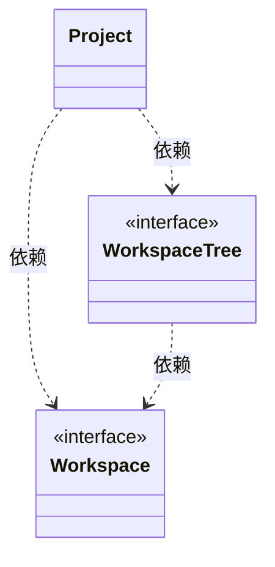

# 业务架构

## 设计意图

业务与能力是对偶视图：能力树组织团队和角色，业务树以 Project 为根，其余节点均为 Workspace。每个 Workspace 在拥有子工作区的同时，承载自身业务描述及来源。Logic 从已校验的正式知识快照读取这棵树。

## 主要组成

| 组成 | 定位 |
| --- | --- |
| [Project](index.ts) | 业务树唯一根，提供直属工作区与按身份查询。 |
| [Workspace](index.ts) | 内部节点和叶子均承载业务；children 指向下级工作区。 |
| [WorkspaceTree](index.ts) | 项目直属模块与按身份索引的模块节点。 |

<!-- architecture:generated:start -->

## 架构关系

[上层设计](../ARCHITECTURE.md)

<!-- architecture:generated:end -->
