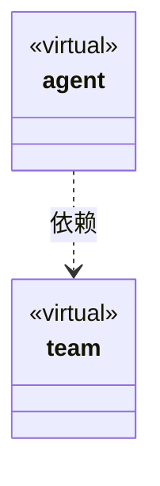

# 能力

## 设计意图

聚合 CBIM 的虚拟角色与团队能力。

## 主要组成

- [Agent](agent/ARCHITECTURE.md) 表达虚拟角色与运行配置。
- [Team](team/ARCHITECTURE.md) 按组织归属组合岗位。

<!-- architecture:generated:start -->

## 架构关系

标注为 `virtual` 的节点是直接子模块的虚拟类封装；内部设计沿下方入口阅读。

## 子模块

| 虚拟封装 | 整体职责 |
| --- | --- |
| [agent](agent/ARCHITECTURE.md) | 冻结虚拟角色的身份、执行配置与对话，通过办公室读取任务环境。 |
| [team](team/ARCHITECTURE.md) | 组织树的分支为团队，叶子为具有岗位身份的 Agent。直属成员可同时包含子团队和 Agent。 |

[上层设计](../ARCHITECTURE.md)

<!-- architecture:generated:end -->
