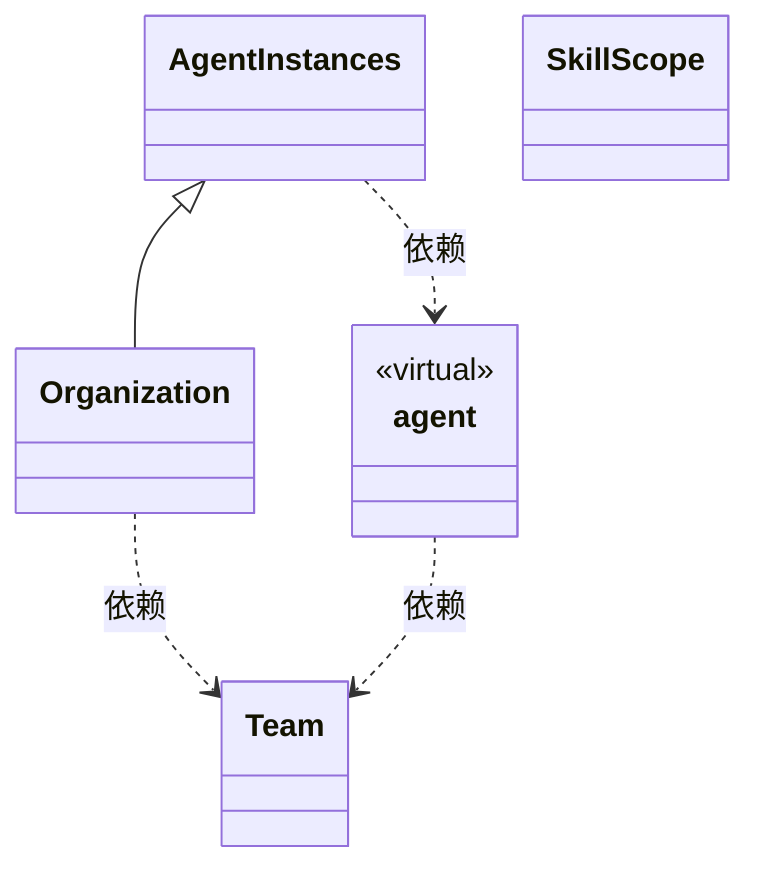

# 能力

## 设计意图

团队可以为空，以支持先建团队再逐步配置成员。TeamDescription/Team 保留可选显示名称和职责；组织变更按稳定 ID 替换登记，不因改名或移动生成新的岗位身份。

`team.ts` 的 `AgentConfiguration` 是岗位及主会话共用的能力数据契约，不含凭据和权限。组织登记保存岗位配置，实际实例由 AgentRole 冻结后交给同一引擎工厂；主/Worker 只区分调用职责，不区分能力模型。

聚合 CBIM 的虚拟角色与团队能力。

## 主要组成

| 组成 | 定位 |
| --- | --- |
| [Team](team.ts) | 组合子团队和岗位。 |
| [SkillScope](skills.ts) | 汇总岗位自身及上级团队声明的技能。 |
| [AgentInstances](organization.ts) | Owns one Office agent registry and its engines. |
| [Organization](organization.ts) | 作为组织树根节点，查询团队与岗位、替换组织结构，并管理 Agent 实例。实例身份分配与引擎激活分开。 |

- [Agent](agent/ARCHITECTURE.md) 表达虚拟角色与运行配置。

主 Agent 与 Office 成员启动时均由调用方传入引擎工厂及其参数。Organization 预留实例身份，调用工厂取得已启动的引擎及其释放方法，启动成功后返回 Agent。

AgentInstances 绑定所属 Office 的权限读取器；实例的 `permission` 与工厂参数 `ReadPermission` 均读取这一个来源，不把权限复制到每个成员。未绑定 Office 的独立实例默认只读。这里负责传递授权上下文，具体工具执行仍由宿主检查。

<!-- architecture:generated:start -->

## 架构关系

标注为 `virtual` 的节点是直接子模块的虚拟类封装；内部设计沿下方入口阅读。

## 子模块

| 虚拟封装 | 整体职责 |
| --- | --- |
| [agent](agent/ARCHITECTURE.md) | 冻结虚拟角色的身份、执行配置与对话，通过办公室读取任务环境。 |

[上层设计](../ARCHITECTURE.md)

<!-- architecture:generated:end -->
