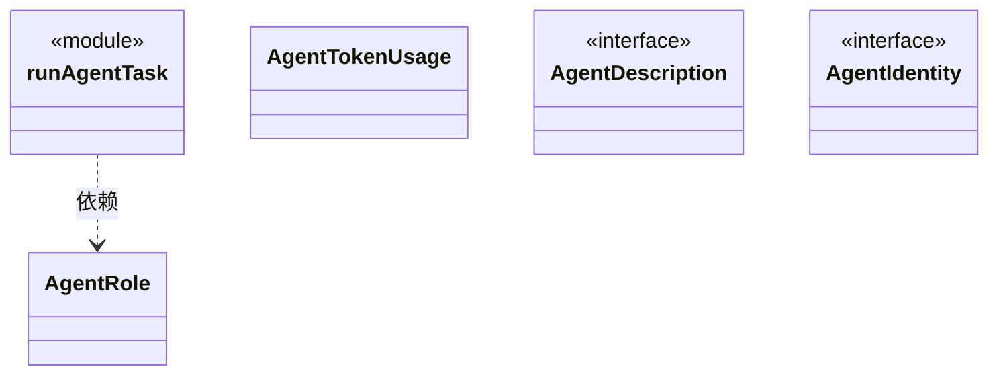

# Agent

## 设计意图

冻结虚拟角色的身份、执行配置与对话，通过办公室读取任务环境。

## 主要组成

| 组成 | 定位 |
| --- | --- |
| [AgentTokenUsage](token-usage.ts) | 保留实例累计消耗，在执行期间维护两秒速率窗口。 |
| [runAgentTask](execution.ts) | 分析任务、读取环境并拆解，按序执行或等待转发回报，全部完成后汇总。缺少调度时返回已完成结果与待办。 |
| [AgentDescription](description.ts) | 记录本次运行的大脑选择、职责、原则、岗位指令、参考和生效技能。 |
| [AgentRole](agent.ts) | 冻结虚拟角色的身份、执行配置与对话，通过办公室读取任务环境。 |

| [AgentIdentity](identity.ts) | 岗位及角色身份。 |

<!-- architecture:generated:start -->

## 架构关系

[上层设计](../ARCHITECTURE.md)

<!-- architecture:generated:end -->
