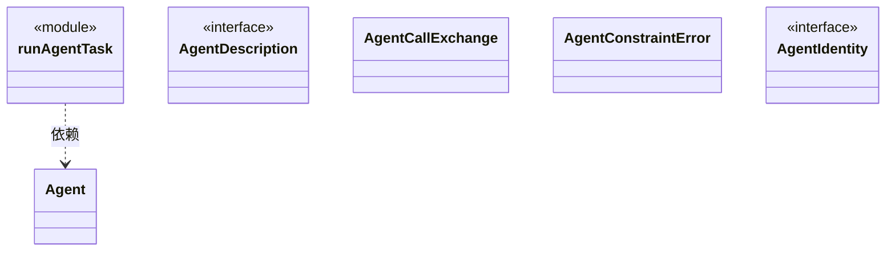
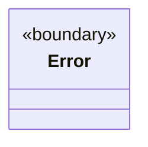

# Agent

## 设计意图

冻结虚拟角色的身份、执行配置与对话，通过办公室读取任务环境。

## 主要组成

| 组成 | 定位 |
| --- | --- |
| [runAgentTask](execution.ts) | 分析任务、读取环境并拆解，按序执行或等待转发回报，全部完成后汇总。缺少调度时返回已完成结果与待办。 |
| [AgentDescription](description.ts) | 记录本次运行的大脑选择、职责、原则、岗位指令、参考和生效技能。 |
| [Agent](agent.ts) | 冻结虚拟角色的身份、执行配置与对话，通过办公室读取任务环境。 |

| [AgentCallExchange](exchange.ts) | 协调原问题、一次性答复及运行结果。 |
| [AgentConstraintError](call.ts) | 携带执行限制的事实。 |
| [AgentIdentity](identity.ts) | 岗位及角色身份。 |

<!-- architecture:generated:start -->

## 架构关系

### 关系组 1：Agent

### 关系组 2：Error

### 跨图协作

按引用方归并目标，保留全部跨图关系；分图只用于阅读，不表示新增模块或依赖边界。

| 引用方 | 关系 | 目标 |
| --- | --- | --- |
| [AgentConstraintError](call.ts)（图 1） | 继承 | `Error`（图 2） |

外部继承／实现边界：`Error`。

[上层设计](../ARCHITECTURE.md)

<!-- architecture:generated:end -->
