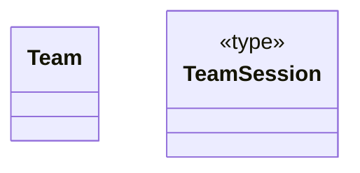

# Team

## 设计意图

组织树的分支为团队，叶子为具有岗位身份的 Agent。直属成员可同时包含子团队和 Agent。

## 主要组成

| 组成 | 定位 |
| --- | --- |
| [Team](index.ts) | 组织树的分支为团队，叶子为具有岗位身份的 Agent。直属成员可同时包含子团队和 Agent。 |

| [TeamSession](session.ts) | 维护团队的会话身份、占用和追加规则。 |

<!-- architecture:generated:start -->

## 架构关系

[上层设计](../ARCHITECTURE.md)

<!-- architecture:generated:end -->
