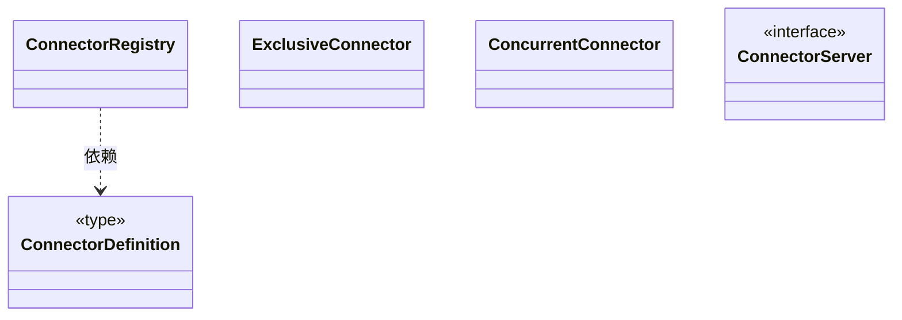

# 外部服务连接器

## 设计意图

描述可连接的外部服务及其身份，供宿主发现、核实和连接。现有协议覆盖插件与资源仓库。

Skill 和 Workflow 承载操作手册及经验流程；ConnectorServer 表达外部办公工具的运行端口。宿主管理进程、账号、连接和适用范围，Agent 调度使用本轮捕获的服务。

## 主要组成

| 组成 | 定位 |
| --- | --- |
| [ExclusiveConnector](connector.ts) | 按任务获取和释放同一资源的独占使用权。 |
| [ConcurrentConnector](connector.ts) | 为每个任务打开独立会话，允许同时使用同一资源。 |
| [ConnectorRegistry](registry.ts) | 登记静态服务身份、查询与重复校验。 |
| [ConnectorServer](service.ts) | 定义同一连接上的发现、描述与调用契约。 |
| [ConnectorDefinition](definition.ts) | 描述可连接的外部服务及其身份，供宿主发现、核实和连接。现有协议覆盖插件与资源仓库。 |

<!-- architecture:generated:start -->

## 架构关系

[上层设计](../ARCHITECTURE.md)

<!-- architecture:generated:end -->
