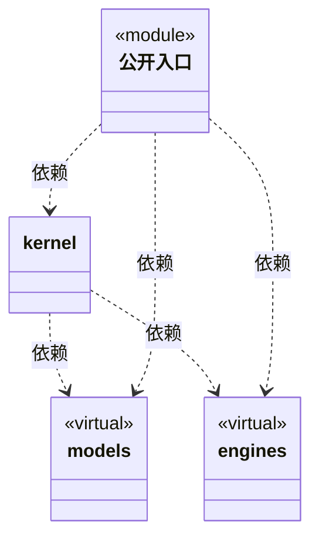

# CBIM 执行内核

## 设计意图

Kernel 是 CBIM 面向大模型厂商和 Agent 工具厂商的兼容层。模型决定一次推理使用的服务，引擎负责驱动 Agent Loop。同一引擎可以支持多种模型，具体组合由 Logic 的兼容清单决定。上层通过配置引用取得执行实例，按轮次提交任务和接收事件。Kernel 的公开类型从 [index.ts](index.ts) 导出。

## 主要组成

| 组成 | 定位 |
| --- | --- |
| [kernel](kernel.ts) | 加载本次运行的模型，创建并绑定引擎，结束时先关闭引擎再卸载模型。 |
| [公开入口](index.ts) | 对外提供模型和 Agent 引擎契约。 |

## 稳定的公共契约

下列行为是上层与适配器之间的兼容约定。修改已有行为时，需要同时评审调用方和已发布的适配器包。

| 契约 | 调用方可以依赖的行为 |
| --- | --- |
| 配置和所有权 | 引擎描述包含引擎类型与模型配置。服务解析并捕获本次配置，按引用选适配器，持有实例的创建与销毁权。销毁时先关闭引擎，再卸载对应模型。[生命周期实现](kernel.ts) |
| 模型加载 | 每次成功的 `Load(configuration)` 提供一个带 `runtime` 的模型句柄，服务将对应句柄交给 `Unload(instance)`。调用方通过 `provider` 和 `model` 表达模型选择。[模型契约](models/index.ts) |
| 轮次与结果 | `Submit(input, context?)` 按提交顺序执行，立即返回 `turnId` 和 `done`。终态区分完成、取消和失败；调用方还应处理 Promise 异常。`Stop(turnId)` 针对指定轮次，停止请求完成后仍应等待轮次结算。[实例契约](engines/instance.ts) |
| 事件与追加输入 | `Subscribe` 按轮次投递实时事件并返回退订函数。使用 `Append` 前读取 `supportsAppend`，并传入当前轮次 ID 和取消信号。View 的历史补读走运行日志游标。[轮次实现](../../logic/execution/assembly/engine-instance.ts) |
| 厂商包协议 | protocol 1 的包具名导出 `engineAdapter`，提供包身份、版本和同步工厂 `create(options)`。每次调用创建独立驱动；驱动实现 `start/run/stop/close`。启动和首轮输入分开，启动失败也须支持清理。[工厂](engines/adapter.ts) · [驱动](engines/agent-engine.ts) |

## 可扩展的部分

- **模型厂商**可以复用已有推理协议，扩充提供方预设、模型目录及连接配置。若厂商引入新的传输协议，还需在 Logic 实现协议和兼容规则。模型加载器的载荷和资源释放方式由宿主提供。[模型实现](../../logic/models/protocol/ARCHITECTURE.md) · [引擎选型](../../logic/engines/catalog/supported-engines.ts)
- **Agent 工具厂商**在 Logic 适配 SDK、子进程、会话恢复和原生事件。支持运行中追加时实现 `steer`。能够在工具产生副作用前拦截调用时，才声明 `supportsBeforeToolCall`。宿主要求拦截而包缺少该声明时，服务在创建驱动前拒绝运行。[适配器实现](../../engine-plugins/ARCHITECTURE.md)
- **可信宿主扩展**可用 `BeforeTurn` 补充上下文或阻止轮次，用 `BeforeToolCall` 否决调用，用 `OnEvent` 观察已保存事件，也可提供工具。工具最终仍由运行时按 Office 权限授权。事件详情随引擎能力变化，View 只展示厂商提供且允许公开的摘要与进度。[扩展契约](engines/extensions.ts)

## 示例：接入一家提供 Agent CLI 的厂商

假设新引擎叫 `acme`，可调用 CBIM 已支持的模型协议。先在 Logic 的引擎清单登记 `acme`、兼容协议和实际使用的历史格式。然后在 `engine-plugins/acme/` 实现驱动。下面是该目录的包入口示例，`AcmeEngine` 代表接入方编写的驱动类。

```ts
import { engineDescriptor } from '../..';
import type { EngineAdapter, EngineAdapterOptions } from '../../../execution/rules/engine-adapter';
import { AcmeEngine } from './engine';

export const engineAdapter: EngineAdapter = Object.freeze({
  protocol: 1,
  id: 'acme',
  version: '1.0.0',
  descriptor: engineDescriptor('acme'),
  create: (options: EngineAdapterOptions) => new AcmeEngine(options),
});
```

1. **绑定模型与会话。** 在 `start(context)` 中使用工厂收到的模型配置准备 CLI 和事件桥；在 `run(message)` 中发送本轮输入，把厂商输出映射为 `context.emit` 事件和统一终态。`stop` 请求取消，`close` 回收进程与监听器。可参考 [Pi 包入口](../../engine-plugins/pi/package.ts) 和 [Pi 驱动](../../engine-plugins/pi/engine.ts)。
2. **按能力接入工具。** 示例省略工具拦截声明。如果 CLI 支持工具预执行回调，让驱动等待 `context.beforeTool` 的裁决，验证拒绝时工具未执行，再声明拦截能力。每次工具调用沿用同一个调用 ID。
3. **登记并验证。** 把工厂加入[源码装配表](../../logic/execution/assembly/engine-adapters.ts)；需要发布引擎包时，在[构建入口](../../../scripts/build-engine-adapters.mjs)登记源码映射，按[包管理模块](../../logic/engines/packages/ARCHITECTURE.md)核对制品身份。通过服务按配置创建实例，验证一次输入、实时事件、终态、取消和销毁，以及缺少所需能力时的拒绝行为。[服务契约用例](../../../tests/src/framework/kernel/kernel.test.ts)

实例释放回执随创建结果交付，关闭失败可以重试。kernel 管理配置引用，运行实例的登记和释放时机由能力层 Organization 管理。

<!-- architecture:generated:start -->

## 架构关系

标注为 `virtual` 的节点是直接子模块的虚拟类封装；内部设计沿下方入口阅读。



## 子模块

| 虚拟封装 | 整体职责 |
| --- | --- |
| [engines](engines/ARCHITECTURE.md) | 定义引擎描述、适配器工厂协议和执行句柄。 |
| [models](models/ARCHITECTURE.md) | Kernel 统一描述“这次运行使用哪个模型”以及“谁负责加载和释放它”。Logic 负责把保存的配置解析为厂商端点、协议和运行时凭据；引擎驱动使用这些参数发起推理。[Kernel 公共契约](../ARCHITECTURE.md) |

[上层设计](../ARCHITECTURE.md)

<!-- architecture:generated:end -->
