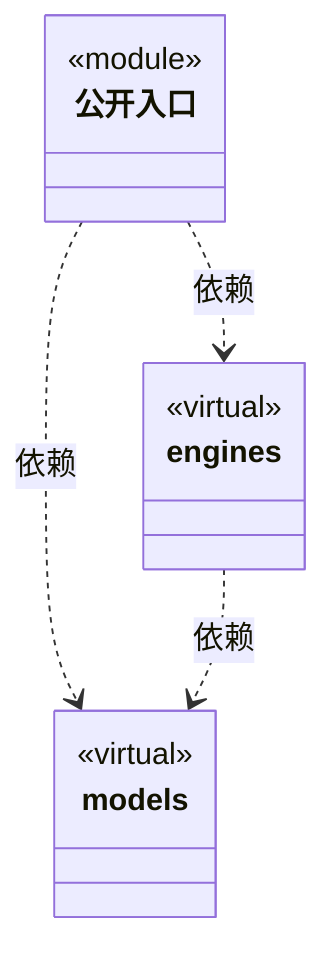

# CBIM 执行内核

## 设计意图

执行内核通过统一入口提供 CBIM 的模型能力与 Agent 引擎协议，供 Logic 装配。引擎按能力选择模型；模型目录独立于引擎。

## 主要组成

| 组成 | 定位 |
| --- | --- |
| [公开入口](index.ts) | 对外提供模型和 Agent 引擎契约。 |

- [模型](models/ARCHITECTURE.md)
- [Agent 引擎](engines/ARCHITECTURE.md)

<!-- architecture:generated:start -->

## 架构关系

标注为 `virtual` 的节点是直接子模块的虚拟类封装；内部设计沿下方入口阅读。

## 子模块

| 虚拟封装 | 整体职责 |
| --- | --- |
| [engines](engines/ARCHITECTURE.md) | 维护引擎能力声明、模型兼容性选择、执行生命周期和版本化适配器工厂校验。Logic 提供实际运行上下文、工具和预算端口。 |
| [models](models/ARCHITECTURE.md) | 维护模型配置结构、供应商连接选择、模型目录解析及生成与嵌入快照。凭据存取和设置持久化由 Logic 装配。 |

[上层设计](../ARCHITECTURE.md)

<!-- architecture:generated:end -->
