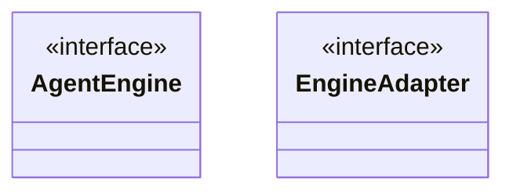

# Agent 引擎

## 设计意图

定义引擎描述、适配器工厂协议和执行句柄。

## 主要组成

| 组成 | 定位 |
| --- | --- |
| [AgentEngine](agent-engine.ts) | 引擎启动、运行、补充输入与终止。 |
| [EngineAdapter](adapter.ts) | 对版本化工厂执行身份和能力校验。 |

## 执行引擎插件协议 v1

新增引擎通过 `plugin.json` 登记。包内路径相对于插件根目录，入口文件名由清单决定。独立 SDK 或工具进程的文件随运行库一起交付。

| 部分 | 必须提供 | 按需提供 |
| --- | --- | --- |
| 包清单 `EnginePluginManifest` | 产品 ID、运行库版本与入口、引擎类型、兼容配置与显示名，以及适配器入口、版本和协议号 | 依赖插件的 ID 与固定制品摘要 |
| 工厂模块 `EnginePluginModule` | CommonJS 命名导出 `engineAdapter`，含 `id`、`version`、`protocol: 1`、`descriptor` 和 `create(options)` | 支持逐次工具调用前回调时声明 `supportsBeforeToolCall` |
| 工厂返回的 `AgentEngine` | `kind`、`start(context)`、`run(message)`、`stop()`、`close()` | 实现 `steer(message, images, signal)` 接收运行中追加的输入 |

运行库入口和工厂入口可以指向同一文件。宿主根据清单加载工厂，核对产品 ID、适配器版本、协议和能力声明，再为每个 Agent 创建独立实例。安装、更新和卸载由插件管理器负责。

<!-- architecture:generated:start -->

## 架构关系

[上层设计](../ARCHITECTURE.md)

<!-- architecture:generated:end -->
