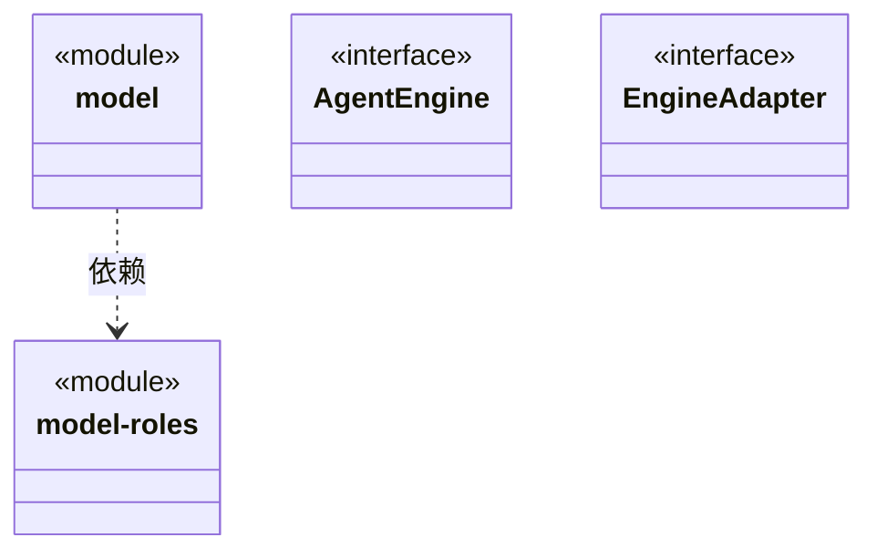

# Agent 引擎

## 设计意图

维护引擎能力声明、模型兼容性选择、执行生命周期和版本化适配器工厂校验。Logic 提供实际运行上下文、工具和预算端口。

## 主要组成

| 组成 | 定位 |
| --- | --- |
| [model](model.ts) | 引擎执行准备后的模型快照契约，供岗位、任务与装配保存公开参数。 |
| [model-roles](model-roles.ts) | V2 额外模型角色的公开引用与冻结快照，供 Agent、岗位和任务共同携带。 |
| [AgentEngine](agent-engine.ts) | 引擎启动、运行、补充输入与终止。 |
| [EngineAdapter](adapter.ts) | 对版本化工厂执行身份和能力校验。 |

<!-- architecture:generated:start -->

## 架构关系

[上层设计](../ARCHITECTURE.md)

<!-- architecture:generated:end -->
