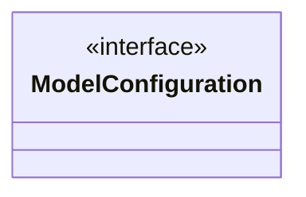

# 模型契约

## 设计意图

Kernel 统一描述“这次运行使用哪个模型”以及“谁负责加载和释放它”。Logic 负责把保存的配置解析为厂商端点、协议和运行时凭据；引擎驱动使用这些参数发起推理。[Kernel 公共契约](../ARCHITECTURE.md)

## 主要组成

| 组成 | 定位 |
| --- | --- |
| [ModelConfiguration](index.ts) | 供应方、模型身份与已解析配置。 |

## 稳定的公共契约

| 契约 | 调用方可以依赖的行为 |
| --- | --- |
| 配置引用与模型身份 | 宿主将配置引用解析为引擎描述，服务捕获该次运行的配置。`llm.provider` 标识运行时供应方，`llm.model` 是模型 ID，`llm.resolved` 可携带宿主解析的配置。当前 Logic 从配置 ID 生成 `cbim-<配置 ID>` 作为 provider，同一家厂商的两个配置可以分别使用。[配置装配](../../../logic-new/engines/service/model-profiles.ts) |
| 加载与消费 | `ModelLoader.Load(configuration)` 返回 `ModelInstance`。服务读取其 `runtime`，将模型参数和句柄一起传给引擎工厂。当前默认加载器持有本轮配置，首次网络推理由引擎驱动发起。[类型定义](index.ts) · [默认加载器](../../../logic-new/engines/catalog/model.ts) |
| 卸载与失败清理 | 正常销毁先关闭引擎，再用原句柄调用 `Unload(instance)`。模型加载成功后，若工厂或绑定失败，服务清理已创建的驱动并卸载模型。默认加载器卸载后再次读取句柄的 `runtime` 会抛错。[生命周期实现](../kernel.ts) |
| 凭据边界 | 运行快照保存可公开的 profile，已解析的 API Key 只交给可信执行路径。厂商预设仅记录公开连接信息。[运行时配置](../../../logic-new/engines/catalog/model.ts) |

## 可扩展的部分

Logic 可从 Kernel 公共入口导入 `ModelAdapter` 和 `ModelAdapterRegistry`。在装配阶段，`Register(adapter)` 按适配器的稳定 ID 登记，重复 ID 应报错。该 ID 由宿主选定，与某次运行的 `cbim-<配置 ID>` 分别表达厂商实现和用户配置。

按契约，调用方先通过 `Get(id)` 查找厂商，再把配置和引擎接受的目标协议交给 `SelectLoader(configuration, protocol)`。查无厂商或该配置无法适配目标协议时，对应步骤返回 `undefined`。匹配成功后，返回的加载器沿用已有的 `Load/Unload` 契约，负责准备该协议的配置或连接并释放资源。执行装配使用宿主注入或内置的注册表。优先匹配配置的供应方或已识别的厂商，通用连接按冻结的协议查表；缺少模型快照的旧调用使用原生配置加载器。

- **厂商兼容已有协议**时，可在 Logic 登记官方端点、明确的别名和各协议支持的模型 ID，沿用现有传输和加载器。自定义端点也可通过配置显式指定。[厂商预设](../../../logic-new/models/protocol/provider-presets.ts)
- **厂商引入新协议**时，需要在 Logic 扩展协议类型、请求及响应处理，并由实际支持它的引擎声明兼容性。只增加端点不能完成协议转换。[协议定义](../../../logic-new/models/protocol/config.ts) · [引擎能力清单](../../../logic-new/engines/catalog/supported-engines.ts)
- **模型需要独立资源**时，宿主可在 `kernel.ForRun` 的 `Models` 入口提供加载器。实现者负责回收加载期间部分创建的资源，并通过 `Unload` 释放成功返回的实例。当前服务要求句柄的 `runtime` 保留模型配置结构。[宿主装配入口](../kernel.ts)

## 接入示例：为 Acme 模型适配已有协议

假设 Acme 的主端点兼容 `openai-completions`，其中只有 `acme-chat` 还支持另一个 `anthropic-messages` 端点。可以把下面的条目加入 Logic 的 `providerPresets`。域名和模型均为示例，正式登记时使用厂商公布并已核实的值。

```ts
const acme: ProviderPreset = {
  id: 'acme',
  name: 'Acme',
  connections: [
    { api: 'openai-completions', baseUrl: 'https://api.acme.example/v1' },
    {
      api: 'anthropic-messages',
      baseUrl: 'https://api.acme.example/anthropic',
      modelIds: ['acme-chat'],
    },
  ],
  sources: ['https://docs.acme.example/models'],
};
```

保存模型配置时选主协议、主端点和模型 ID，凭据通过既有配置服务录入。运行时由引擎提供协议要求。以 `selectProviderConnection(profile, requirement, modelId)` 为入口，可验证三种结果。[选择实现](../../../logic-new/models/protocol/provider-connections.ts) · [现有契约用例](../../../../tests/src/logic-new/models/provider-connections.test.ts)

| 输入条件 | 预期选择 |
| --- | --- |
| 引擎接受主协议 | 返回主端点，来源为 `primary`。 |
| 引擎只接受并指定回退到 `anthropic-messages`，开启自动识别，无显式备用配置，模型为 `acme-chat` | 精确匹配官方主端点后返回 Acme 的 Anthropic 兼容端点，来源为 `preset`，沿用原模型 ID。 |
| 同上，模型换为未列出的 `acme-lite` | 返回 `undefined`，该组合无法选用。 |

如果用户显式配置了同协议备用端点，它优先于预设；其模型限制不匹配时直接返回无可用连接。联调时还需用目标模型和目标引擎完成一次真实请求，分别确认凭据、流式输出，以及应用需要的工具调用能力。

<!-- architecture:generated:start -->

## 架构关系



[上层设计](../ARCHITECTURE.md)

<!-- architecture:generated:end -->
