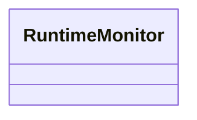

# 运行时监控

## 设计意图

Monitor 单向读取 Framework 的运行实例。Office 管理成员、引擎和工作区的生命周期；应用宿主提供进程采样，模型执行事件提供实际 Token 用量。

## 主要组成

| 组成 | 定位 |
| --- | --- |
| [RuntimeMonitor](index.ts) | 按办公室汇总运行快照，按运行时变更推送快照。 |

<!-- architecture:generated:start -->

## 架构关系

[上层设计](../ARCHITECTURE.md)

<!-- architecture:generated:end -->
