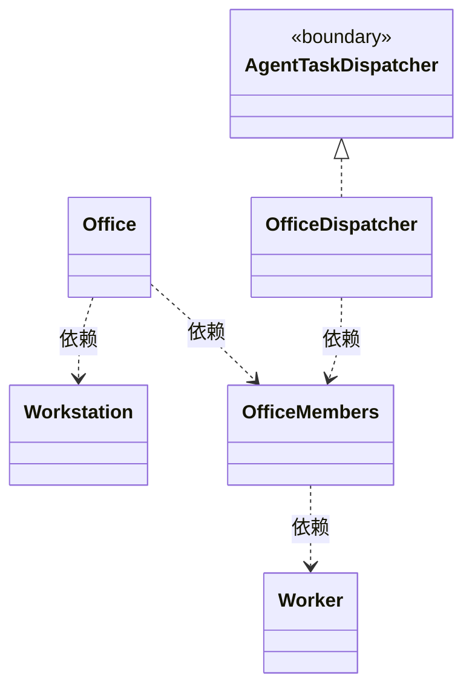
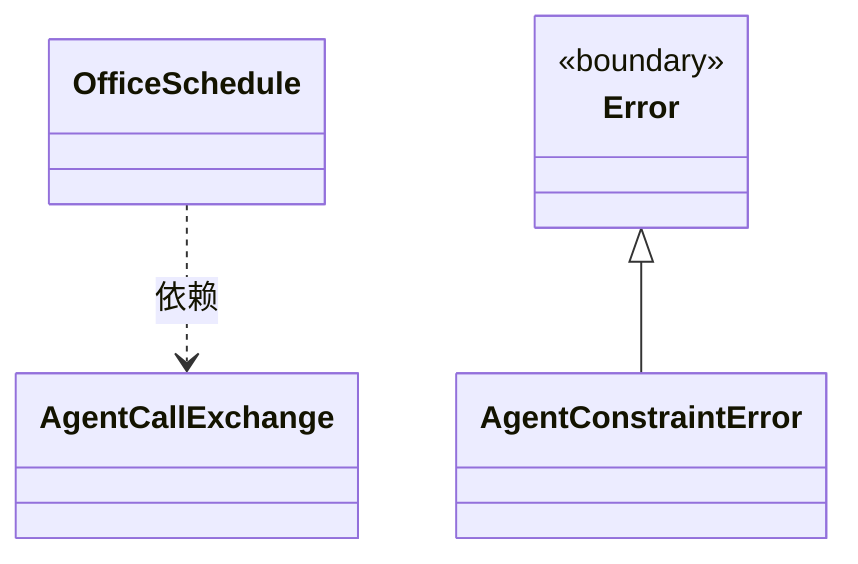

# Office

## 设计意图

Office 是用户与团队交互的唯一对象，一个主会话对应一个办公室。产品交互目标是在同一对话中提交需求、查看任务执行过程、Agent 调度详情、成员协作记录和需求反馈；执行期间也可插入新需求或打断当前 Office 任务。

办公室调度器绑定调用身份，准备并启动子运行，等待结果，完成验收后关闭运行并释放准入。

每个主会话的 Office 保存岗位与实例的绑定。递归协作沿用当前 Office。任务结束释放本轮引擎上下文，同一岗位在后续任务继续使用该办公室分配的身份。

业务派发把岗位 Skill 和该任务所有工作区的 Workflow 正文组合为本次岗位快照。执行约定由任务选中的 Workflow 决定。

## 主要组成

| 组成 | 定位 |
| --- | --- |
| [OfficeMembers](members.ts) | 按本办公室的组织树定位成员并绑定任务。 |
| [Office](office.ts) | 持有一个主会话的办公室身份与成员。 |
| [Worker](worker.ts) | 将本办公室的岗位与唯一 Agent 实例关联。 |
| [Workstation](workstation.ts) | 持有已打开的 WorkspaceInstance，通过实例定位实际业务目录。 |
| [OfficeSchedule](schedule.ts) | 按父运行跟踪子调用、复用重复指令的回执并取消在途后代。 |
| [OfficeDispatcher](index.ts) | 实现 AgentTaskDispatcher，提供子运行生命周期及结果回传。 |

| [AgentCallExchange](exchange.ts) | 协调原问题、一次性答复及运行结果。 |
| [AgentConstraintError](call.ts) | 携带执行限制的事实。 |

成员会话由 [OfficeMemberSession](session.ts) 定义。Office 按 officeId 和 workerId 登记会话、判断占用。每个 Worker 封装一个 Agent，同一办公室内一对一绑定；不同办公室可分别采用同一 Agent 配置。

<!-- architecture:generated:start -->

## 架构关系

### 关系组 1：OfficeMembers

### 关系组 2：AgentCallExchange

外部继承／实现边界：[AgentTaskDispatcher](../cability/agent/execution.ts)、`Error`。

[上层设计](../ARCHITECTURE.md)

<!-- architecture:generated:end -->
