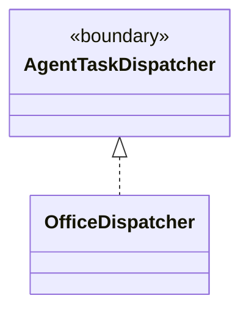

# Office

## 设计意图

办公室调度器绑定调用身份，准备并启动子运行，等待结果，完成验收后关闭运行并释放准入。

## 主要组成

| 组成 | 定位 |
| --- | --- |
| [OfficeDispatcher](index.ts) | 实现 AgentTaskDispatcher，提供子运行生命周期及结果回传。 |

<!-- architecture:generated:start -->

## 架构关系

外部继承／实现边界：[AgentTaskDispatcher](../cability/agent/execution.ts)。

[上层设计](../ARCHITECTURE.md)

<!-- architecture:generated:end -->
