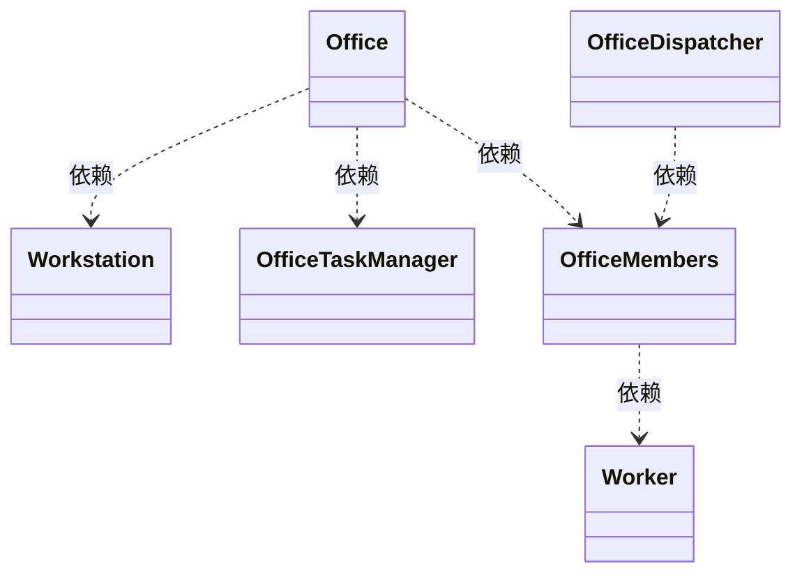
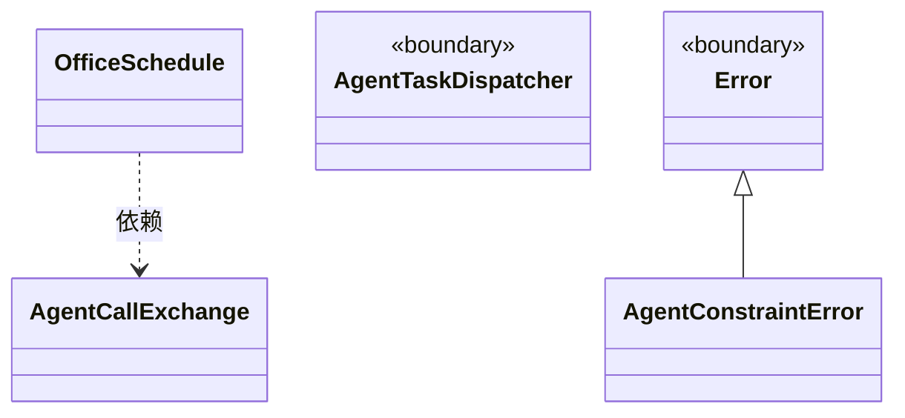

# Office

## 设计意图

OpenMainAgent 接受与成员相同的 AgentConfiguration，在本次启动中生成冻结角色；内置主角色只提供默认职责，模型、Skill、连接器来自当前对话设置。运行配置编辑不改变已经启动的实例。

每个 Office 内置一名主 Agent，同时担任办公室负责人和用户助手。其岗位绑定当前主会话，负责理解需求、通过 Office 协调成员、跟踪进度并向用户汇总结果。调用方提供引擎工厂；关闭 Office 时释放主 Agent 的引擎。

Office 是用户与团队交互的唯一对象，一个主会话对应一个办公室。产品交互目标是在同一对话中提交需求、查看任务执行过程、Agent 调度详情、成员协作记录和需求反馈；执行期间也可插入新需求或打断当前 Office 任务。

办公室调度器绑定调用身份，准备并启动子运行，等待结果，完成验收后关闭运行并释放准入。

每个主会话的 Office 保存岗位与实例的绑定。递归协作沿用当前 Office。任务结束释放本轮引擎上下文，同一岗位在后续任务继续使用该办公室分配的身份。

`Office.permission` 是本办公室的唯一权限来源，支持 read、ask、execute。实例集合只绑定一个 Office；主 Agent、成员及后续创建的实例通过只读访问器查询当前权限。引擎工厂接收同一 `ReadPermission`，权限降低后不能继续使用旧快照授权。不同 Office 的权限相互独立；工具仍需宿主单独装配并在调用时执行授权检查。

业务派发把岗位 Skill 和该任务所有工作区的 Workflow 正文组合为本次岗位快照。执行约定由任务选中的 Workflow 决定。

## 主要组成

| 组成 | 定位 |
| --- | --- |
| [OfficeTaskManager](task-manager.ts) | 按 Office 内的 Agent 实例排队，记录工位、目标、父任务和执行状态。 |
| [OfficeMembers](members.ts) | 按本办公室的组织树定位成员并绑定任务。 |
| [Office](office.ts) | 持有一个主会话的办公室身份与成员。 |
| [Worker](worker.ts) | 将本办公室的岗位与唯一 Agent 实例关联。 |
| [Workstation](workstation.ts) | 持有已打开的 WorkspaceInstance，通过实例定位实际业务目录。 |
| [OfficeSchedule](schedule.ts) | 按父运行跟踪子调用、复用重复指令的回执并取消在途后代。 |
| [OfficeDispatcher](index.ts) | 实现 AgentTaskDispatcher，提供子运行生命周期及结果回传。 |

| [AgentCallExchange](exchange.ts) | 协调原问题、一次性答复及运行结果。 |
| [AgentConstraintError](call.ts) | 携带执行限制的事实。 |

成员会话由 [OfficeMemberSession](session.ts) 定义。Office 按 officeId 和 workerId 登记会话、判断占用。每个 Worker 封装一个 Agent，同一办公室内一对一绑定；不同办公室可分别采用同一 Agent 配置。

<!-- architecture:generated:start -->

## 架构关系

### 关系组 1：Office

### 关系组 2：AgentCallExchange

### 跨图协作

按引用方归并目标，保留全部跨图关系；分图只用于阅读，不表示新增模块或依赖边界。

| 引用方 | 关系 | 目标 |
| --- | --- | --- |
| [OfficeDispatcher](index.ts)（图 1） | 实现 | [AgentTaskDispatcher](../cability/agent/execution.ts)（图 2） |

外部继承／实现边界：[AgentTaskDispatcher](../cability/agent/execution.ts)、`Error`。

[上层设计](../ARCHITECTURE.md)

<!-- architecture:generated:end -->
