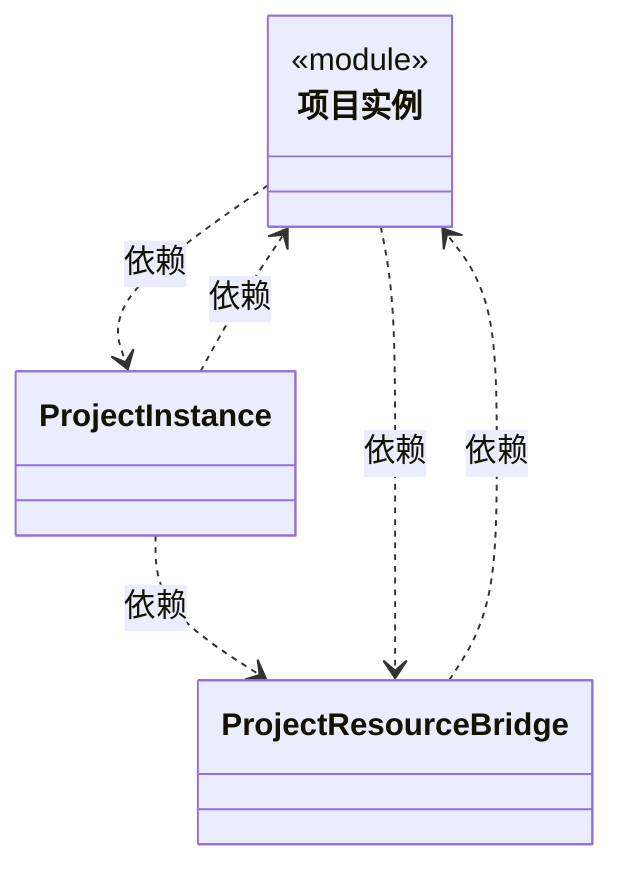

# 项目运行实例

## 设计意图

项目列表为每个打开的项目创建一个 ProjectInstance，由它持有组织树、业务树和按主会话 ID 索引的 Office。两个 Office 共享定义，各自持有成员实例和任务。项目关闭时统一释放 Office，不卸载本机共享包。

打开项目时从项目根目录读取可选的 .cbim/shared-resources.json。engines 和 connectors 分别按资源 ID 映射到制品 SHA-256 摘要。项目桥将引用交给本机管理器校验和取得版本；缺少锁定包时报错，不回退。旧项目没有锁定条目时沿用本机活动版本。主 Agent 通过 cbim_project_read 和 cbim_project_write 调用实例的 ReadResource 和 ChangeResource。存储适配器校验并持久化变更，再发布新的引用；已启动的引擎不会因此重启。
项目加载时初始化 .cbim/cability/organization.json 和 .cbim/bussinss/business.json。项目目录中的快照优先；不存在时从旧用户目录导入，其次从旧团队与工作区定义生成。岗位的独立能力设置随组织一并迁入 cability/。同一项目的 Office 共用项目实例中的两棵树。
持久 Office 记录使用主会话 ID，和运行实例的临时 ID 分离。ListOfficeRecords 可列出未运行的历史；ProjectCache 按项目封装本机会话、队列、引擎运行目录和工作树。侧栏可读取缓存而无需启动项目实例。

[项目实例的生命周期](LIFECYCLE.md)：登记、首次加载、旧缓存导入、多 Office 共享及关闭恢复。

## 主要组成

| 组成 | 定位 |
| --- | --- |
| [ProjectResourceBridge](index.ts) | 解析项目引用的共享制品版本。 |
| [ProjectInstance](index.ts) | 维护 Office 实例并提供项目资源操作。 |
| [项目实例](index.ts) | 维护打开的办公室和项目资源桥。 |

<!-- architecture:generated:start -->

## 架构关系

[上层设计](../ARCHITECTURE.md)

<!-- architecture:generated:end -->
