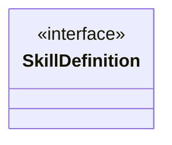

# 文字流程

## 设计意图

岗位 Skill 与业务 Workflow 共用文字流程声明，以名称及正文引用定位流程。

## 主要组成

| 组成 | 定位 |
| --- | --- |
| [SkillDefinition](index.ts) | 岗位 Skill 与业务 Workflow 共用文字流程声明，以名称及正文引用定位流程。 |

<!-- architecture:generated:start -->

## 架构关系

[上层设计](../ARCHITECTURE.md)

<!-- architecture:generated:end -->
