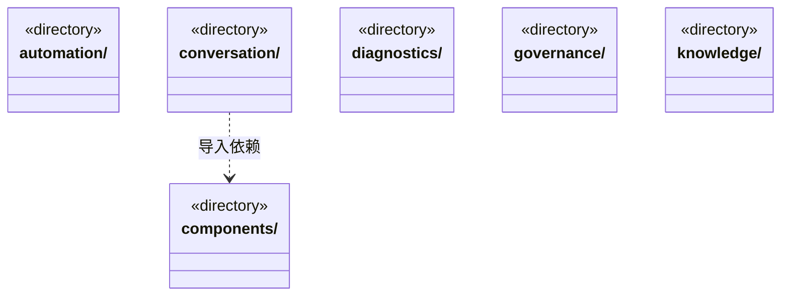
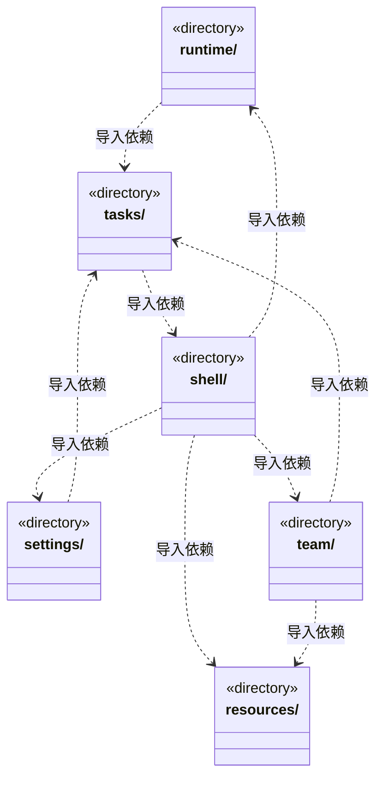
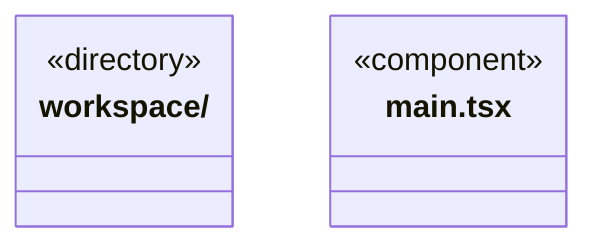

# src/frontend 架构

## 目录定位

React 桌面界面。只消费 contracts 和自身组件，不导入调度或主进程实现。

本文描述当前实现。通过分析目录边界后维护的 [源码架构脚本](../../scripts/source-architecture.mjs) 同步清单和声明；代码变更时仍须核对职责、关键成员与关系。

## 代码清单

| 文件 | 当前职责 |
| --- | --- |
| [main.tsx](main.tsx) | 前端视图层的渲染进程入口，仅挂载 App 并加载外壳样式；通过 bridge 与本机后端通信。 |

## 架构类图

各图中的同名节点表示同一目录边界；跨组及完整直接依赖如下（无边不代表继承）：

- `conversation` → `components`：导入。
- `conversation` → `shell`：导入。
- `conversation` → `tasks`：导入。
- `main.tsx` → `shell`：导入。
- `resources` → `knowledge`：导入。
- `runtime` → `tasks`：导入。
- `settings` → `tasks`：导入。
- `shell` → `resources`：导入。
- `shell` → `settings`：导入。
- `shell` → `components`：导入。
- `shell` → `conversation`：导入。
- `shell` → `runtime`：导入。
- `shell` → `team`：导入。
- `shell` → `workspace`：导入。
- `shell` → `automation`：导入。
- `shell` → `diagnostics`：导入。
- `tasks` → `components`：导入。
- `tasks` → `shell`：导入。
- `tasks` → `conversation`：导入。
- `team` → `tasks`：导入。
- `team` → `conversation`：导入。
- `team` → `knowledge`：导入。
- `team` → `components`：导入。
- `team` → `resources`：导入。
- `workspace` → `components`：导入。
- `workspace` → `knowledge`：导入。
- `workspace` → `resources`：导入。
- `workspace` → `governance`：导入。

## 子目录导航

- [automation/](automation/ARCHITECTURE.md)：工作区内部自动化展示；定时触发尚未实现。
- [components/](components/ARCHITECTURE.md)：通用展示组件，不持有领域服务与运行状态。
- [conversation/](conversation/ARCHITECTURE.md)：中央主对话、目标摘要、输入、附件及队列；附件区明确显示目录清单、URL指针、网页摘录与仓库静态资料。两处插入口冻结原run，入队成功保留事实，停止锁独立于插入等待。进程准入等待与持久用户等待分别展示，纯等待不累计工作时长；未受理保留草稿。核实与重规划权限分离，可续聊头由后端核实。 双视图共享人工决定控制器，保存意见不清除聊天草稿或消费等待。
- [diagnostics/](diagnostics/ARCHITECTURE.md)：只读展示工作区运行状态和知识校验问题，不把工作区就绪视为知识校验通过。
- [governance/](governance/ARCHITECTURE.md)：静态业务模块的知识治理面板。展示真实来源、精确差异、补证/异议与回应评价。审阅绑定来源版本，未评价不补造理解，人工决定与实施分开；原命令先保存再发送，未知只查询。
- [knowledge/](knowledge/ARCHITECTURE.md)：知识问题、预览提交和静态对象表单；固定编辑基线，模块维护人同事务确认，删除先检查影响。业务架构展示位于 workspace。
- [resources/](resources/ARCHITECTURE.md)：统一资源仓库的查看、编辑、静态包发布与下载应用。人才按团队/Agent/Skill复用，业务按整套架构应用；工作区身份及预览版本固定。设置通过统一入口打开。
- [runtime/](runtime/ARCHITECTURE.md)：全局只读运行管理。分别呈现目标周期、人员、任务、准入等待和已报告消耗；单次在途游标读取保留未变行，隐藏时退订，按真实身份定位既有会话而不执行任务。
- [settings/](settings/ARCHITECTURE.md)：模型、仓库、并发及新目标软限额配置。并发实时状态不覆盖草稿；软限额默认关闭，显式保存与新周期生效相区分，失败保留输入且不盲目重试。凭据只提交主进程，账户仍为占位。
- [shell/](shell/ARCHITECTURE.md)：工作区侧栏、会话选择、用户栏与右侧扩展页签；会话区与项目级视图区分开。向会话传递活动页签状态，隐藏页签保留草稿/节点选择并降低成员与任务图同步频率。
- [tasks/](tasks/ARCHITECTURE.md)：主会话任务图、目标与准入状态；依赖追加/替换只读历史核对身份和节点修订，摘要按实际版本选择最新，图沿真实启用边排列，不补造结果。运行内补充按真实接收记录显示，未知优先旧审阅，同版摘要/详情核对后增量呈现。根停止使用独立在途标记，插入等待不锁住停止按钮。等待补充共享多来源草稿与导入锁，原等待选择代次阻止迟到导入；明确目录/链接/网页/授权仓库来源，普通聊天草稿独立。流程、验证、检查点、基线、人工决定与用量保留各自冻结身份和证据，不把历史当当前验收。
- [team/](team/ARCHITECTURE.md)：工作区唯一的静态 Team/组/Agent 图及角色维护、继承与人才复用。Agent 节点可按 Session 查看只读执行履历；历史角色独立导航，删定义不回填团队树。详情按需分页，不轮询全量历史或启动执行。项目岗位在独立面板登记、采纳和暂停退休；预览后固定命令，未知只查询原回执，不启动模型。
- [workspace/](workspace/ARCHITECTURE.md)：工作区唯一的静态领域工程/模块图及自身 Workflow。语义编辑委托 knowledge，完整业务模板复用委托 resources；多个主会话共享定义、动态任务各自独立。

[返回上层](../ARCHITECTURE.md)。

每次修改本目录代码，同步维护文件头、关键契约说明及本图。未实现的治理、证据验收和自动编排能力不列入当前类图。
