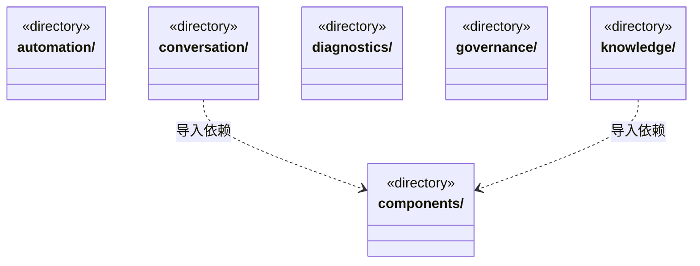
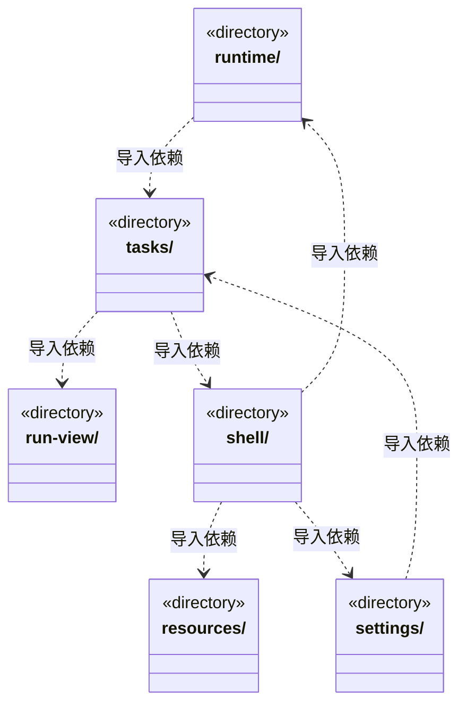
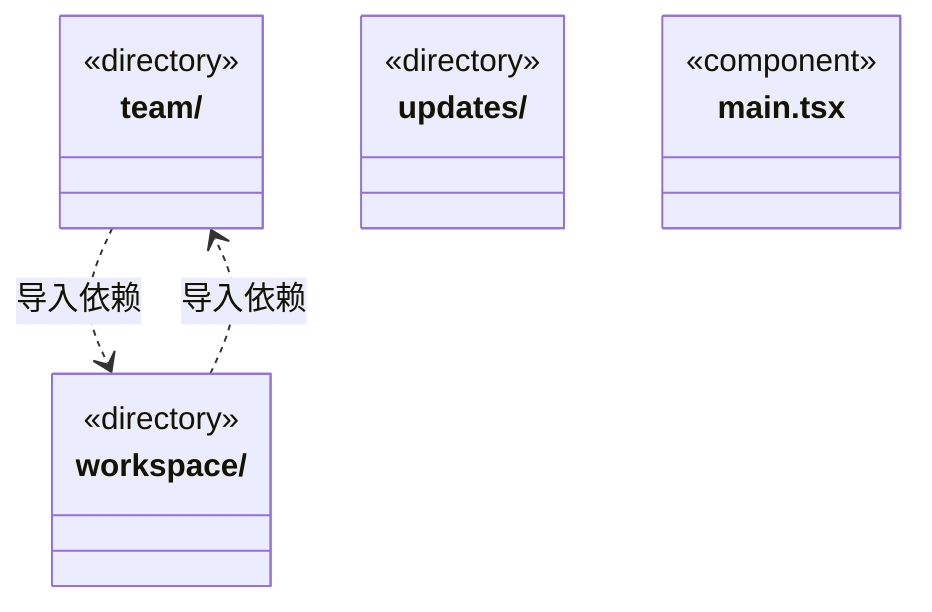

# src/frontend 架构

## 目录定位

React 桌面界面。只消费 contracts 和自身组件，不导入调度或主进程实现。

本文描述当前实现。通过分析目录边界后维护的 [源码架构脚本](../../scripts/source-architecture.mjs) 同步清单和声明；代码变更时仍须核对职责、关键成员与关系。

## 代码清单

| 文件 | 当前职责 |
| --- | --- |
| [main.tsx](main.tsx) | 前端视图层的渲染进程入口，仅挂载 App 并加载外壳样式；通过 bridge 与本机后端通信。 |

## 架构类图

各图中的同名节点表示同一目录边界；跨组及完整直接依赖如下（无边不代表继承）：

- `conversation` → `components`：导入。
- `conversation` → `shell`：导入。
- `conversation` → `tasks`：导入。
- `conversation` → `run-view`：导入。
- `knowledge` → `components`：导入。
- `main.tsx` → `shell`：导入。
- `resources` → `knowledge`：导入。
- `run-view` → `components`：导入。
- `runtime` → `tasks`：导入。
- `settings` → `tasks`：导入。
- `shell` → `resources`：导入。
- `shell` → `settings`：导入。
- `shell` → `updates`：导入。
- `shell` → `conversation`：导入。
- `shell` → `components`：导入。
- `shell` → `runtime`：导入。
- `shell` → `team`：导入。
- `shell` → `workspace`：导入。
- `shell` → `automation`：导入。
- `shell` → `diagnostics`：导入。
- `tasks` → `components`：导入。
- `tasks` → `shell`：导入。
- `tasks` → `run-view`：导入。
- `tasks` → `conversation`：导入。
- `team` → `tasks`：导入。
- `team` → `run-view`：导入。
- `team` → `knowledge`：导入。
- `team` → `components`：导入。
- `team` → `resources`：导入。
- `team` → `workspace`：导入。
- `updates` → `components`：导入。
- `workspace` → `team`：导入。
- `workspace` → `components`：导入。
- `workspace` → `knowledge`：导入。
- `workspace` → `resources`：导入。
- `workspace` → `governance`：导入。

## 子目录导航

- [automation/](automation/ARCHITECTURE.md)：工作区内部自动化展示；定时触发尚未实现。
- [components/](components/ARCHITECTURE.md)：通用展示组件，不持有领域服务与运行状态。 EngineModelPicker 从用户配置级联引擎/模型，失效选型保留提示而不隐式替换。
- [conversation/](conversation/ARCHITECTURE.md)：中央主对话、目标摘要、输入、附件及队列；附件区明确显示目录清单、URL指针、网页摘录与仓库静态资料。两处插入口冻结原run，入队成功保留事实，停止锁独立于插入等待。进程准入等待与持久用户等待分别展示，纯等待不累计工作时长；未受理保留草稿。核实与重规划权限分离，可续聊头由后端核实。 双视图共享人工决定控制器，保存意见不清除聊天草稿或消费等待。 主会话模型栏按用户配置选择 Loop 引擎，Claude Code/Codex 只保留排队。 加号菜单分别请求 BUG 反馈和需求许愿 Skill，按原会话发送或排队，保留已有草稿及附件。 RunToolDetails 在业务装配层组合原命令核实、影响观察及恢复；公共消息/状态已迁到 run-view，队列操作名限制为实际四项。 目标摘要可跳转本周期原任务或替代成果，沿已有任务详情导航，不改草稿、附件或执行状态。 原工具记录显式核实保存事实，保留原失败；控制器按四重身份隔离迟到响应，轮询不重复读取，失败保留旧报告并提示时效。 主调用提供显式影响观察；未知不再凭勾选调用 ID 直接续跑，进入独立只读核实，普通草稿不受影响。 当前工作区实例传入成员详情用于补偿预览时效，主聊天草稿不受补偿控制器影响，挂载不触发文件读取或写入。 可信 GitHub submitted 工具回执之后隐藏追加结果文字；失败、未知及后续普通用户输入仍正常显示。 发送捕获原任务/运行，审批使用原审批任务；动态队列按操作解析。
- [diagnostics/](diagnostics/ARCHITECTURE.md)：只读展示工作区运行状态和知识校验问题，不把工作区就绪视为知识校验通过。
- [governance/](governance/ARCHITECTURE.md)：静态业务模块的知识治理面板。展示真实来源、精确差异、补证/异议与回应评价。审阅绑定来源版本，未评价不补造理解，人工决定与实施分开；原命令先保存再发送，未知只查询。 IPC 名称从冻结的治理动作形成有限联合，保留原命令未知查询。 操作联合与表单请求经对应Schema配对，原命令回执控制器不变。
- [knowledge/](knowledge/ARCHITECTURE.md)：知识问题、预览提交、静态表单与共用来源说明。展示当前、退役、待采纳及待核实状态，不从路径或正文相同猜来源连续；来源组件无提交副作用。固定编辑基线，不要求真人维护声明，业务架构展示位于workspace。 Agent 编辑可保存本机默认引擎/模型，已有岗位不自动采纳。 动态架构表单先按对应IPC Schema核实；本地数据选择为封闭类别。
- [resources/](resources/ARCHITECTURE.md)：统一资源仓库的查看、编辑、静态包发布与下载应用。人才按团队/Agent/Skill复用，业务按整套架构应用；工作区身份及预览版本固定。设置通过统一入口打开。 连接操作名使用持久命令的动作联合，提交、未知与核实流程保持。 连接提交与回执查询按具体Schema形成操作元组。
- [run-view/](run-view/ARCHITECTURE.md)：主对话、成员与历史共用的消息、工具轨道及运行状态；只消费公开快照和最小展示插槽，不依赖任务或会话控制器。原核实与恢复由页面显式组合，Markdown 的用户链接点击继续通过固定 Bridge。
- [runtime/](runtime/ARCHITECTURE.md)：全局只读运行管理。分别呈现目标周期、人员、任务、准入等待和已报告消耗；单次在途游标读取保留未变行，隐藏时退订，按真实身份定位既有会话而不执行任务。
- [settings/](settings/ARCHITECTURE.md)：模型、资源仓库、GitHub 反馈连接、并发及新目标软限额配置。GitHub 采用 Device Flow，页面仅持公开 Client ID 与短期授权码；资源服务器账号仍为占位。并发实时状态不覆盖草稿；软限额默认关闭，显式保存与新周期生效相区分，失败保留输入且不盲目重试。 反馈预置公开产品连接；版本更新迁到账号菜单的独立弹窗，设置表单不因查看日志而卸载。 预算和反馈的动态入口验证操作请求；开启/停止共享各自使用确定签名。
- [shell/](shell/ARCHITECTURE.md)：工作区侧栏、会话选择、用户栏与右侧扩展页签；会话区与项目级视图区分开。向会话传递活动页签状态，隐藏页签保留草稿/节点选择并降低成员与任务图同步频率。 账号菜单和新版提醒打开独立更新弹窗，当前页面及草稿保持挂载，不隐式下载或重启。 导航的操作桥按明确请求Schema解析，坏历史记录不能当完整运行。
- [tasks/](tasks/ARCHITECTURE.md)：主会话任务图、目标与准入状态；依赖追加/替换只读历史核对身份和节点修订，摘要按实际版本选择最新，图沿真实启用边排列，不补造结果。运行内补充按真实接收记录显示，未知优先旧审阅，同版摘要/详情核对后增量呈现。根停止使用独立在途标记，插入等待不锁住停止按钮。等待补充共享多来源草稿与导入锁，原等待选择代次阻止迟到导入；明确目录/链接/网页/授权仓库来源，普通聊天草稿独立。流程、验证、检查点、基线、人工决定与用量保留各自冻结身份和证据，不把历史当当前验收。 任务根和成员正文显式注入业务详情插槽，共用 run-view 展示；资料准备与成员交互端口只列实际 IPC 操作。 成员卡片、节点详情和目标分配展示原岗位及模型；手动核实当前配置独立显示差异，迟到响应按原任务/修订隔离。 主对话、图和详情区分显式交接放弃与普通封存，保留原岗位和运行；审阅中的原/新任务仅按同周期真实节点导航。 成员详情可选择原调用并显式观察；处置先保存本机稳定请求，丢回包只查原命令。历史选择与后续关系按同一处置展示，迟到读取不覆盖其他来源；各面板共享根会话时效，PublicDispatchScope 真实提供新核实和修复来源，沿既有资格创建。 同一影响面板分别显示原工具失败和原知识事务阶段，明确处置继续绑定原观察，查询不取得写权限。 原调用卡分别显示工具/文件操作/补偿结果；显式预览读取当前文件，提交前保存固定本机请求，丢回复只查原命令；查询错误保留已知拒绝/终态，预览过期不能提交。 任务详情与续接动态端口按操作解析后进入关联桥，状态所有权不变。
- [team/](team/ARCHITECTURE.md)：工作区唯一的静态Team/组/Agent图、继承与人才复用，节点按Session查看只读履历。岗位面板独立登记、明确采纳和暂停退休；改名和模型更新保留原能力来源。来源屏障首次拒绝可重新编辑，未知仍查原命令；反查责任委托workspace，不启动模型。 岗位登记支持默认或明确引擎/模型，详情展示冻结引擎。 历史查询按操作关联请求和响应，分页状态与原迟到隔离保持；Markdown 复用 run-view。 当前岗位启用不是运行许可，真正执行还核模块责任和原计划；编辑不会搬运历史。
- [updates/](updates/ARCHITECTURE.md)：账号入口的版本与更新弹窗、最近发布说明及新版提醒。共享窗口级本机更新快照；查看日志保留原页面与草稿，检查、下载和重启安装分别显式操作。只依赖公开 IPC，不导入后端更新实现。
- [workspace/](workspace/ARCHITECTURE.md)：工作区唯一的工程/模块图及自身Workflow。负责人面板展示来源和有界历史，支持同负责人明确采纳当前来源；原回执必须匹配同一关系、版本及owner，未知不换命令。知识编辑和整架构复用委托knowledge/resources；登记不移交旧任务。 一级负责人读取/预览只使用有限 InlineOwnerCall 操作，写入仍由独立命令控制器持有。 关联任务包含新旧协议节点，负责人变更不移交旧任务；实际领取重核原版本。 模块责任按是否给定memberId选择明确入口，内联岗位表单经过Schema配对。

[返回上层](../ARCHITECTURE.md)。

每次修改本目录代码，同步维护文件头、关键契约说明及本图。未实现的治理、证据验收和自动编排能力不列入当前类图。
