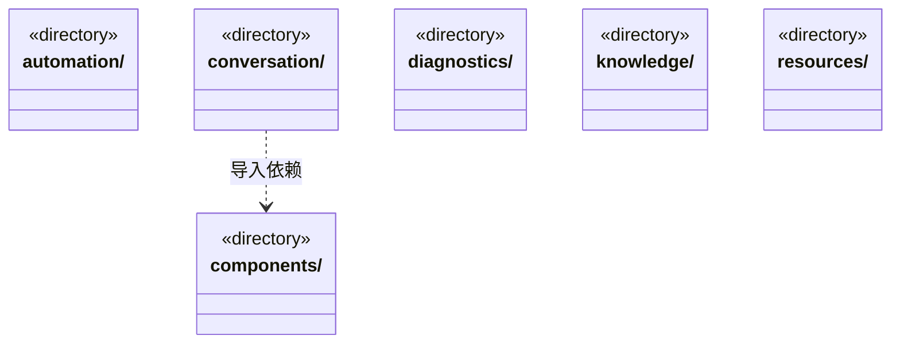
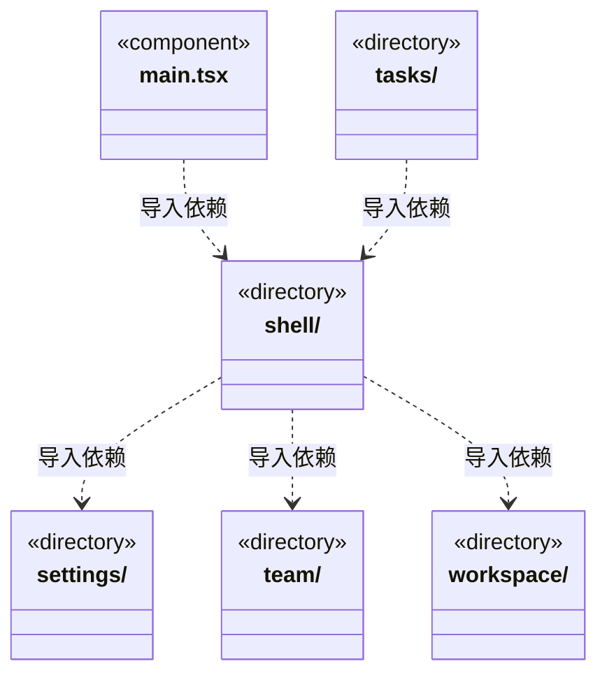

# src/frontend 架构

## 目录定位

React 桌面界面。只消费 contracts 和自身组件，不导入调度或主进程实现。

本文描述当前实现。通过分析目录边界后维护的 [源码架构脚本](../../scripts/source-architecture.mjs) 同步清单和声明；代码变更时仍须核对职责、关键成员与关系。

## 代码清单

| 文件 | 当前职责 |
| --- | --- |
| [main.tsx](main.tsx) | 前端视图层的渲染进程入口，仅挂载 App 并加载外壳样式；通过 bridge 与本机后端通信。 |

## 架构类图

各图中的同名节点表示同一目录边界；跨组及完整直接依赖如下（无边不代表继承）：

- `conversation` → `components`：导入。
- `conversation` → `shell`：导入。
- `conversation` → `tasks`：导入。
- `main.tsx` → `shell`：导入。
- `shell` → `resources`：导入。
- `shell` → `settings`：导入。
- `shell` → `components`：导入。
- `shell` → `conversation`：导入。
- `shell` → `team`：导入。
- `shell` → `workspace`：导入。
- `shell` → `automation`：导入。
- `shell` → `diagnostics`：导入。
- `tasks` → `components`：导入。
- `tasks` → `shell`：导入。
- `tasks` → `conversation`：导入。
- `team` → `components`：导入。
- `workspace` → `components`：导入。
- `workspace` → `knowledge`：导入。

## 子目录导航

- [automation/](automation/ARCHITECTURE.md)：工作区内部自动化展示；定时触发尚未实现。
- [components/](components/ARCHITECTURE.md)：通用展示组件，不持有领域服务与运行状态。
- [conversation/](conversation/ARCHITECTURE.md)：中央对话、输入、附件、队列与工具状态。权限说明覆盖业务文件与知识提交；队列以版本增量同步，不因空轮询替换列表引用。
- [diagnostics/](diagnostics/ARCHITECTURE.md)：只读展示工作区运行状态和知识校验问题，不把工作区就绪视为知识校验通过。
- [knowledge/](knowledge/ARCHITECTURE.md)：知识问题、预览提交和维护工具界面；业务架构展示位于 workspace。
- [resources/](resources/ARCHITECTURE.md)：三类共享资源的查看与编辑界面。仓库设置通过统一设置入口打开。
- [settings/](settings/ARCHITECTURE.md)：模型及仓库配置界面，凭据仅提交主进程保存，账户仍按当前占位语义处理。
- [shell/](shell/ARCHITECTURE.md)：工作区侧栏、会话选择、用户栏与右侧扩展页签；会话区与项目级视图区分开。
- [tasks/](tasks/ARCHITECTURE.md)：当前会话执行视图与维护任务展示，按工作区和任务身份过滤；显示计划步骤、责任、回执引用、修订历史与待审阅交付，不把运行结束当成验收。
- [team/](team/ARCHITECTURE.md)：当前工作区团队架构及能力详情展示。
- [workspace/](workspace/ARCHITECTURE.md)：当前工作区业务模块架构展示；知识编辑仍委托 knowledge 的维护组件。

[返回上层](../ARCHITECTURE.md)。

每次修改本目录代码，同步维护文件头、关键契约说明及本图。未实现的治理、证据验收和自动编排能力不列入当前类图。
