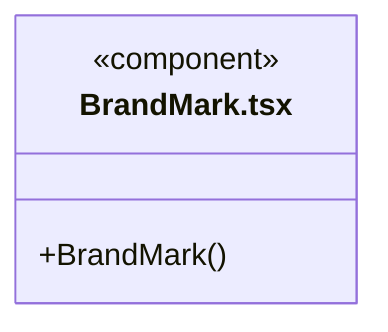
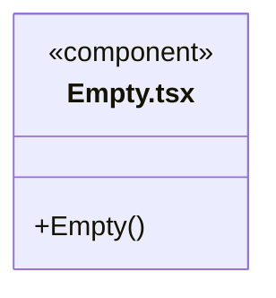
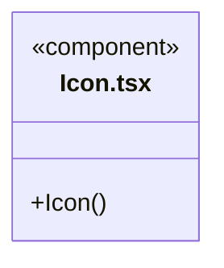
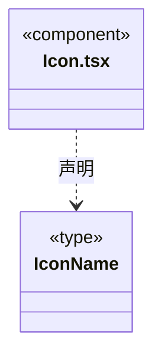
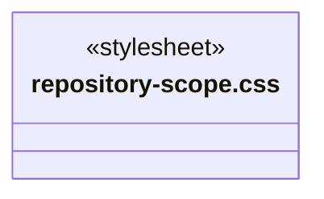
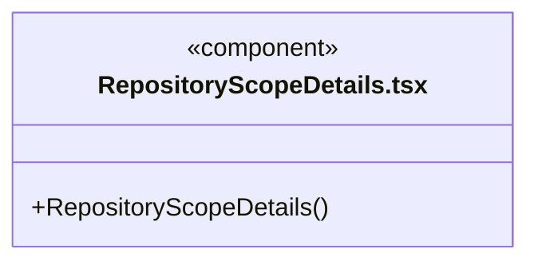
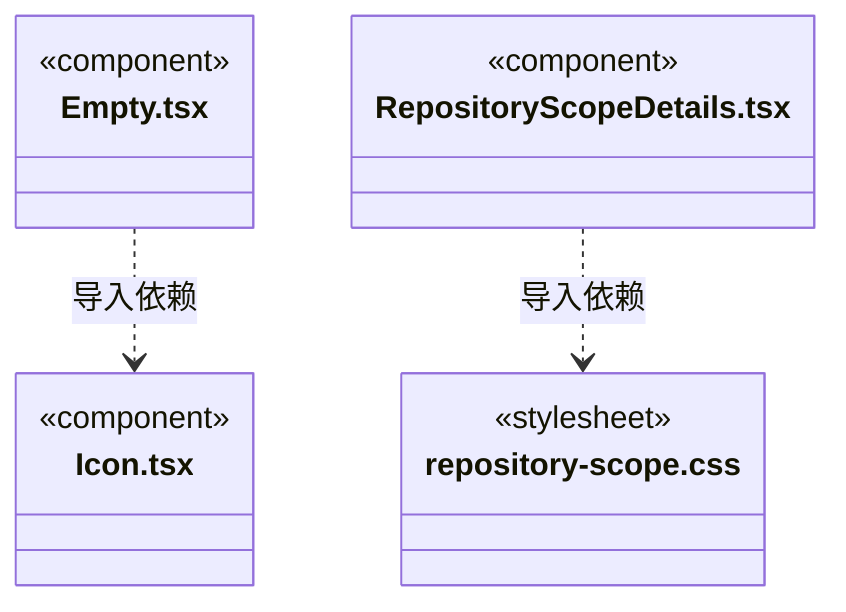

# src/frontend/components 架构

## 目录定位

通用展示组件，不持有领域服务与运行状态。

本文描述当前实现。通过分析目录边界后维护的 [源码架构脚本](../../../scripts/source-architecture.mjs) 同步清单和声明；代码变更时仍须核对职责、关键成员与关系。

## 代码清单

| 文件 | 当前职责 |
| --- | --- |
| [BrandMark.tsx](BrandMark.tsx) | 无业务状态的 CBIM 产品标识，供外壳与欢迎页复用。 |
| [Empty.tsx](Empty.tsx) | 各页面复用的空状态布局。 |
| [Icon.tsx](Icon.tsx) | 无业务状态的 SVG 图标组件。 |
| [repository-scope.css](repository-scope.css) | 对应界面的布局与视觉样式。 |
| [RepositoryScopeDetails.tsx](RepositoryScopeDetails.tsx) | 在主对话工具详情与执行核实报告中展示可信回执的资源仓库范围。 |

## 架构类图

### BrandMark.tsx

### Empty.tsx

直接依赖：[Icon.tsx](Icon.tsx)。

### Icon.tsx

### repository-scope.css

### RepositoryScopeDetails.tsx

直接依赖：[../../bridge/contracts/execution.ts](../../bridge/contracts/execution.ts)、[repository-scope.css](repository-scope.css)。

### 本目录调用边界

## 子目录导航

无子目录。

[返回上层](../ARCHITECTURE.md)。

每次修改本目录代码，同步维护文件头、关键契约说明及本图。未实现的治理、证据验收和自动编排能力不列入当前类图。

## 设计契约 v1 与落地范围

以下内容区分已接通能力与后续设计；以各节的实现状态为准，不将目标图当作现状图。维护源：[CONTRACT.md](CONTRACT.md)；生成类图时同步附加，勿直接修改本附录。

# 通用展示组件

`Icon` 的垂直三点与编辑笔是无状态矢量标识，工作区菜单和两处对话条目共用，不引入外壳或运行依赖。

`RepositoryScopeDetails` 仅消费 Bridge 的严格公开仓库范围。主对话从运行授权/真实回执提供 scope，执行报告从后端已核实的工具条目提供同一协议；组件不读取模型参数中的 scope，也不访问服务。非法范围或旧日志缺范围时不补造仓库身份。

显示仓库、链接器、连接实例和操作，但不显示地址/令牌、不提供授权按钮。范围是该次调用的历史记录，不证明当前连接仍可用；资源资料不等于业务文件或验收证据。
