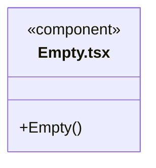
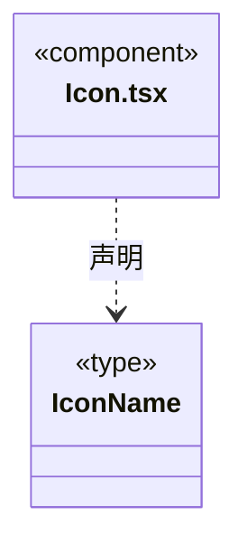
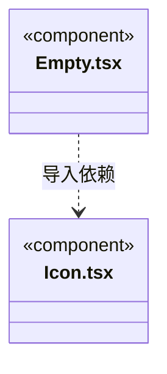

# src/frontend/components 架构

## 目录定位

通用展示组件，不持有领域服务与运行状态。

本文描述当前实现。通过分析目录边界后维护的 [源码架构脚本](../../../scripts/source-architecture.mjs) 同步清单和声明；代码变更时仍须核对职责、关键成员与关系。

## 代码清单

| 文件 | 当前职责 |
| --- | --- |
| [Empty.tsx](Empty.tsx) | 各页面复用的空状态布局。 |
| [Icon.tsx](Icon.tsx) | 无业务状态的 SVG 图标组件。 |

## 架构类图

### Empty.tsx

直接依赖：[Icon.tsx](Icon.tsx)。

### Icon.tsx

### 本目录调用边界

## 子目录导航

无子目录。

[返回上层](../ARCHITECTURE.md)。

每次修改本目录代码，同步维护文件头、关键契约说明及本图。未实现的治理、证据验收和自动编排能力不列入当前类图。
