# src/frontend/conversation 架构

## 目录定位

中央主对话、目标摘要、输入、附件及队列。区分活动周期与持久等待；核实不能提权，正式重规划单独输入目标和权限并与任务根共享控制器。坏历史独立保留，可续聊头由后端确认，不能回退较早轮次。

本文描述当前实现。通过分析目录边界后维护的 [源码架构脚本](../../../scripts/source-architecture.mjs) 同步清单和声明；代码变更时仍须核对职责、关键成员与关系。

## 代码清单

| 文件 | 当前职责 |
| --- | --- |
| [AttachmentMenu.tsx](AttachmentMenu.tsx) | Cindy 风格的加号上下文菜单，接入 CBIM 原生选择器与附件快照服务。 |
| [brain-status.ts](brain-status.ts) | 将公开运行事件投影为输入框左上角的大脑状态。 |
| [ComposerAttachments.tsx](ComposerAttachments.tsx) | 按 Cindy ThumbnailStrip 的 56px 卡片、类型标识和角落移除按钮展示草稿附件。 |
| [ComposerCard.tsx](ComposerCard.tsx) | 从 Cindy ComposerCard 移植的统一输入卡片与内容间距。 |
| [ComposerPicker.tsx](ComposerPicker.tsx) | Cindy 风格的权限和模型 chip，向上展开可搜索、键盘可操作的选择面板。 |
| [conversation-state.ts](conversation-state.ts) | 把主模型运行、开放调度周期和普通消息队列转换为输入区操作状态。 |
| [conversation.css](conversation.css) | 对齐 Cindy 的消息列、工作记录折叠行及一体式底部输入框。 |
| [Conversation.tsx](Conversation.tsx) | 会话双页签入口（对话/本会话任务），默认主 Agent 普通对话、启动与继续大脑、展示流式 Markdown 正文和按生命周期合并的工具证据，移植 Cindy 输入组件并适配上下文附件、权限审批及本次运行全部通过、结构化选项提问、持久化消息队列及任务用时、生成速度、价值和上下文计量。 |
| [MarkdownMessage.tsx](MarkdownMessage.tsx) | 将 Agent 消息渲染成排版后的正文、列表、表格与可复制代码块。 |
| [message-queue.css](message-queue.css) | 与输入框一体的紧凑队列，匹配参考图的单行消息、拖柄及悬停圆形操作。 |
| [MessageCard.tsx](MessageCard.tsx) | 复用 Cindy ChatBubble 的用户气泡/助手裸正文布局，承载消息时间和复制操作。 |
| [MessageQueue.tsx](MessageQueue.tsx) | 展示主进程持久化的待执行消息，提供插队、排序、移除及继续操作。 |
| [QuestionCard.tsx](QuestionCard.tsx) | 展示 Agent 的结构化问题，以选项卡及最后一项其它输入收集答案。 |
| [questions.css](questions.css) | 结构化问题卡片的主题、选中态和输入排版。 |
| [queue-sync.ts](queue-sync.ts) | 把主进程队列增量合并为稳定的消息数组，供轮询与操作后刷新共同使用。 |
| [repairStreamingMarkdown.ts](repairStreamingMarkdown.ts) | 显示正在流入的 Markdown 时临时补齐未闭合语法。 |
| [SendButton.tsx](SendButton.tsx) | 从 Cindy SendButton 移植发送/停止的固定 28px 按钮和按下动作身份保护。 |
| [session-tabs.css](session-tabs.css) | 会话中央区域的对话/任务双页签与任务记录排版。 |
| [ThreadHistoryNotice.tsx](ThreadHistoryNotice.tsx) | 显示主会话中无法读取的历史轮次，并只按后端确认的运行头提供续接记录。 |
| [ToolActivity.tsx](ToolActivity.tsx) | 把工具申请、授权、运行、输出及完成记录合并成可展开的执行时间线。 |
| [transcript.ts](transcript.ts) | 将持久化执行事件投影为对话消息、工具证据与运行错误。 |
| [usage.css](usage.css) | 输入框旁计量条、上下文环与明细弹层的排版。 |
| [usage.ts](usage.ts) | 保留对话界面的用量统计入口，经桥接契约使用 Core 的纯计量函数。 |
| [UsageStatus.tsx](UsageStatus.tsx) | Cindy 风格的输入框上方时间/速度与底部任务价值、上下文占用显示。 |
| [useMessageQueue.ts](useMessageQueue.ts) | 会话队列的独立增量刷新入口，覆盖轮询和用户操作后的即时同步。 |
| [WorkStatus.tsx](WorkStatus.tsx) | 移植 Cindy WorkGroupBlock 的折叠标题、运行旋转图标、实时活动预览和执行轨道。 |

## 架构类图

### AttachmentMenu.tsx

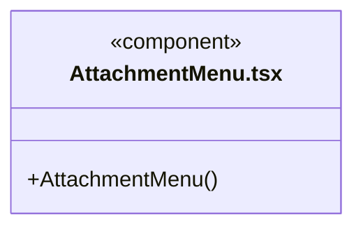

直接依赖：[../components/Icon.tsx](../components/Icon.tsx)、[../../bridge/contracts/chat.ts](../../bridge/contracts/chat.ts)。

### brain-status.ts

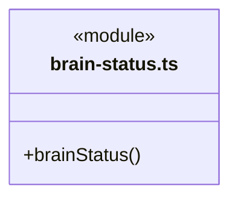

直接依赖：[../../bridge/contracts/execution.ts](../../bridge/contracts/execution.ts)。

### ComposerAttachments.tsx

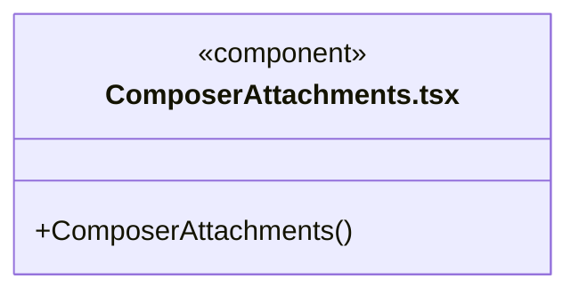

直接依赖：[../../bridge/contracts/chat.ts](../../bridge/contracts/chat.ts)、[../components/Icon.tsx](../components/Icon.tsx)。

### ComposerCard.tsx

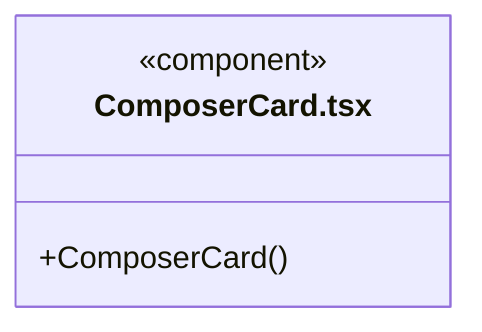


### ComposerPicker.tsx

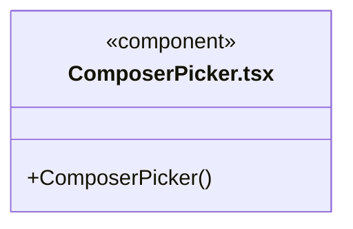

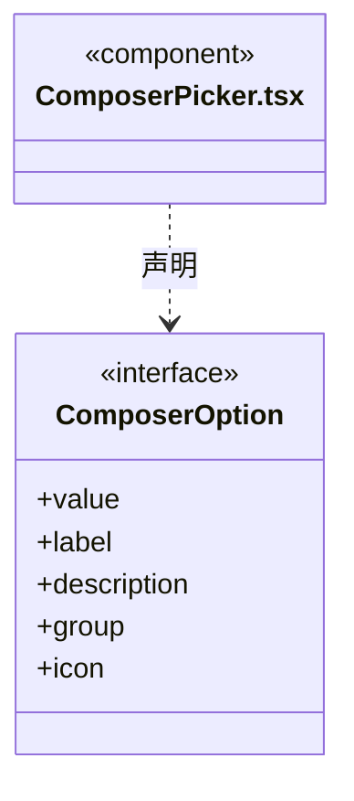

直接依赖：[../components/Icon.tsx](../components/Icon.tsx)。

### conversation-state.ts

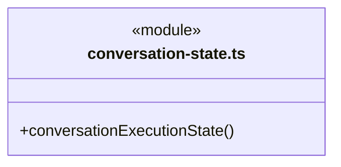

直接依赖：[../../bridge/contracts/execution.ts](../../bridge/contracts/execution.ts)、[../../bridge/contracts/dispatch.ts](../../bridge/contracts/dispatch.ts)。

### conversation.css

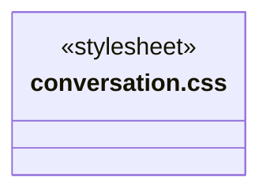

### Conversation.tsx

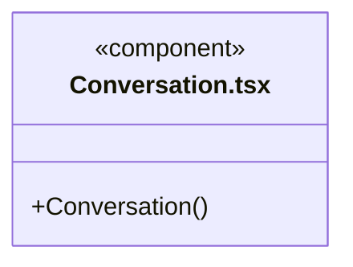

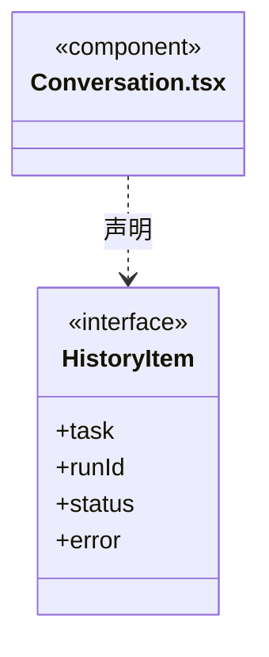

直接依赖：[../../bridge/contracts/workspace.ts](../../bridge/contracts/workspace.ts)、[../../bridge/contracts/execution.ts](../../bridge/contracts/execution.ts)、[../../bridge/contracts/models.ts](../../bridge/contracts/models.ts)、[../shell/tabs.ts](../shell/tabs.ts)、[transcript.ts](transcript.ts)、[MarkdownMessage.tsx](MarkdownMessage.tsx)、[WorkStatus.tsx](WorkStatus.tsx)、[../tasks/SessionTaskView.tsx](../tasks/SessionTaskView.tsx)、[../tasks/useSessionGraph.ts](../tasks/useSessionGraph.ts)、[../tasks/MemberActivity.tsx](../tasks/MemberActivity.tsx)、[../tasks/ScopeGoalPanel.tsx](../tasks/ScopeGoalPanel.tsx)、[session-tabs.css](session-tabs.css)、[MessageQueue.tsx](MessageQueue.tsx)、[useMessageQueue.ts](useMessageQueue.ts)、[QuestionCard.tsx](QuestionCard.tsx)、[UsageStatus.tsx](UsageStatus.tsx)、[MessageCard.tsx](MessageCard.tsx)、[../components/Icon.tsx](../components/Icon.tsx)、[conversation.css](conversation.css)、[ComposerCard.tsx](ComposerCard.tsx)、[SendButton.tsx](SendButton.tsx)、[AttachmentMenu.tsx](AttachmentMenu.tsx)、[ComposerPicker.tsx](ComposerPicker.tsx)、[ComposerAttachments.tsx](ComposerAttachments.tsx)、[../../bridge/contracts/chat.ts](../../bridge/contracts/chat.ts)、[conversation-state.ts](conversation-state.ts)、[../tasks/useScopeContinuation.ts](../tasks/useScopeContinuation.ts)、[../tasks/useScopeReplan.ts](../tasks/useScopeReplan.ts)、[ThreadHistoryNotice.tsx](ThreadHistoryNotice.tsx)。

### MarkdownMessage.tsx

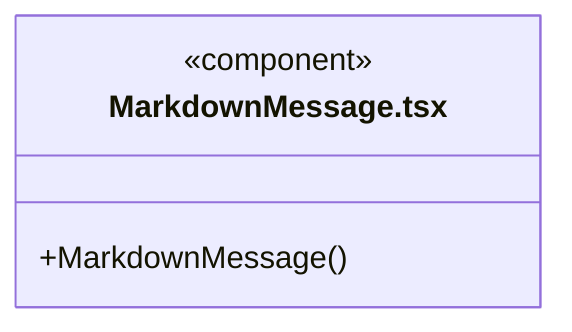

直接依赖：[repairStreamingMarkdown.ts](repairStreamingMarkdown.ts)。

### message-queue.css

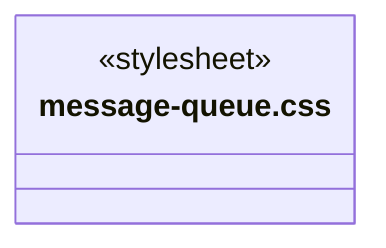

### MessageCard.tsx

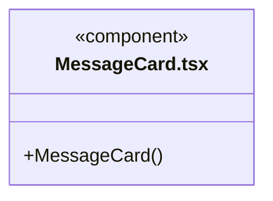


### MessageQueue.tsx

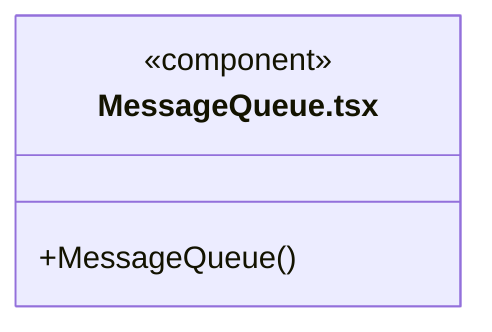

直接依赖：[../../bridge/contracts/execution.ts](../../bridge/contracts/execution.ts)、[message-queue.css](message-queue.css)。

### QuestionCard.tsx

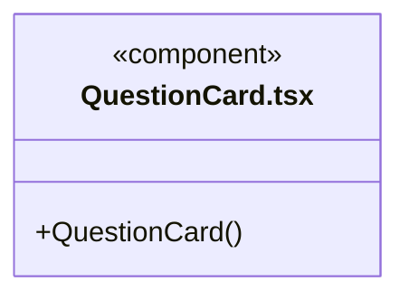

直接依赖：[../../bridge/contracts/execution.ts](../../bridge/contracts/execution.ts)、[questions.css](questions.css)。

### questions.css

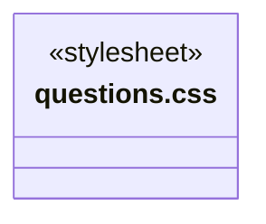

### queue-sync.ts

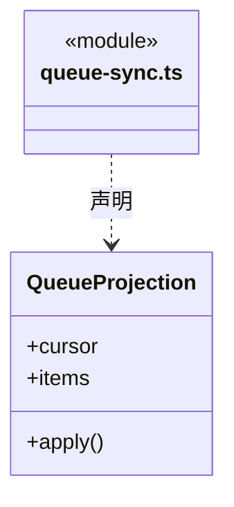

直接依赖：[../../bridge/contracts/execution.ts](../../bridge/contracts/execution.ts)。

### repairStreamingMarkdown.ts

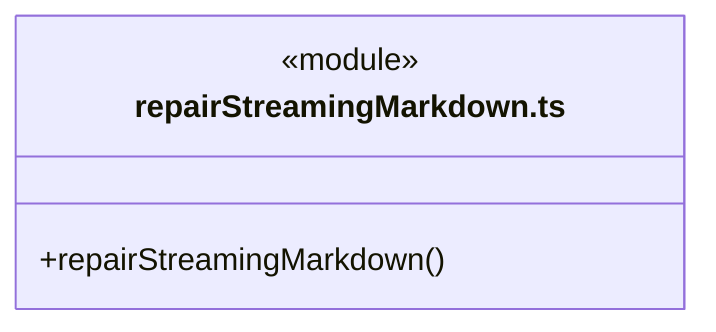


### SendButton.tsx

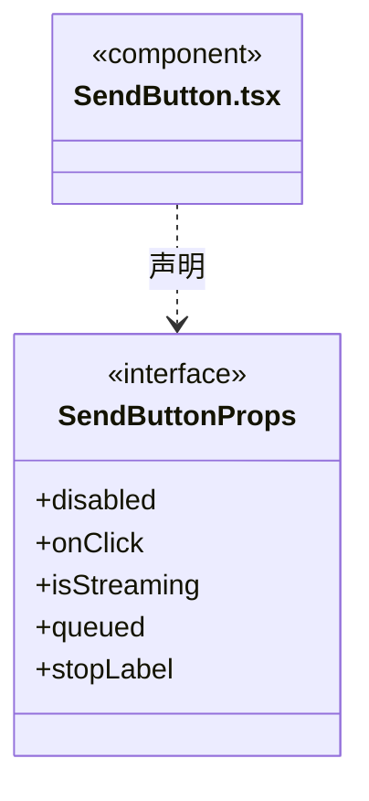


### session-tabs.css

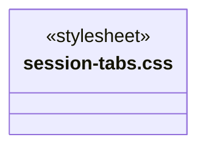

### ThreadHistoryNotice.tsx

```mermaid
classDiagram
class N_src_frontend_conversation_ThreadHistoryNotice_tsx["ThreadHistoryNotice.tsx"] {
  <<component>>
  +threadResumeRun()
  +ThreadHistoryNotice()
}
```

直接依赖：[../../bridge/contracts/execution.ts](../../bridge/contracts/execution.ts)。

### ToolActivity.tsx

```mermaid
classDiagram
class N_src_frontend_conversation_ToolActivity_tsx["ToolActivity.tsx"] {
  <<component>>
  +ToolActivity()
}
```

直接依赖：[../../bridge/contracts/execution.ts](../../bridge/contracts/execution.ts)。

### transcript.ts

```mermaid
classDiagram
class N_src_frontend_conversation_transcript_ts["transcript.ts"] {
  <<module>>
  +transcript()
}
```

```mermaid
classDiagram
class N_src_frontend_conversation_transcript_ts["transcript.ts"] {
  <<module>>
}
class N_src_frontend_conversation_transcript_ts_ChatItem["ChatItem"] {
  <<interface>>
  +id
  +kind
  +text
  +pending
  +attachments
}
N_src_frontend_conversation_transcript_ts ..> N_src_frontend_conversation_transcript_ts_ChatItem : 声明
```

直接依赖：[../../bridge/contracts/execution.ts](../../bridge/contracts/execution.ts)、[../../bridge/contracts/models.ts](../../bridge/contracts/models.ts)。

### usage.css

```mermaid
classDiagram
class N_src_frontend_conversation_usage_css["usage.css"] {
  <<stylesheet>>
}
```

### usage.ts

```mermaid
classDiagram
class N_src_frontend_conversation_usage_ts["usage.ts"] {
  <<module>>
  +conversationUsage()
}
```

直接依赖：[../../bridge/contracts/usage.ts](../../bridge/contracts/usage.ts)、[../../bridge/contracts/execution.ts](../../bridge/contracts/execution.ts)。

### UsageStatus.tsx

```mermaid
classDiagram
class N_src_frontend_conversation_UsageStatus_tsx["UsageStatus.tsx"] {
  <<component>>
  +UsageStatus()
}
```

```mermaid
classDiagram
class N_src_frontend_conversation_UsageStatus_tsx["UsageStatus.tsx"] {
  <<component>>
}
class N_src_frontend_conversation_UsageStatus_tsx_ConversationActivity["ConversationActivity"] {
  <<interface>>
  +label
  +active
  +tone
  +waitingSince
}
N_src_frontend_conversation_UsageStatus_tsx ..> N_src_frontend_conversation_UsageStatus_tsx_ConversationActivity : 声明
```

直接依赖：[../../bridge/contracts/execution.ts](../../bridge/contracts/execution.ts)、[brain-status.ts](brain-status.ts)、[../components/Icon.tsx](../components/Icon.tsx)、[usage.ts](usage.ts)、[usage.css](usage.css)。

### useMessageQueue.ts

```mermaid
classDiagram
class N_src_frontend_conversation_useMessageQueue_ts["useMessageQueue.ts"] {
  <<module>>
  +useMessageQueue()
}
```

直接依赖：[queue-sync.ts](queue-sync.ts)、[../../bridge/contracts/execution.ts](../../bridge/contracts/execution.ts)。

### WorkStatus.tsx

```mermaid
classDiagram
class N_src_frontend_conversation_WorkStatus_tsx["WorkStatus.tsx"] {
  <<component>>
  +WorkStatus()
}
```

直接依赖：[../../bridge/contracts/execution.ts](../../bridge/contracts/execution.ts)、[../components/Icon.tsx](../components/Icon.tsx)、[ToolActivity.tsx](ToolActivity.tsx)。

### 本目录调用边界

```mermaid
classDiagram
class N_src_frontend_conversation_Conversation_tsx["Conversation.tsx"] {
  <<component>>
}
class N_src_frontend_conversation_transcript_ts["transcript.ts"] {
  <<module>>
}
class N_src_frontend_conversation_MarkdownMessage_tsx["MarkdownMessage.tsx"] {
  <<component>>
}
class N_src_frontend_conversation_WorkStatus_tsx["WorkStatus.tsx"] {
  <<component>>
}
class N_src_frontend_conversation_session_tabs_css["session-tabs.css"] {
  <<stylesheet>>
}
N_src_frontend_conversation_Conversation_tsx ..> N_src_frontend_conversation_transcript_ts : 导入依赖
N_src_frontend_conversation_Conversation_tsx ..> N_src_frontend_conversation_MarkdownMessage_tsx : 导入依赖
N_src_frontend_conversation_Conversation_tsx ..> N_src_frontend_conversation_WorkStatus_tsx : 导入依赖
N_src_frontend_conversation_Conversation_tsx ..> N_src_frontend_conversation_session_tabs_css : 导入依赖
```

```mermaid
classDiagram
class N_src_frontend_conversation_Conversation_tsx["Conversation.tsx"] {
  <<component>>
}
class N_src_frontend_conversation_MessageQueue_tsx["MessageQueue.tsx"] {
  <<component>>
}
class N_src_frontend_conversation_useMessageQueue_ts["useMessageQueue.ts"] {
  <<module>>
}
class N_src_frontend_conversation_QuestionCard_tsx["QuestionCard.tsx"] {
  <<component>>
}
class N_src_frontend_conversation_UsageStatus_tsx["UsageStatus.tsx"] {
  <<component>>
}
N_src_frontend_conversation_Conversation_tsx ..> N_src_frontend_conversation_MessageQueue_tsx : 导入依赖
N_src_frontend_conversation_Conversation_tsx ..> N_src_frontend_conversation_useMessageQueue_ts : 导入依赖
N_src_frontend_conversation_Conversation_tsx ..> N_src_frontend_conversation_QuestionCard_tsx : 导入依赖
N_src_frontend_conversation_Conversation_tsx ..> N_src_frontend_conversation_UsageStatus_tsx : 导入依赖
```

```mermaid
classDiagram
class N_src_frontend_conversation_Conversation_tsx["Conversation.tsx"] {
  <<component>>
}
class N_src_frontend_conversation_MessageCard_tsx["MessageCard.tsx"] {
  <<component>>
}
class N_src_frontend_conversation_conversation_css["conversation.css"] {
  <<stylesheet>>
}
class N_src_frontend_conversation_ComposerCard_tsx["ComposerCard.tsx"] {
  <<component>>
}
class N_src_frontend_conversation_SendButton_tsx["SendButton.tsx"] {
  <<component>>
}
N_src_frontend_conversation_Conversation_tsx ..> N_src_frontend_conversation_MessageCard_tsx : 导入依赖
N_src_frontend_conversation_Conversation_tsx ..> N_src_frontend_conversation_conversation_css : 导入依赖
N_src_frontend_conversation_Conversation_tsx ..> N_src_frontend_conversation_ComposerCard_tsx : 导入依赖
N_src_frontend_conversation_Conversation_tsx ..> N_src_frontend_conversation_SendButton_tsx : 导入依赖
```

```mermaid
classDiagram
class N_src_frontend_conversation_Conversation_tsx["Conversation.tsx"] {
  <<component>>
}
class N_src_frontend_conversation_AttachmentMenu_tsx["AttachmentMenu.tsx"] {
  <<component>>
}
class N_src_frontend_conversation_ComposerPicker_tsx["ComposerPicker.tsx"] {
  <<component>>
}
class N_src_frontend_conversation_ComposerAttachments_tsx["ComposerAttachments.tsx"] {
  <<component>>
}
class N_src_frontend_conversation_conversation_state_ts["conversation-state.ts"] {
  <<module>>
}
N_src_frontend_conversation_Conversation_tsx ..> N_src_frontend_conversation_AttachmentMenu_tsx : 导入依赖
N_src_frontend_conversation_Conversation_tsx ..> N_src_frontend_conversation_ComposerPicker_tsx : 导入依赖
N_src_frontend_conversation_Conversation_tsx ..> N_src_frontend_conversation_ComposerAttachments_tsx : 导入依赖
N_src_frontend_conversation_Conversation_tsx ..> N_src_frontend_conversation_conversation_state_ts : 导入依赖
```

```mermaid
classDiagram
class N_src_frontend_conversation_Conversation_tsx["Conversation.tsx"] {
  <<component>>
}
class N_src_frontend_conversation_ThreadHistoryNotice_tsx["ThreadHistoryNotice.tsx"] {
  <<component>>
}
class N_src_frontend_conversation_MarkdownMessage_tsx["MarkdownMessage.tsx"] {
  <<component>>
}
class N_src_frontend_conversation_repairStreamingMarkdown_ts["repairStreamingMarkdown.ts"] {
  <<module>>
}
class N_src_frontend_conversation_MessageQueue_tsx["MessageQueue.tsx"] {
  <<component>>
}
class N_src_frontend_conversation_message_queue_css["message-queue.css"] {
  <<stylesheet>>
}
class N_src_frontend_conversation_QuestionCard_tsx["QuestionCard.tsx"] {
  <<component>>
}
class N_src_frontend_conversation_questions_css["questions.css"] {
  <<stylesheet>>
}
N_src_frontend_conversation_Conversation_tsx ..> N_src_frontend_conversation_ThreadHistoryNotice_tsx : 导入依赖
N_src_frontend_conversation_MarkdownMessage_tsx ..> N_src_frontend_conversation_repairStreamingMarkdown_ts : 导入依赖
N_src_frontend_conversation_MessageQueue_tsx ..> N_src_frontend_conversation_message_queue_css : 导入依赖
N_src_frontend_conversation_QuestionCard_tsx ..> N_src_frontend_conversation_questions_css : 导入依赖
```

```mermaid
classDiagram
class N_src_frontend_conversation_UsageStatus_tsx["UsageStatus.tsx"] {
  <<component>>
}
class N_src_frontend_conversation_brain_status_ts["brain-status.ts"] {
  <<module>>
}
class N_src_frontend_conversation_usage_ts["usage.ts"] {
  <<module>>
}
class N_src_frontend_conversation_usage_css["usage.css"] {
  <<stylesheet>>
}
class N_src_frontend_conversation_useMessageQueue_ts["useMessageQueue.ts"] {
  <<module>>
}
class N_src_frontend_conversation_queue_sync_ts["queue-sync.ts"] {
  <<module>>
}
N_src_frontend_conversation_UsageStatus_tsx ..> N_src_frontend_conversation_brain_status_ts : 导入依赖
N_src_frontend_conversation_UsageStatus_tsx ..> N_src_frontend_conversation_usage_ts : 导入依赖
N_src_frontend_conversation_UsageStatus_tsx ..> N_src_frontend_conversation_usage_css : 导入依赖
N_src_frontend_conversation_useMessageQueue_ts ..> N_src_frontend_conversation_queue_sync_ts : 导入依赖
```

```mermaid
classDiagram
class N_src_frontend_conversation_WorkStatus_tsx["WorkStatus.tsx"] {
  <<component>>
}
class N_src_frontend_conversation_ToolActivity_tsx["ToolActivity.tsx"] {
  <<component>>
}
N_src_frontend_conversation_WorkStatus_tsx ..> N_src_frontend_conversation_ToolActivity_tsx : 导入依赖
```


## 子目录导航

无子目录。

[返回上层](../ARCHITECTURE.md)。

每次修改本目录代码，同步维护文件头、关键契约说明及本图。未实现的治理、证据验收和自动编排能力不列入当前类图。

## 设计契约 v1 与落地范围

以下内容区分已接通能力与后续设计；以各节的实现状态为准，不将目标图当作现状图。维护源：[CONTRACT.md](CONTRACT.md)；生成类图时同步附加，勿直接修改本附录。

# 会话执行与持久等待交互

`Conversation` 只接收当前工作区和主会话的运行、队列及目标投影。`conversationExecutionState` 把主模型执行、开放周期与持久等待分开；历史周期选择不参与发送、停止、排队或计时的判断。

- `mainRunning` 只表示可插入消息的主运行。后端已提交 `waiting` 时，另一条轮询暂未追齐的 running 日志不能重新开启插入能力。
- `executing` 驱动当前工作时间刷新与生成动画；持久等待没有后台模型工作，不计入等待时间。
- `taskOpen` 包含执行和持久等待，保留停止/取消入口，普通发送统一走 `loop.enqueue`。普通排队消息不是目标补充，也不是人工验收。
- `busy` 仍只表示用户操作正在提交，等待本身不会锁住附件、模型、权限选择或队列编辑。

等待时输入区显示“当前目标等待补充；新消息会排队为下个任务”，取消按钮操作当前开放目标。模型与权限修改用于后续消息，不改变已冻结目标。`MessageQueue.continueDisabled` 只禁用“继续队列”，保留删除、编辑和排序；不传 `onInsert`，快捷键处理也拒绝插入。后端仍独立验证状态，界面不是权限边界。

`UsageStatus.waitingSince` 只使用可信目标摘要的等待时间。它优先于尚未追齐的运行日志，停止生成动画，并限制尚显示 running 的旧记录计时不会越过等待检查点；不改写已有 token、费用或执行日志。

当前等待目标卡片提供“补充并继续”纯文本表单。`Conversation` 装配唯一 `useScopeContinuation`，对话卡与任务根共享草稿、提交锁和回执；表单不会消费或清空聊天草稿、附件和队列。提交时从输入区选定的有效供应商配置解析实际 `provider + profileId + model + permission`，完整请求先保存在本机再发送，后续修改模型和权限不改写已冻结请求。

普通排队消息、问题回答、工具批准及“继续队列”均不能恢复目标。显式补充不是人工验收；已受理只代表恢复意图持久化，实际运行/等待/结束继续由目标增量流显示。通信结果未知时保留原命令，重开只查询，不自动再次执行；表单仅在当前 waiting 身份和版本一致时可以首次提交或原请求重试，历史只读。

## 异常历史与新核实上下文

主对话轮询及发送后的刷新使用 `loop.threadView`。完整运行仍按真实日志显示，`ThreadHistoryNotice` 为无法读取的轮次提供独立只读问题占位，不伪造 `RunSummary`，不因为某条旧日志损坏而隐藏全部新对话。普通续聊、消息插入和当前脑状态使用后端 `resumeRunId` 指向的运行；无可信头时禁止回退到过滤后 `runs.at(-1)`。当前开放周期仍可以排队与停止。

从成员报告发起的新只读核实周期经 `SessionTaskView` 装配专用表单。主会话只传实际模型与真实开放周期，权限由表单固定 read；核实周期进入 waiting 后，目标补充仍保持 read。普通输入区草稿、附件、模型和权限不被表单改写，历史选择也不改变当前工作对象。

已完成的核实周期另有正式业务新目标入口，`Conversation` 装配唯一 `useScopeReplan`，对话 `ScopeGoalPanel` 与任务根透传同一个视图。它仅共享实际模型身份，表单权限独立默认 ask，execute 必须明确选择。显式条件核验不运行模型，最终创建新业务周期才发送稳定命令；未知命令查询/重试不引用当前聊天输入。旧核实周期仍为只读，新业务目标不清空原草稿、附件或队列，历史选择不会替换真实开放周期或主会话身份。

`UsageStatus.currentRun` 为 null 时明确没有安全运行头，不猜脑状态与上下文；有可信头则只取该轮上下文，即使历史时间排序把它排在较前。`conversationUsage` 仍累计所有可读运行已报告的费用和 token，旧异常 running 时长截于最后已知事件，不把它持续当成后台工作。存在历史问题时费用标为“已知部分”，不声称完整总消耗，也不估算缺失日志。

```mermaid
classDiagram
class Conversation { <<component>> }
class ConversationState { <<module>> }
class SessionGraphState { <<tasks boundary>> }
class ScopeContinuation { <<tasks boundary>> }
class ScopeReplan { <<tasks boundary>> }
class MessageQueue { <<component>> }
class UsageStatus { <<component>> }
Conversation --> SessionGraphState : 当前开放目标与历史选择分离
Conversation --> ScopeContinuation : 两处卡片共享显式补充状态
Conversation --> ScopeReplan : 两处卡片共享业务新目标与条件核验
Conversation --> ConversationState : 计算发送与执行状态
Conversation --> MessageQueue : 等待只禁启动不禁整理
Conversation --> UsageStatus : 真实等待检查点与状态
```
