# src/frontend/conversation 架构

## 目录定位

中央主对话、目标摘要、输入、附件及队列；附件区明确显示目录清单、URL指针、网页摘录与仓库静态资料。两处插入口冻结原run，入队成功保留事实，停止锁独立于插入等待。进程准入等待与持久用户等待分别展示，纯等待不累计工作时长；未受理保留草稿。核实与重规划权限分离，可续聊头由后端核实。 双视图共享人工决定控制器，保存意见不清除聊天草稿或消费等待。 加号菜单分别请求 BUG 反馈和需求许愿 Skill，按原会话发送或排队，保留已有草稿及附件。 目标摘要可跳转本周期原任务或替代成果，沿已有任务详情导航，不改草稿、附件或执行状态。 原工具记录显式核实保存事实，保留原失败；控制器按四重身份隔离迟到响应，轮询不重复读取，失败保留旧报告并提示时效。 主调用提供显式影响观察；未知不再凭勾选调用 ID 直接续跑，进入独立只读核实，普通草稿不受影响。 当前工作区实例传入成员详情用于补偿预览时效，主聊天草稿不受补偿控制器影响，挂载不触发文件读取或写入。 可信 GitHub submitted 工具回执之后隐藏追加结果文字；失败、未知及后续普通用户输入仍正常显示。

本文描述当前实现。通过分析目录边界后维护的 [源码架构脚本](../../../scripts/source-architecture.mjs) 同步清单和声明；代码变更时仍须核对职责、关键成员与关系。

## 代码清单

| 文件 | 当前职责 |
| --- | --- |
| [AttachmentMenu.tsx](AttachmentMenu.tsx) | 对话加号菜单，提供附件入口以及 BUG 反馈、需求许愿内置 Skill 入口。 |
| [brain-status.ts](brain-status.ts) | 将公开运行事件投影为输入框左上角的大脑状态。 |
| [command-verification-state.ts](command-verification-state.ts) | 保存一次原主工具调用的显式核实状态，校验报告身份并隔离迟到的异步响应。 |
| [command-verification.css](command-verification.css) | 原命令核实卡的主题排版与独立状态颜色。 |
| [CommandVerificationPanel.tsx](CommandVerificationPanel.tsx) | 在主对话的原工具记录中展示显式核实入口，分别呈现原工具结果、事务保存事实与验收边界。 |
| [ComposerAttachments.tsx](ComposerAttachments.tsx) | 按 Cindy ThumbnailStrip 的 56px 卡片、类型标识和角落移除按钮展示草稿附件。 |
| [ComposerCard.tsx](ComposerCard.tsx) | 从 Cindy ComposerCard 移植的统一输入卡片与内容间距。 |
| [ComposerPicker.tsx](ComposerPicker.tsx) | Cindy 风格的权限和模型 chip，向上展开可搜索、键盘可操作的选择面板。 |
| [conversation-state.ts](conversation-state.ts) | 把主模型运行、开放调度周期和普通消息队列转换为输入区操作状态。 |
| [conversation-stop.ts](conversation-stop.ts) | 为会话停止操作提供独立于发送/插入锁的在途去重标记。 |
| [conversation.css](conversation.css) | 对齐 Cindy 的消息列、工作记录折叠行及一体式底部输入框。 |
| [Conversation.tsx](Conversation.tsx) | 会话双页签入口（对话/本会话任务），默认主 Agent 普通对话、启动与继续大脑、展示流式 Markdown 正文和按生命周期合并的工具证据，移植 Cindy 输入组件并适配上下文附件、权限审批及本次运行全部通过、结构化选项提问、持久化消息队列及任务用时、生成速度、价值和上下文计量。 |
| [MarkdownMessage.tsx](MarkdownMessage.tsx) | 将 Agent 消息渲染成排版后的正文、列表、表格与可复制代码块。 |
| [message-queue.css](message-queue.css) | 与输入框一体的紧凑队列，匹配参考图的单行消息、拖柄及悬停圆形操作。 |
| [MessageCard.tsx](MessageCard.tsx) | 复用 Cindy ChatBubble 的用户气泡/助手裸正文布局，承载消息时间和复制操作。 |
| [MessageQueue.tsx](MessageQueue.tsx) | 展示主进程持久化的待执行消息，提供插队、排序、移除及继续操作。 |
| [QuestionCard.tsx](QuestionCard.tsx) | 展示 Agent 的结构化问题，以选项卡及最后一项其它输入收集答案。 |
| [questions.css](questions.css) | 结构化问题卡片的主题、选中态和输入排版。 |
| [queue-insertion.ts](queue-insertion.ts) | 冻结会话插入动作的主运行身份，共用新草稿入队后插入与已有队列项插入。 |
| [queue-sync.ts](queue-sync.ts) | 把主进程队列增量合并为稳定的消息数组，供轮询与操作后刷新共同使用。 |
| [repairStreamingMarkdown.ts](repairStreamingMarkdown.ts) | 显示正在流入的 Markdown 时临时补齐未闭合语法。 |
| [SendButton.tsx](SendButton.tsx) | 从 Cindy SendButton 移植发送/停止的固定 28px 按钮和按下动作身份保护。 |
| [session-tabs.css](session-tabs.css) | 会话中央区域的对话/任务双页签与任务记录排版。 |
| [ThreadHistoryNotice.tsx](ThreadHistoryNotice.tsx) | 显示主会话中无法读取的历史轮次，并只按后端确认的运行头提供续接记录。 |
| [ToolActivity.tsx](ToolActivity.tsx) | 把工具申请、授权、运行、输出及完成记录合并成可展开的执行时间线。 |
| [transcript.ts](transcript.ts) | 将持久化执行事件投影为对话消息、工具证据与运行错误。 |
| [usage.css](usage.css) | 输入框旁计量条、上下文环与明细弹层的排版。 |
| [usage.ts](usage.ts) | 保留对话界面的用量统计入口，经桥接契约使用 Core 的纯计量函数。 |
| [UsageStatus.tsx](UsageStatus.tsx) | Cindy 风格的输入框上方时间/速度与底部任务价值、上下文占用显示。 |
| [useMessageQueue.ts](useMessageQueue.ts) | 会话队列的独立增量刷新入口，覆盖轮询和用户操作后的即时同步。 |
| [WorkStatus.tsx](WorkStatus.tsx) | 移植 Cindy WorkGroupBlock 的折叠标题、运行旋转图标、实时活动预览和执行轨道。 |

## 架构类图

### AttachmentMenu.tsx

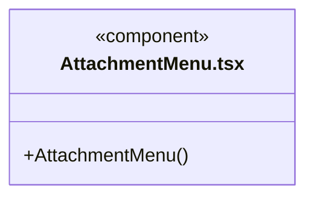

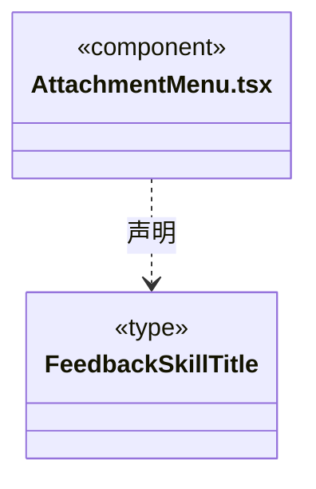

直接依赖：[../components/Icon.tsx](../components/Icon.tsx)、[../../bridge/contracts/chat.ts](../../bridge/contracts/chat.ts)。

### brain-status.ts

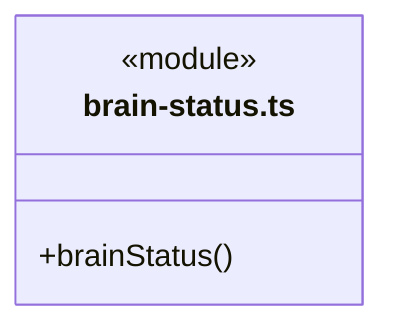

直接依赖：[../../bridge/contracts/execution.ts](../../bridge/contracts/execution.ts)。

### command-verification-state.ts

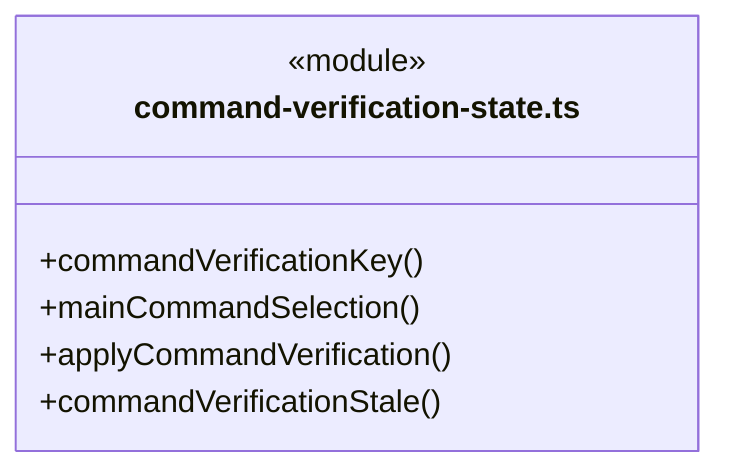

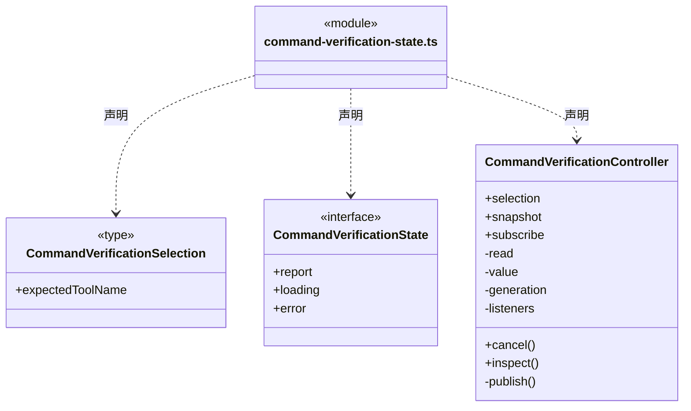

直接依赖：[../../bridge/contracts/command-verification.ts](../../bridge/contracts/command-verification.ts)、[../../bridge/contracts/execution.ts](../../bridge/contracts/execution.ts)。

### command-verification.css

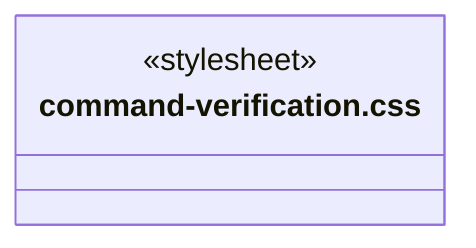

### CommandVerificationPanel.tsx

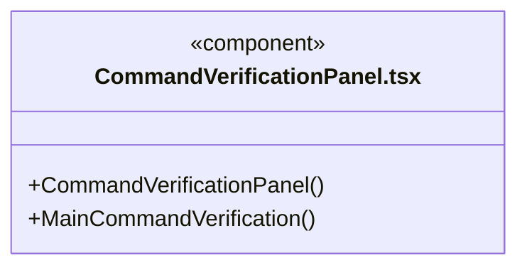

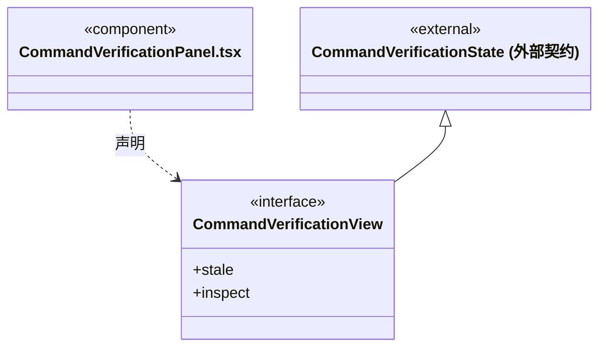

直接依赖：[../../bridge/contracts/command-verification.ts](../../bridge/contracts/command-verification.ts)、[command-verification-state.ts](command-verification-state.ts)、[command-verification.css](command-verification.css)。

### ComposerAttachments.tsx

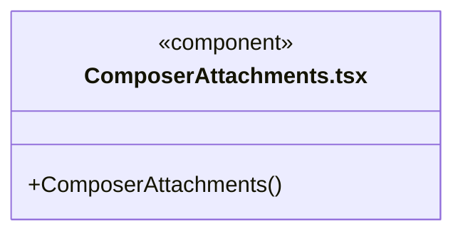

直接依赖：[../../bridge/contracts/chat.ts](../../bridge/contracts/chat.ts)、[../components/Icon.tsx](../components/Icon.tsx)。

### ComposerCard.tsx

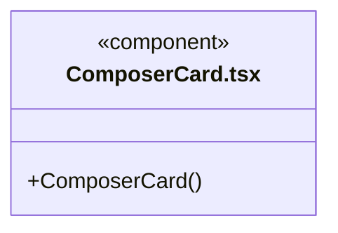


### ComposerPicker.tsx

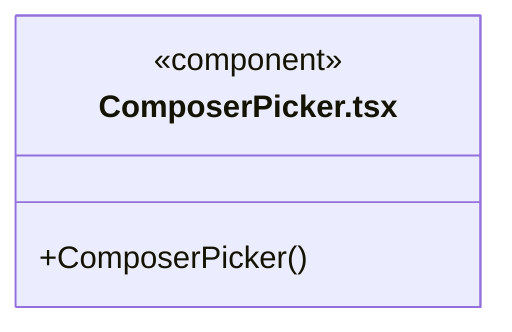

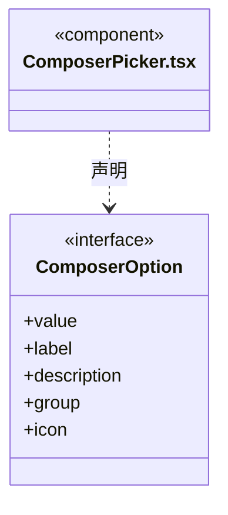

直接依赖：[../components/Icon.tsx](../components/Icon.tsx)。

### conversation-state.ts

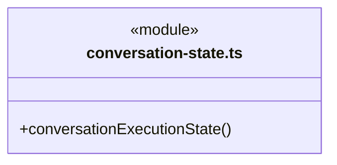

直接依赖：[../../bridge/contracts/execution.ts](../../bridge/contracts/execution.ts)、[../../bridge/contracts/dispatch.ts](../../bridge/contracts/dispatch.ts)。

### conversation-stop.ts

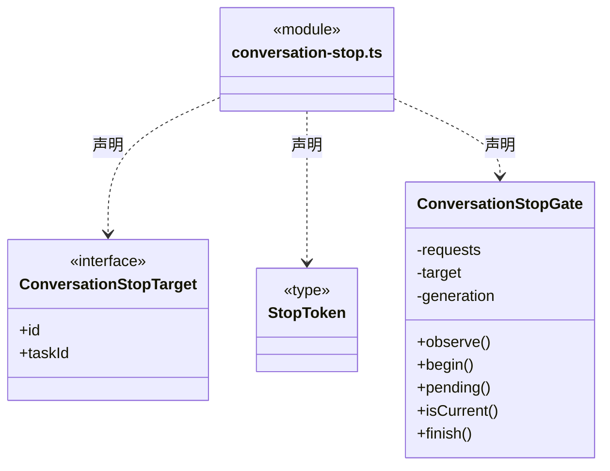


### conversation.css

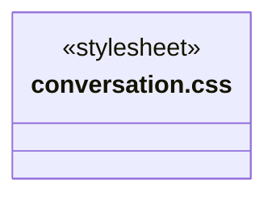

### Conversation.tsx

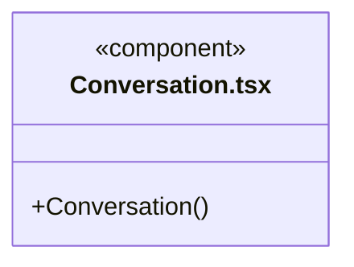

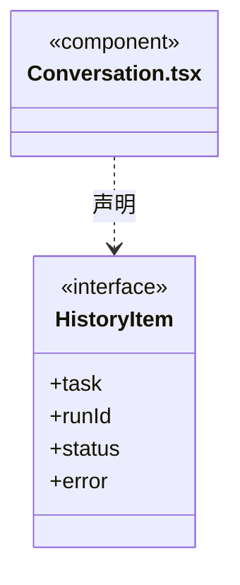

直接依赖：[../../bridge/contracts/workspace.ts](../../bridge/contracts/workspace.ts)、[../../bridge/contracts/execution.ts](../../bridge/contracts/execution.ts)、[../../bridge/contracts/models.ts](../../bridge/contracts/models.ts)、[../shell/tabs.ts](../shell/tabs.ts)、[../shell/runtime-navigation.ts](../shell/runtime-navigation.ts)、[transcript.ts](transcript.ts)、[MarkdownMessage.tsx](MarkdownMessage.tsx)、[WorkStatus.tsx](WorkStatus.tsx)、[../tasks/SessionTaskView.tsx](../tasks/SessionTaskView.tsx)、[../tasks/useSessionGraph.ts](../tasks/useSessionGraph.ts)、[../tasks/MemberActivity.tsx](../tasks/MemberActivity.tsx)、[../tasks/ScopeGoalPanel.tsx](../tasks/ScopeGoalPanel.tsx)、[session-tabs.css](session-tabs.css)、[MessageQueue.tsx](MessageQueue.tsx)、[useMessageQueue.ts](useMessageQueue.ts)、[QuestionCard.tsx](QuestionCard.tsx)、[UsageStatus.tsx](UsageStatus.tsx)、[MessageCard.tsx](MessageCard.tsx)、[../components/Icon.tsx](../components/Icon.tsx)、[conversation.css](conversation.css)、[ComposerCard.tsx](ComposerCard.tsx)、[SendButton.tsx](SendButton.tsx)、[AttachmentMenu.tsx](AttachmentMenu.tsx)、[ComposerPicker.tsx](ComposerPicker.tsx)、[ComposerAttachments.tsx](ComposerAttachments.tsx)、[../../bridge/contracts/chat.ts](../../bridge/contracts/chat.ts)、[conversation-state.ts](conversation-state.ts)、[queue-insertion.ts](queue-insertion.ts)、[conversation-stop.ts](conversation-stop.ts)、[../tasks/useScopeContinuation.ts](../tasks/useScopeContinuation.ts)、[../tasks/useExecutionRecovery.ts](../tasks/useExecutionRecovery.ts)、[../tasks/useScopeReplan.ts](../tasks/useScopeReplan.ts)、[../tasks/useHumanDecisions.ts](../tasks/useHumanDecisions.ts)、[../tasks/useHumanContinuation.ts](../tasks/useHumanContinuation.ts)、[ThreadHistoryNotice.tsx](ThreadHistoryNotice.tsx)、[../tasks/useAdmission.ts](../tasks/useAdmission.ts)、[../tasks/admission-state.ts](../tasks/admission-state.ts)、[../tasks/AdmissionNotice.tsx](../tasks/AdmissionNotice.tsx)。

### MarkdownMessage.tsx

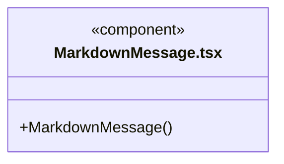

直接依赖：[repairStreamingMarkdown.ts](repairStreamingMarkdown.ts)。

### message-queue.css

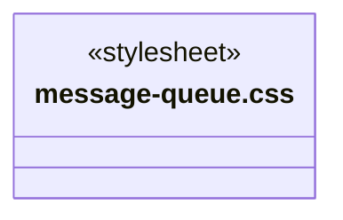

### MessageCard.tsx

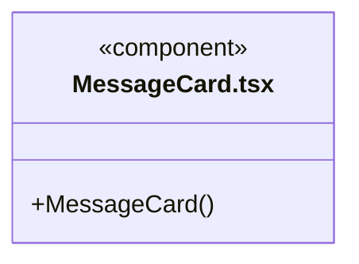


### MessageQueue.tsx

```mermaid
classDiagram
class N_src_frontend_conversation_MessageQueue_tsx["MessageQueue.tsx"] {
  <<component>>
  +MessageQueue()
}
```

直接依赖：[../../bridge/contracts/execution.ts](../../bridge/contracts/execution.ts)、[message-queue.css](message-queue.css)。

### QuestionCard.tsx

```mermaid
classDiagram
class N_src_frontend_conversation_QuestionCard_tsx["QuestionCard.tsx"] {
  <<component>>
  +QuestionCard()
}
```

直接依赖：[../../bridge/contracts/execution.ts](../../bridge/contracts/execution.ts)、[questions.css](questions.css)。

### questions.css

```mermaid
classDiagram
class N_src_frontend_conversation_questions_css["questions.css"] {
  <<stylesheet>>
}
```

### queue-insertion.ts

```mermaid
classDiagram
class N_src_frontend_conversation_queue_insertion_ts["queue-insertion.ts"] {
  <<module>>
  +captureQueueInsertTarget()
  +insertQueuedMessage()
  +enqueueConversationMessage()
}
```

```mermaid
classDiagram
class N_src_frontend_conversation_queue_insertion_ts["queue-insertion.ts"] {
  <<module>>
}
class N_src_frontend_conversation_queue_insertion_ts_QueueInsertTarget["QueueInsertTarget"] {
  <<type>>

}
N_src_frontend_conversation_queue_insertion_ts ..> N_src_frontend_conversation_queue_insertion_ts_QueueInsertTarget : 声明
class N_src_frontend_conversation_queue_insertion_ts_QueuedReceipt["QueuedReceipt"] {
  <<type>>
  +taskId
  +id
}
N_src_frontend_conversation_queue_insertion_ts ..> N_src_frontend_conversation_queue_insertion_ts_QueuedReceipt : 声明
class N_src_frontend_conversation_queue_insertion_ts_InsertPort["InsertPort"] {
  <<type>>

}
N_src_frontend_conversation_queue_insertion_ts ..> N_src_frontend_conversation_queue_insertion_ts_InsertPort : 声明
```

直接依赖：[../../bridge/contracts/execution.ts](../../bridge/contracts/execution.ts)。

### queue-sync.ts

```mermaid
classDiagram
class N_src_frontend_conversation_queue_sync_ts["queue-sync.ts"] {
  <<module>>
}
class N_src_frontend_conversation_queue_sync_ts_QueueProjection["QueueProjection"] {
  +cursor
  +items
  +apply()
}
N_src_frontend_conversation_queue_sync_ts ..> N_src_frontend_conversation_queue_sync_ts_QueueProjection : 声明
```

直接依赖：[../../bridge/contracts/execution.ts](../../bridge/contracts/execution.ts)。

### repairStreamingMarkdown.ts

```mermaid
classDiagram
class N_src_frontend_conversation_repairStreamingMarkdown_ts["repairStreamingMarkdown.ts"] {
  <<module>>
  +repairStreamingMarkdown()
}
```


### SendButton.tsx

```mermaid
classDiagram
class N_src_frontend_conversation_SendButton_tsx["SendButton.tsx"] {
  <<component>>
}
class N_src_frontend_conversation_SendButton_tsx_SendButtonProps["SendButtonProps"] {
  <<interface>>
  +disabled
  +onClick
  +isStreaming
  +queued
  +stopLabel
}
N_src_frontend_conversation_SendButton_tsx ..> N_src_frontend_conversation_SendButton_tsx_SendButtonProps : 声明
```


### session-tabs.css

```mermaid
classDiagram
class N_src_frontend_conversation_session_tabs_css["session-tabs.css"] {
  <<stylesheet>>
}
```

### ThreadHistoryNotice.tsx

```mermaid
classDiagram
class N_src_frontend_conversation_ThreadHistoryNotice_tsx["ThreadHistoryNotice.tsx"] {
  <<component>>
  +threadResumeRun()
  +ThreadHistoryNotice()
}
```

直接依赖：[../../bridge/contracts/execution.ts](../../bridge/contracts/execution.ts)。

### ToolActivity.tsx

```mermaid
classDiagram
class N_src_frontend_conversation_ToolActivity_tsx["ToolActivity.tsx"] {
  <<component>>
  +ToolActivity()
}
```

直接依赖：[../../bridge/contracts/execution.ts](../../bridge/contracts/execution.ts)、[../components/RepositoryScopeDetails.tsx](../components/RepositoryScopeDetails.tsx)、[../../bridge/contracts/command-verification.ts](../../bridge/contracts/command-verification.ts)、[command-verification-state.ts](command-verification-state.ts)、[CommandVerificationPanel.tsx](CommandVerificationPanel.tsx)、[../tasks/useExecutionRecovery.ts](../tasks/useExecutionRecovery.ts)、[../tasks/EffectObservationPanel.tsx](../tasks/EffectObservationPanel.tsx)、[../tasks/effect-recovery-state.ts](../tasks/effect-recovery-state.ts)。

### transcript.ts

```mermaid
classDiagram
class N_src_frontend_conversation_transcript_ts["transcript.ts"] {
  <<module>>
  +transcript()
}
```

```mermaid
classDiagram
class N_src_frontend_conversation_transcript_ts["transcript.ts"] {
  <<module>>
}
class N_src_frontend_conversation_transcript_ts_ChatItem["ChatItem"] {
  <<interface>>
  +id
  +kind
  +text
  +pending
  +attachments
}
N_src_frontend_conversation_transcript_ts ..> N_src_frontend_conversation_transcript_ts_ChatItem : 声明
```

直接依赖：[../../bridge/contracts/execution.ts](../../bridge/contracts/execution.ts)、[../../bridge/contracts/models.ts](../../bridge/contracts/models.ts)。

### usage.css

```mermaid
classDiagram
class N_src_frontend_conversation_usage_css["usage.css"] {
  <<stylesheet>>
}
```

### usage.ts

```mermaid
classDiagram
class N_src_frontend_conversation_usage_ts["usage.ts"] {
  <<module>>
  +conversationUsage()
}
```

直接依赖：[../../bridge/contracts/usage.ts](../../bridge/contracts/usage.ts)、[../../bridge/contracts/execution.ts](../../bridge/contracts/execution.ts)。

### UsageStatus.tsx

```mermaid
classDiagram
class N_src_frontend_conversation_UsageStatus_tsx["UsageStatus.tsx"] {
  <<component>>
  +UsageStatus()
}
```

```mermaid
classDiagram
class N_src_frontend_conversation_UsageStatus_tsx["UsageStatus.tsx"] {
  <<component>>
}
class N_src_frontend_conversation_UsageStatus_tsx_ConversationActivity["ConversationActivity"] {
  <<interface>>
  +label
  +active
  +tone
  +waitingSince
}
N_src_frontend_conversation_UsageStatus_tsx ..> N_src_frontend_conversation_UsageStatus_tsx_ConversationActivity : 声明
```

直接依赖：[../../bridge/contracts/execution.ts](../../bridge/contracts/execution.ts)、[brain-status.ts](brain-status.ts)、[../components/Icon.tsx](../components/Icon.tsx)、[usage.ts](usage.ts)、[usage.css](usage.css)。

### useMessageQueue.ts

```mermaid
classDiagram
class N_src_frontend_conversation_useMessageQueue_ts["useMessageQueue.ts"] {
  <<module>>
  +useMessageQueue()
}
```

直接依赖：[queue-sync.ts](queue-sync.ts)、[../../bridge/contracts/execution.ts](../../bridge/contracts/execution.ts)。

### WorkStatus.tsx

```mermaid
classDiagram
class N_src_frontend_conversation_WorkStatus_tsx["WorkStatus.tsx"] {
  <<component>>
  +WorkStatus()
}
```

直接依赖：[../../bridge/contracts/execution.ts](../../bridge/contracts/execution.ts)、[../components/Icon.tsx](../components/Icon.tsx)、[ToolActivity.tsx](ToolActivity.tsx)、[../tasks/useExecutionRecovery.ts](../tasks/useExecutionRecovery.ts)。

### 本目录调用边界

```mermaid
classDiagram
class N_src_frontend_conversation_CommandVerificationPanel_tsx["CommandVerificationPanel.tsx"] {
  <<component>>
}
class N_src_frontend_conversation_command_verification_state_ts["command-verification-state.ts"] {
  <<module>>
}
class N_src_frontend_conversation_command_verification_css["command-verification.css"] {
  <<stylesheet>>
}
class N_src_frontend_conversation_Conversation_tsx["Conversation.tsx"] {
  <<component>>
}
class N_src_frontend_conversation_transcript_ts["transcript.ts"] {
  <<module>>
}
class N_src_frontend_conversation_MarkdownMessage_tsx["MarkdownMessage.tsx"] {
  <<component>>
}
N_src_frontend_conversation_CommandVerificationPanel_tsx ..> N_src_frontend_conversation_command_verification_state_ts : 导入依赖
N_src_frontend_conversation_CommandVerificationPanel_tsx ..> N_src_frontend_conversation_command_verification_css : 导入依赖
N_src_frontend_conversation_Conversation_tsx ..> N_src_frontend_conversation_transcript_ts : 导入依赖
N_src_frontend_conversation_Conversation_tsx ..> N_src_frontend_conversation_MarkdownMessage_tsx : 导入依赖
```

```mermaid
classDiagram
class N_src_frontend_conversation_Conversation_tsx["Conversation.tsx"] {
  <<component>>
}
class N_src_frontend_conversation_WorkStatus_tsx["WorkStatus.tsx"] {
  <<component>>
}
class N_src_frontend_conversation_session_tabs_css["session-tabs.css"] {
  <<stylesheet>>
}
class N_src_frontend_conversation_MessageQueue_tsx["MessageQueue.tsx"] {
  <<component>>
}
class N_src_frontend_conversation_useMessageQueue_ts["useMessageQueue.ts"] {
  <<module>>
}
N_src_frontend_conversation_Conversation_tsx ..> N_src_frontend_conversation_WorkStatus_tsx : 导入依赖
N_src_frontend_conversation_Conversation_tsx ..> N_src_frontend_conversation_session_tabs_css : 导入依赖
N_src_frontend_conversation_Conversation_tsx ..> N_src_frontend_conversation_MessageQueue_tsx : 导入依赖
N_src_frontend_conversation_Conversation_tsx ..> N_src_frontend_conversation_useMessageQueue_ts : 导入依赖
```

```mermaid
classDiagram
class N_src_frontend_conversation_Conversation_tsx["Conversation.tsx"] {
  <<component>>
}
class N_src_frontend_conversation_QuestionCard_tsx["QuestionCard.tsx"] {
  <<component>>
}
class N_src_frontend_conversation_UsageStatus_tsx["UsageStatus.tsx"] {
  <<component>>
}
class N_src_frontend_conversation_MessageCard_tsx["MessageCard.tsx"] {
  <<component>>
}
class N_src_frontend_conversation_conversation_css["conversation.css"] {
  <<stylesheet>>
}
N_src_frontend_conversation_Conversation_tsx ..> N_src_frontend_conversation_QuestionCard_tsx : 导入依赖
N_src_frontend_conversation_Conversation_tsx ..> N_src_frontend_conversation_UsageStatus_tsx : 导入依赖
N_src_frontend_conversation_Conversation_tsx ..> N_src_frontend_conversation_MessageCard_tsx : 导入依赖
N_src_frontend_conversation_Conversation_tsx ..> N_src_frontend_conversation_conversation_css : 导入依赖
```

```mermaid
classDiagram
class N_src_frontend_conversation_Conversation_tsx["Conversation.tsx"] {
  <<component>>
}
class N_src_frontend_conversation_ComposerCard_tsx["ComposerCard.tsx"] {
  <<component>>
}
class N_src_frontend_conversation_SendButton_tsx["SendButton.tsx"] {
  <<component>>
}
class N_src_frontend_conversation_AttachmentMenu_tsx["AttachmentMenu.tsx"] {
  <<component>>
}
class N_src_frontend_conversation_ComposerPicker_tsx["ComposerPicker.tsx"] {
  <<component>>
}
N_src_frontend_conversation_Conversation_tsx ..> N_src_frontend_conversation_ComposerCard_tsx : 导入依赖
N_src_frontend_conversation_Conversation_tsx ..> N_src_frontend_conversation_SendButton_tsx : 导入依赖
N_src_frontend_conversation_Conversation_tsx ..> N_src_frontend_conversation_AttachmentMenu_tsx : 导入依赖
N_src_frontend_conversation_Conversation_tsx ..> N_src_frontend_conversation_ComposerPicker_tsx : 导入依赖
```

```mermaid
classDiagram
class N_src_frontend_conversation_Conversation_tsx["Conversation.tsx"] {
  <<component>>
}
class N_src_frontend_conversation_ComposerAttachments_tsx["ComposerAttachments.tsx"] {
  <<component>>
}
class N_src_frontend_conversation_conversation_state_ts["conversation-state.ts"] {
  <<module>>
}
class N_src_frontend_conversation_queue_insertion_ts["queue-insertion.ts"] {
  <<module>>
}
class N_src_frontend_conversation_conversation_stop_ts["conversation-stop.ts"] {
  <<module>>
}
N_src_frontend_conversation_Conversation_tsx ..> N_src_frontend_conversation_ComposerAttachments_tsx : 导入依赖
N_src_frontend_conversation_Conversation_tsx ..> N_src_frontend_conversation_conversation_state_ts : 导入依赖
N_src_frontend_conversation_Conversation_tsx ..> N_src_frontend_conversation_queue_insertion_ts : 导入依赖
N_src_frontend_conversation_Conversation_tsx ..> N_src_frontend_conversation_conversation_stop_ts : 导入依赖
```

```mermaid
classDiagram
class N_src_frontend_conversation_Conversation_tsx["Conversation.tsx"] {
  <<component>>
}
class N_src_frontend_conversation_ThreadHistoryNotice_tsx["ThreadHistoryNotice.tsx"] {
  <<component>>
}
class N_src_frontend_conversation_MarkdownMessage_tsx["MarkdownMessage.tsx"] {
  <<component>>
}
class N_src_frontend_conversation_repairStreamingMarkdown_ts["repairStreamingMarkdown.ts"] {
  <<module>>
}
class N_src_frontend_conversation_MessageQueue_tsx["MessageQueue.tsx"] {
  <<component>>
}
class N_src_frontend_conversation_message_queue_css["message-queue.css"] {
  <<stylesheet>>
}
class N_src_frontend_conversation_QuestionCard_tsx["QuestionCard.tsx"] {
  <<component>>
}
class N_src_frontend_conversation_questions_css["questions.css"] {
  <<stylesheet>>
}
N_src_frontend_conversation_Conversation_tsx ..> N_src_frontend_conversation_ThreadHistoryNotice_tsx : 导入依赖
N_src_frontend_conversation_MarkdownMessage_tsx ..> N_src_frontend_conversation_repairStreamingMarkdown_ts : 导入依赖
N_src_frontend_conversation_MessageQueue_tsx ..> N_src_frontend_conversation_message_queue_css : 导入依赖
N_src_frontend_conversation_QuestionCard_tsx ..> N_src_frontend_conversation_questions_css : 导入依赖
```

```mermaid
classDiagram
class N_src_frontend_conversation_ToolActivity_tsx["ToolActivity.tsx"] {
  <<component>>
}
class N_src_frontend_conversation_command_verification_state_ts["command-verification-state.ts"] {
  <<module>>
}
class N_src_frontend_conversation_CommandVerificationPanel_tsx["CommandVerificationPanel.tsx"] {
  <<component>>
}
class N_src_frontend_conversation_UsageStatus_tsx["UsageStatus.tsx"] {
  <<component>>
}
class N_src_frontend_conversation_brain_status_ts["brain-status.ts"] {
  <<module>>
}
class N_src_frontend_conversation_usage_ts["usage.ts"] {
  <<module>>
}
N_src_frontend_conversation_ToolActivity_tsx ..> N_src_frontend_conversation_command_verification_state_ts : 导入依赖
N_src_frontend_conversation_ToolActivity_tsx ..> N_src_frontend_conversation_CommandVerificationPanel_tsx : 导入依赖
N_src_frontend_conversation_UsageStatus_tsx ..> N_src_frontend_conversation_brain_status_ts : 导入依赖
N_src_frontend_conversation_UsageStatus_tsx ..> N_src_frontend_conversation_usage_ts : 导入依赖
```

```mermaid
classDiagram
class N_src_frontend_conversation_UsageStatus_tsx["UsageStatus.tsx"] {
  <<component>>
}
class N_src_frontend_conversation_usage_css["usage.css"] {
  <<stylesheet>>
}
class N_src_frontend_conversation_useMessageQueue_ts["useMessageQueue.ts"] {
  <<module>>
}
class N_src_frontend_conversation_queue_sync_ts["queue-sync.ts"] {
  <<module>>
}
class N_src_frontend_conversation_WorkStatus_tsx["WorkStatus.tsx"] {
  <<component>>
}
class N_src_frontend_conversation_ToolActivity_tsx["ToolActivity.tsx"] {
  <<component>>
}
N_src_frontend_conversation_UsageStatus_tsx ..> N_src_frontend_conversation_usage_css : 导入依赖
N_src_frontend_conversation_useMessageQueue_ts ..> N_src_frontend_conversation_queue_sync_ts : 导入依赖
N_src_frontend_conversation_WorkStatus_tsx ..> N_src_frontend_conversation_ToolActivity_tsx : 导入依赖
```


## 子目录导航

无子目录。

[返回上层](../ARCHITECTURE.md)。

每次修改本目录代码，同步维护文件头、关键契约说明及本图。未实现的治理、证据验收和自动编排能力不列入当前类图。

## 设计契约 v1 与落地范围

以下内容区分已接通能力与后续设计；以各节的实现状态为准，不将目标图当作现状图。维护源：[CONTRACT.md](CONTRACT.md)；生成类图时同步附加，勿直接修改本附录。

# 会话执行与持久等待交互

## GitHub 成功提交的静默显示

`transcript` 只在真实 `tool.finished` 的固定反馈工具、成功回执和 `github-feedback` 范围同时成立后，隐藏后续追加的结果文字及其流式片段。工具证据保留；失败、未知、拒绝或缺少可信回执时正常显示说明。新的用户插入或工具调用恢复普通投影，之后再次成功提交才重新静默。这里不把模型自述当成提交事实，也不影响私有运行日志。

## 加号菜单的产品反馈 Skill

`AttachmentMenu` 的「BUG 反馈」「需求许愿」经 `onSkill` 向 `Conversation` 发送明确的流程调用请求。主 Agent 分别读取 `cbim_skill_bug_feedback`、`cbim_skill_feature_wish` 并展示上下文格式。首次点击不提交现有草稿或附件，不打开网页，也不创建 GitHub Issue。

调用沿用当前会话的模型、权限、发送／排队和安全续接条件。菜单关闭后按正常消息显示调用请求；已有任务开放时仅排队，不插入或恢复等待中的目标。受理成功、失败及刷新历史均不清空本次未发送的草稿与附件。附件已达 12 项仍可调用 Skill；模型缺失、加载中、停止中或操作在途时禁用。保留原共享请求锁，双击不能并发发送。

```mermaid
classDiagram
class AttachmentMenu { <<component>>
  +onSkill(FeedbackSkillTitle)
}
class Conversation { <<component>>
  +send(insert, skill)
}
class ChatLoop { <<backend boundary>> }
AttachmentMenu --> Conversation : 明确选择两项 Skill 之一
Conversation --> ChatLoop : 独立调用消息，空附件
note for Conversation "已有草稿与附件保留；开放任务只排队"
```

原主工具轨道为八项已接入的调度写命令提供“核实原命令”。`MainCommandVerification` 通过唯一 `dispatch.commandReport` 入口传原 workspace/root/run/call 身份；主实例绑定必须与日志一致，成员轨道与无可信主绑定旧日志不猜测入口。工具失败与原事务已保存分别展示，查询不修改原日志、未确认项、验收、恢复资格或普通草稿。

`CommandVerificationController` 仅显式点击读取，同身份在途点击合并；轮询、挂载和展开不查询。严格核对报告 Schema、四重身份和原工具名，切换/卸载忽略迟到响应；失败保留旧报告并标明时效。`throughSeq` 早于当前日志仅提示有更新，不撤回已保存事实或自动刷新。界面只展示有界公共结果、序号和摘要，不导入后端命令算法，不显示 Prepared/native/私有事务。查无回执仍然未知，不能据此重新执行；本卡不提供重试或恢复按钮。

目标摘要中的原任务/替代成果沿 `viewMember` 切到同一主会话任务页并选择已有节点；`ScopeGoalPanel` 先核对所选周期与图、节点归属。只读定位不重新派发、不迁移旧负责人、不清除普通草稿/附件，也不修改原审阅或绘制额外执行边。

全局运行页通过一次性 `RuntimeNavigationRequest` 定位原会话。`Conversation` 等待原图完成读取后核对工作区实例、主根、周期和节点，只切到任务视图并选中真实对象；缺失或图读取失败显示定位错误，不补造节点、执行任务或退回最新周期。消费后通知外壳清除请求，用户主动切换会话内容/节点同样取消待处理导航，不被迟到同步反复覆盖；原草稿、附件与执行选项不变。

仓库工具在轨道中显示“查询仓库资源/读取仓库资料”，输入区状态沿真实 started/updated 事件更新。`ToolActivity` 只将运行授权或回执中的 scope 交给共享纯展示组件，不读取模型 input.scope。完整原始结果与运行回执分别可展开；历史仓库身份不代表当前连接仍可用，资料不是业务实现或验收证据。

人工决定与普通发送、目标补充相互独立。`Conversation` 只创建一个 `useHumanDecisions` 控制器，向摘要卡和任务根传递同一份视图；组件切换不产生新命令，保存不清理普通草稿和附件、不改模型权限、不中断等待或消费队列。保存接受/拒绝/补证及精确依据以后，另由 `useHumanContinuation` 共享控制器提供“按以上决定继续”，不自动调用。

按人工决定继续使用输入区实际模型与权限，只读周期仍强制 read；首次点击冻结当前等待的最新决定全集与执行配置。`transcript` 对 `human_decisions` 展示系统来源，不将内部续执行提示伪装成用户输入。普通草稿、附件和队列保持独立；已受理不是已完成，实际状态来自周期增量。

全局准入票据独立于目标状态。`Conversation` 共享窗口级 `useAdmission`，在两个会话页签上方显示当前 root 的等待原因；只有有票且无实际占用时停止工作动画，并用请求时间冻结等待期间显示。读取失败不据旧票据断言已经停止。新聊天的容量拒绝发生在受理前，原发送流程只在成功后清空草稿，因而拒绝时保留正文与附件。

`Conversation` 只接收当前工作区和主会话的运行、队列及目标投影。`conversationExecutionState` 把主模型执行、开放周期与持久等待分开；历史周期选择不参与发送、停止、排队或计时的判断。

- `mainRunning` 只表示可插入消息的主运行。后端已提交 `waiting` 时，另一条轮询暂未追齐的 running 日志不能重新开启插入能力。
- `executing` 驱动当前工作时间刷新与生成动画；持久等待没有后台模型工作，不计入等待时间。
- `taskOpen` 包含执行和持久等待，保留停止/取消入口，普通发送统一走 `loop.enqueue`。普通排队消息不是目标补充，也不是人工验收。
- `busy` 仍只表示用户操作正在提交，等待本身不会锁住附件、模型、权限选择或队列编辑。

等待时输入区显示“当前目标等待补充；新消息会排队为下个任务”，取消按钮操作当前开放目标。模型与权限修改用于后续消息，不改变已冻结目标。`MessageQueue.continueDisabled` 只禁用“继续队列”，保留删除、编辑和排序；不传 `onInsert`，快捷键处理也拒绝插入。后端仍独立验证状态，界面不是权限边界。

`UsageStatus.waitingSince` 只使用可信目标摘要的等待时间。它优先于尚未追齐的运行日志，停止生成动画，并限制尚显示 running 的旧记录计时不会越过等待检查点；不改写已有 token、费用或执行日志。

当前等待目标卡片提供“补充并继续”表单。`Conversation` 装配唯一 `useScopeContinuation`，对话卡与任务根共享草稿、提交锁和回执；显式传入外壳 `active`，因此切换到其他会话、当前组件仅隐藏时也取消未完成的资料导入。此取消不消费等待、不撤销已受理命令，回到原会话不重新导入。表单不会消费或清空聊天草稿、附件和队列。提交时从输入区选定的有效供应商配置解析实际 `provider + profileId + model + permission`，完整请求先保存在本机再发送，后续修改模型和权限不改写已冻结请求。

普通排队消息、问题回答、工具批准及“继续队列”均不能恢复目标。显式补充不是人工验收；已受理只代表恢复意图持久化，实际运行/等待/结束继续由目标增量流显示。通信结果未知时保留原命令，重开只查询，不自动再次执行；表单仅在当前 waiting 身份和版本一致时可以首次提交或原请求重试，历史只读。

## 异常历史与新核实上下文

主对话轮询及发送后的刷新使用 `loop.threadView`。完整运行仍按真实日志显示，`ThreadHistoryNotice` 为无法读取的轮次提供独立只读问题占位，不伪造 `RunSummary`，不因为某条旧日志损坏而隐藏全部新对话。普通续聊、消息插入和当前脑状态使用后端 `resumeRunId` 指向的运行；无可信头时禁止回退到过滤后 `runs.at(-1)`。当前开放周期仍可以排队与停止。

从成员报告发起的新只读核实周期经 `SessionTaskView` 装配专用表单。主会话只传实际模型与真实开放周期，权限由表单固定 read；核实周期进入 waiting 后，目标补充仍保持 read。普通输入区草稿、附件、模型和权限不被表单改写，历史选择也不改变当前工作对象。

已完成的核实周期另有正式业务新目标入口，`Conversation` 装配唯一 `useScopeReplan`，对话 `ScopeGoalPanel` 与任务根透传同一个视图。它仅共享实际模型身份，表单权限独立默认 ask，execute 必须明确选择。显式条件核验不运行模型，最终创建新业务周期才发送稳定命令；未知命令查询/重试不引用当前聊天输入。旧核实周期仍为只读，新业务目标不清空原草稿、附件或队列，历史选择不会替换真实开放周期或主会话身份。

`UsageStatus.currentRun` 为 null 时明确没有安全运行头，不猜脑状态与上下文；有可信头则只取该轮上下文，即使历史时间排序把它排在较前。`conversationUsage` 仍累计所有可读运行已报告的费用和 token，旧异常 running 时长截于最后已知事件，不把它持续当成后台工作。存在历史问题时费用标为“已知部分”，不声称完整总消耗，也不估算缺失日志。

```mermaid
classDiagram
class Conversation { <<component>> }
class ConversationState { <<module>> }
class SessionGraphState { <<tasks boundary>> }
class ScopeContinuation { <<tasks boundary>> }
class ScopeReplan { <<tasks boundary>> }
class MessageQueue { <<component>> }
class UsageStatus { <<component>> }
Conversation --> SessionGraphState : 当前开放目标与历史选择分离
Conversation --> ScopeContinuation : 两处卡片共享显式补充状态
Conversation --> ScopeReplan : 两处卡片共享业务新目标与条件核验
Conversation --> ConversationState : 计算发送与执行状态
Conversation --> MessageQueue : 等待只禁启动不禁整理
Conversation --> UsageStatus : 真实等待检查点与状态
```

## 绑定原主运行的队列插入与停止

`queue-insertion.ts` 共用新草稿 Ctrl+Enter 与已有队列项的插入请求构造。用户操作开始时从可信主会话头捕获 `workspace/task/run`；入队或附件等待后仍发送原 `expectedRunId`，不重取新轮次。成员活动和持久等待只允许排队，不生成插入请求。原消息已入队就清空已发送草稿及附件；随后插入拒绝或回包未知只显示错误并刷新真实队列，不恢复草稿、删除消息、重新入队或自动再插入。

`ConversationStopGate` 使用与普通操作分离的在途标记。插入、附件或原生回包等待期间，输入区和任务根的停止仍可提交；同会话重复停止不再次发送。停止未结束时禁止新的发送、插入与继续队列，草稿和编辑仍保留。完成仅释放原停止标记，不清除仍在途的发送 busy；会话切换的视图代次保证迟到结果不会刷新别的会话或覆盖新的错误。停止与插入是否已接受以后台实际记录为准，不把按钮操作解释为回滚。

## 异常影响入口与原运行续接

原工具轨道缺少完整任务身份时仍展示真实状态和错误，主核实入口明确缺省；不因为新增影响面板而读取缺失字段崩溃，也不根据角色名称补造身份。

Conversation 经 WorkStatus / ToolActivity 传递真实主会话的恢复上下文。每项主调用可明确核实影响，九类主写命令仍保留独立原命令核实卡。不会以业务TaskNode冒充主来源；任务根与对话轨道使用同一真实run和本机处置控制器。展开、挂载与轮询不读取业务文件或自动启动核实。

unknown 提示不再提供勾选ID解锁旧native的入口。普通无未决工具的对话仍可续聊，有unknown则沿明确观察/新只读核实处理；后端Runtime/Manager另行强制门禁。新核实、修复目标及处置不读写普通草稿、附件、队列或当前模型/权限选择。
### 文件补偿的当前工作区身份

对话向会话任务视图传递当前已打开工作区 `instanceId`，供成员原调用的显式补偿核验。历史run/task/root仍由原任务图和日志提供，不以新实例替换旧身份。这个透传不启动文件读取、补偿或模型，不影响聊天草稿、附件、权限和队列。

## 原前置修订命令核实

原工具卡复用显式 CommandVerificationPanel，已保存结果显示原目标、退役/新增数量及当时 queued/waiting。查询与普通草稿、原工具成功/失败和当前图分离，展开或重开不自动请求，不提供重发或恢复动作。
