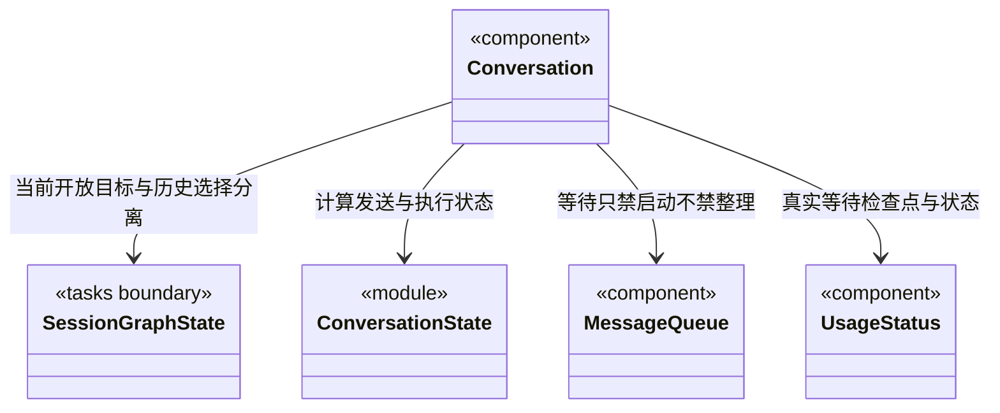

# 会话执行与持久等待交互

`Conversation` 只接收当前工作区和主会话的运行、队列及目标投影。`conversationExecutionState` 把主模型执行、开放周期与持久等待分开；历史周期选择不参与发送、停止、排队或计时的判断。

- `mainRunning` 只表示可插入消息的主运行。后端已提交 `waiting` 时，另一条轮询暂未追齐的 running 日志不能重新开启插入能力。
- `executing` 驱动当前工作时间刷新与生成动画；持久等待没有后台模型工作，不计入等待时间。
- `taskOpen` 包含执行和持久等待，保留停止/取消入口，普通发送统一走 `loop.enqueue`。普通排队消息不是目标补充，也不是人工验收。
- `busy` 仍只表示用户操作正在提交，等待本身不会锁住附件、模型、权限选择或队列编辑。

等待时输入区显示“当前目标等待补充；新消息会排队为下个任务”，取消按钮操作当前开放目标。模型与权限修改用于后续消息，不改变已冻结目标。`MessageQueue.continueDisabled` 只禁用“继续队列”，保留删除、编辑和排序；不传 `onInsert`，快捷键处理也拒绝插入。后端仍独立验证状态，界面不是权限边界。

`UsageStatus.waitingSince` 只使用可信目标摘要的等待时间。它优先于尚未追齐的运行日志，停止生成动画，并限制尚显示 running 的旧记录计时不会越过等待检查点；不改写已有 token、费用或执行日志。

本步没有显式补充、恢复或人工批准表单。界面如实说明恢复入口尚未接通，可取消目标后另发任务；不提供不起作用的按钮，也不把“继续队列”、问题回答或工具批准复用为恢复操作。

