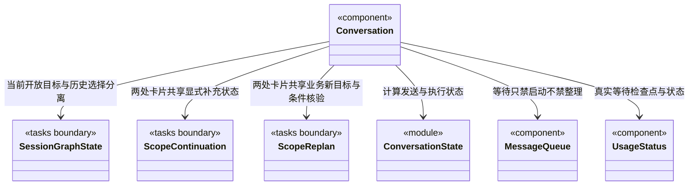

# 会话执行与持久等待交互

原主工具轨道为八项已接入的调度写命令提供“核实原命令”。`MainCommandVerification` 通过唯一 `dispatch.commandReport` 入口传原 workspace/root/run/call 身份；主实例绑定必须与日志一致，成员轨道与无可信主绑定旧日志不猜测入口。工具失败与原事务已保存分别展示，查询不修改原日志、未确认项、验收、恢复资格或普通草稿。

`CommandVerificationController` 仅显式点击读取，同身份在途点击合并；轮询、挂载和展开不查询。严格核对报告 Schema、四重身份和原工具名，切换/卸载忽略迟到响应；失败保留旧报告并标明时效。`throughSeq` 早于当前日志仅提示有更新，不撤回已保存事实或自动刷新。界面只展示有界公共结果、序号和摘要，不导入后端命令算法，不显示 Prepared/native/私有事务。查无回执仍然未知，不能据此重新执行；本卡不提供重试或恢复按钮。

目标摘要中的原任务/替代成果沿 `viewMember` 切到同一主会话任务页并选择已有节点；`ScopeGoalPanel` 先核对所选周期与图、节点归属。只读定位不重新派发、不迁移旧负责人、不清除普通草稿/附件，也不修改原审阅或绘制额外执行边。

全局运行页通过一次性 `RuntimeNavigationRequest` 定位原会话。`Conversation` 等待原图完成读取后核对工作区实例、主根、周期和节点，只切到任务视图并选中真实对象；缺失或图读取失败显示定位错误，不补造节点、执行任务或退回最新周期。消费后通知外壳清除请求，用户主动切换会话内容/节点同样取消待处理导航，不被迟到同步反复覆盖；原草稿、附件与执行选项不变。

仓库工具在轨道中显示“查询仓库资源/读取仓库资料”，输入区状态沿真实 started/updated 事件更新。`ToolActivity` 只将运行授权或回执中的 scope 交给共享纯展示组件，不读取模型 input.scope。完整原始结果与运行回执分别可展开；历史仓库身份不代表当前连接仍可用，资料不是业务实现或验收证据。

人工决定与普通发送、目标补充相互独立。`Conversation` 只创建一个 `useHumanDecisions` 控制器，向摘要卡和任务根传递同一份视图；组件切换不产生新命令，保存不清理普通草稿和附件、不改模型权限、不中断等待或消费队列。保存接受/拒绝/补证及精确依据以后，另由 `useHumanContinuation` 共享控制器提供“按以上决定继续”，不自动调用。

按人工决定继续使用输入区实际模型与权限，只读周期仍强制 read；首次点击冻结当前等待的最新决定全集与执行配置。`transcript` 对 `human_decisions` 展示系统来源，不将内部续执行提示伪装成用户输入。普通草稿、附件和队列保持独立；已受理不是已完成，实际状态来自周期增量。

全局准入票据独立于目标状态。`Conversation` 共享窗口级 `useAdmission`，在两个会话页签上方显示当前 root 的等待原因；只有有票且无实际占用时停止工作动画，并用请求时间冻结等待期间显示。读取失败不据旧票据断言已经停止。新聊天的容量拒绝发生在受理前，原发送流程只在成功后清空草稿，因而拒绝时保留正文与附件。

`Conversation` 只接收当前工作区和主会话的运行、队列及目标投影。`conversationExecutionState` 把主模型执行、开放周期与持久等待分开；历史周期选择不参与发送、停止、排队或计时的判断。

- `mainRunning` 只表示可插入消息的主运行。后端已提交 `waiting` 时，另一条轮询暂未追齐的 running 日志不能重新开启插入能力。
- `executing` 驱动当前工作时间刷新与生成动画；持久等待没有后台模型工作，不计入等待时间。
- `taskOpen` 包含执行和持久等待，保留停止/取消入口，普通发送统一走 `loop.enqueue`。普通排队消息不是目标补充，也不是人工验收。
- `busy` 仍只表示用户操作正在提交，等待本身不会锁住附件、模型、权限选择或队列编辑。

等待时输入区显示“当前目标等待补充；新消息会排队为下个任务”，取消按钮操作当前开放目标。模型与权限修改用于后续消息，不改变已冻结目标。`MessageQueue.continueDisabled` 只禁用“继续队列”，保留删除、编辑和排序；不传 `onInsert`，快捷键处理也拒绝插入。后端仍独立验证状态，界面不是权限边界。

`UsageStatus.waitingSince` 只使用可信目标摘要的等待时间。它优先于尚未追齐的运行日志，停止生成动画，并限制尚显示 running 的旧记录计时不会越过等待检查点；不改写已有 token、费用或执行日志。

当前等待目标卡片提供“补充并继续”表单。`Conversation` 装配唯一 `useScopeContinuation`，对话卡与任务根共享草稿、提交锁和回执；显式传入外壳 `active`，因此切换到其他会话、当前组件仅隐藏时也取消未完成的资料导入。此取消不消费等待、不撤销已受理命令，回到原会话不重新导入。表单不会消费或清空聊天草稿、附件和队列。提交时从输入区选定的有效供应商配置解析实际 `provider + profileId + model + permission`，完整请求先保存在本机再发送，后续修改模型和权限不改写已冻结请求。

普通排队消息、问题回答、工具批准及“继续队列”均不能恢复目标。显式补充不是人工验收；已受理只代表恢复意图持久化，实际运行/等待/结束继续由目标增量流显示。通信结果未知时保留原命令，重开只查询，不自动再次执行；表单仅在当前 waiting 身份和版本一致时可以首次提交或原请求重试，历史只读。

## 异常历史与新核实上下文

主对话轮询及发送后的刷新使用 `loop.threadView`。完整运行仍按真实日志显示，`ThreadHistoryNotice` 为无法读取的轮次提供独立只读问题占位，不伪造 `RunSummary`，不因为某条旧日志损坏而隐藏全部新对话。普通续聊、消息插入和当前脑状态使用后端 `resumeRunId` 指向的运行；无可信头时禁止回退到过滤后 `runs.at(-1)`。当前开放周期仍可以排队与停止。

从成员报告发起的新只读核实周期经 `SessionTaskView` 装配专用表单。主会话只传实际模型与真实开放周期，权限由表单固定 read；核实周期进入 waiting 后，目标补充仍保持 read。普通输入区草稿、附件、模型和权限不被表单改写，历史选择也不改变当前工作对象。

已完成的核实周期另有正式业务新目标入口，`Conversation` 装配唯一 `useScopeReplan`，对话 `ScopeGoalPanel` 与任务根透传同一个视图。它仅共享实际模型身份，表单权限独立默认 ask，execute 必须明确选择。显式条件核验不运行模型，最终创建新业务周期才发送稳定命令；未知命令查询/重试不引用当前聊天输入。旧核实周期仍为只读，新业务目标不清空原草稿、附件或队列，历史选择不会替换真实开放周期或主会话身份。

`UsageStatus.currentRun` 为 null 时明确没有安全运行头，不猜脑状态与上下文；有可信头则只取该轮上下文，即使历史时间排序把它排在较前。`conversationUsage` 仍累计所有可读运行已报告的费用和 token，旧异常 running 时长截于最后已知事件，不把它持续当成后台工作。存在历史问题时费用标为“已知部分”，不声称完整总消耗，也不估算缺失日志。

## 绑定原主运行的队列插入与停止

`queue-insertion.ts` 共用新草稿 Ctrl+Enter 与已有队列项的插入请求构造。用户操作开始时从可信主会话头捕获 `workspace/task/run`；入队或附件等待后仍发送原 `expectedRunId`，不重取新轮次。成员活动和持久等待只允许排队，不生成插入请求。原消息已入队就清空已发送草稿及附件；随后插入拒绝或回包未知只显示错误并刷新真实队列，不恢复草稿、删除消息、重新入队或自动再插入。

`ConversationStopGate` 使用与普通操作分离的在途标记。插入、附件或原生回包等待期间，输入区和任务根的停止仍可提交；同会话重复停止不再次发送。停止未结束时禁止新的发送、插入与继续队列，草稿和编辑仍保留。完成仅释放原停止标记，不清除仍在途的发送 busy；会话切换的视图代次保证迟到结果不会刷新别的会话或覆盖新的错误。停止与插入是否已接受以后台实际记录为准，不把按钮操作解释为回滚。
