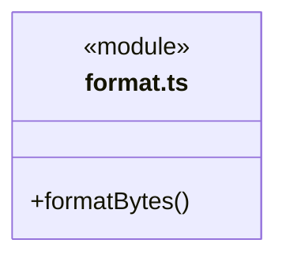
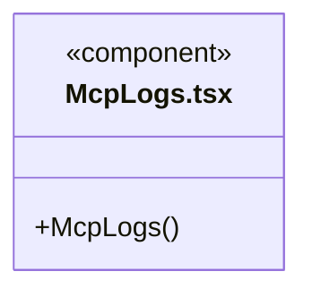
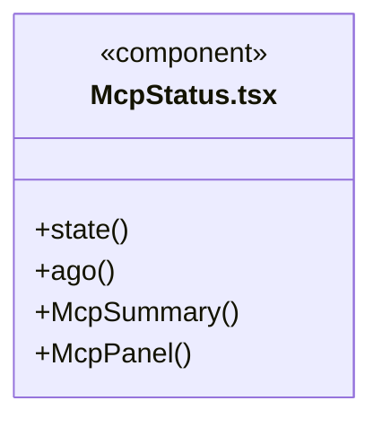
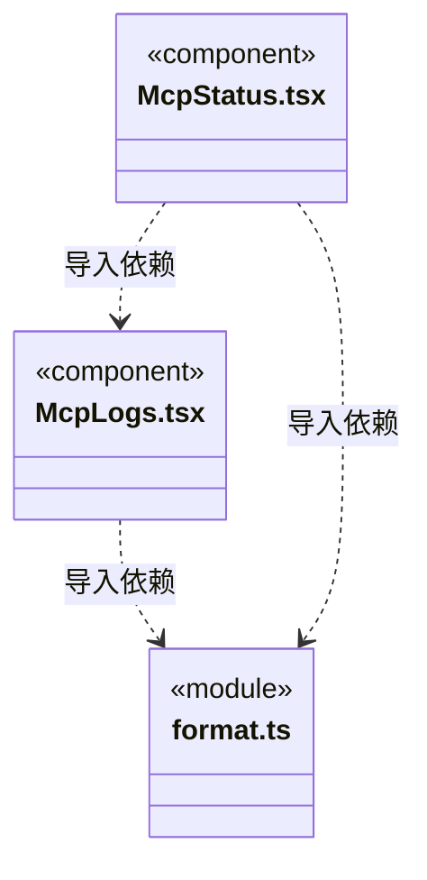

# src/frontend/diagnostics 架构

## 目录定位

MCP 健康、流量与调用日志的诊断展示，不把服务在线视为知识校验通过。

本文描述当前实现。通过分析目录边界后维护的 [源码架构脚本](../../../scripts/source-architecture.mjs) 同步清单和声明；代码变更时仍须核对职责、关键成员与关系。

## 代码清单

| 文件 | 当前职责 |
| --- | --- |
| [format.ts](format.ts) | 资料文件；不直接执行应用逻辑。 |
| [McpLogs.tsx](McpLogs.tsx) | 查询和筛选当前工作区的 MCP 调用日志。 |
| [McpStatus.tsx](McpStatus.tsx) | 工作区 MCP 状态摘要、流量、问题详情和重启入口。 |

## 架构类图

### format.ts

### McpLogs.tsx

直接依赖：[../../bridge/contracts/workspace.ts](../../bridge/contracts/workspace.ts)、[format.ts](format.ts)。

### McpStatus.tsx

直接依赖：[../../bridge/contracts/workspace.ts](../../bridge/contracts/workspace.ts)、[McpLogs.tsx](McpLogs.tsx)、[format.ts](format.ts)。

### 本目录调用边界

## 子目录导航

无子目录。

[返回上层](../ARCHITECTURE.md)。

每次修改本目录代码，同步维护文件头、关键契约说明及本图。未实现的治理、证据验收和自动编排能力不列入当前类图。
