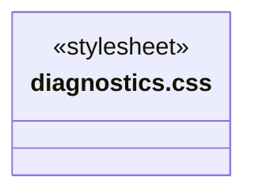
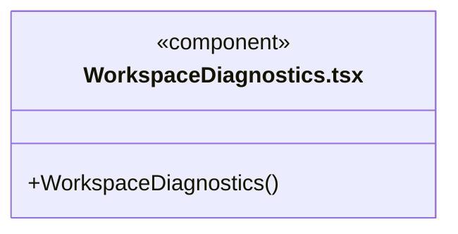
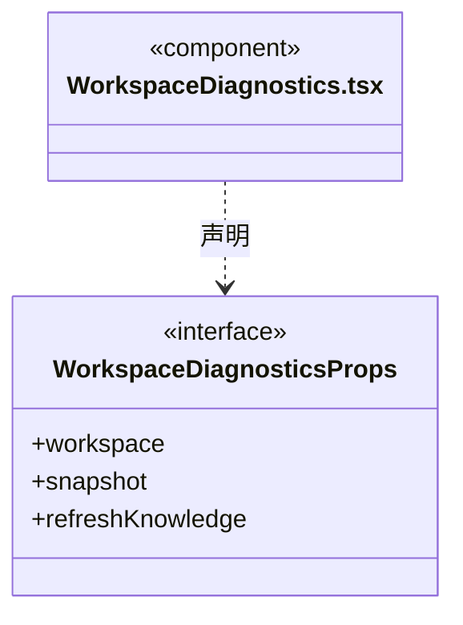
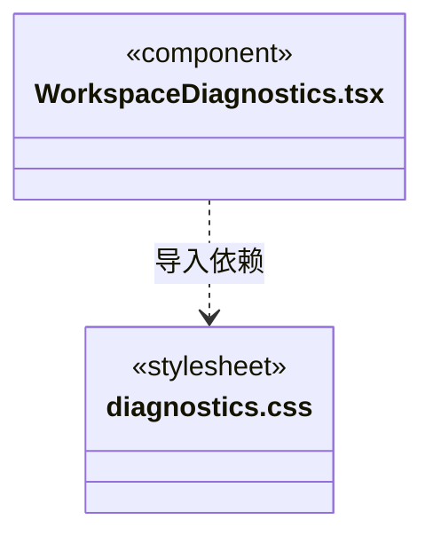

# src/frontend/diagnostics 架构

## 目录定位

只读展示工作区运行状态和知识校验问题，不把工作区就绪视为知识校验通过。

本文描述当前实现。通过分析目录边界后维护的 [源码架构脚本](../../../scripts/source-architecture.mjs) 同步清单和声明；代码变更时仍须核对职责、关键成员与关系。

## 代码清单

| 文件 | 当前职责 |
| --- | --- |
| [diagnostics.css](diagnostics.css) | 工作区运行状态与知识校验详情的扩展面板样式。 |
| [WorkspaceDiagnostics.tsx](WorkspaceDiagnostics.tsx) | 只读展示工作区内部运行状态和知识校验问题。 |

## 架构类图

### diagnostics.css

### WorkspaceDiagnostics.tsx

直接依赖：[../../bridge/contracts/workspace.ts](../../bridge/contracts/workspace.ts)、[diagnostics.css](diagnostics.css)。

### 本目录调用边界

## 子目录导航

无子目录。

[返回上层](../ARCHITECTURE.md)。

每次修改本目录代码，同步维护文件头、关键契约说明及本图。未实现的治理、证据验收和自动编排能力不列入当前类图。
