# src/frontend/execution-view 架构

## 目录定位

主对话、成员任务和团队履历共用的消息、工具轨道、状态、问答及输入展示。只依赖公开通信契约和通用组件；查询、恢复和处置控制器由页面组合，不反向依赖 conversation、tasks 或 team。主对话、成员与历史共用的消息、工具轨道及运行状态；只消费公开快照和最小展示插槽，不依赖任务或会话控制器。原核实与恢复由页面显式组合，Markdown 的用户链接点击继续通过固定 Bridge。

本文描述当前实现。通过分析目录边界后维护的 [源码架构脚本](../../../scripts/source-architecture.mjs) 同步清单和声明；代码变更时仍须核对职责、关键成员与关系。

## 代码清单

| 文件 | 当前职责 |
| --- | --- |
| [ComposerAttachments.tsx](ComposerAttachments.tsx) | 按 Cindy ThumbnailStrip 的 56px 卡片、类型标识和角落移除按钮展示草稿附件。 |
| [knowledge-tool-view.css](knowledge-tool-view.css) | 对应界面的布局与视觉样式。 |
| [knowledge-tool-view.ts](knowledge-tool-view.ts) | 从已结束的原知识调用中提取预览诊断或已提交回执，供工具轨道和工作摘要展示。 |
| [MarkdownMessage.tsx](MarkdownMessage.tsx) | 将 Agent 消息渲染成排版后的正文、列表、表格与可复制代码块。 |
| [message-queue.css](message-queue.css) | 与输入框一体的紧凑队列，匹配参考图的单行消息、拖柄及悬停圆形操作。 |
| [MessageQueue.tsx](MessageQueue.tsx) | 展示主进程持久化的待执行消息，提供插队、排序、移除及继续操作。 |
| [QuestionCard.tsx](QuestionCard.tsx) | 展示 Agent 的结构化问题，以选项卡及最后一项其它输入收集答案。 |
| [questions.css](questions.css) | 结构化问题卡片的主题、选中态和输入排版。 |
| [repairStreamingMarkdown.ts](repairStreamingMarkdown.ts) | 显示正在流入的 Markdown 时临时补齐未闭合语法。 |
| [tool-labels.ts](tool-labels.ts) | 工具轨道和实时活动预览共用的公开动作名称。 |
| [ToolTimeline.tsx](ToolTimeline.tsx) | 把工具申请、授权、运行、输出及完成记录合并成可展开的执行时间线。 |
| [transcript.ts](transcript.ts) | 将持久化执行事件投影为对话消息、工具证据与运行错误。 |
| [WorkStatus.tsx](WorkStatus.tsx) | 移植 Cindy WorkGroupBlock 的用时和结果；主对话只显示行尾状态，成员详情仍可折叠查看执行轨道。 |

## 架构类图

### ComposerAttachments.tsx

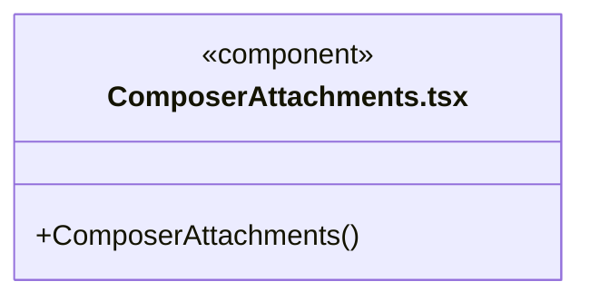

直接依赖：[../../bridge/contracts/chat.ts](../../bridge/contracts/chat.ts)、[../components/Icon.tsx](../components/Icon.tsx)。

### knowledge-tool-view.css

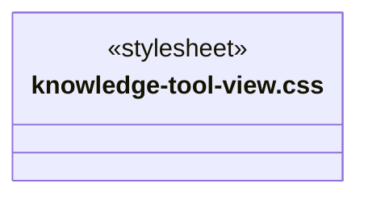

### knowledge-tool-view.ts

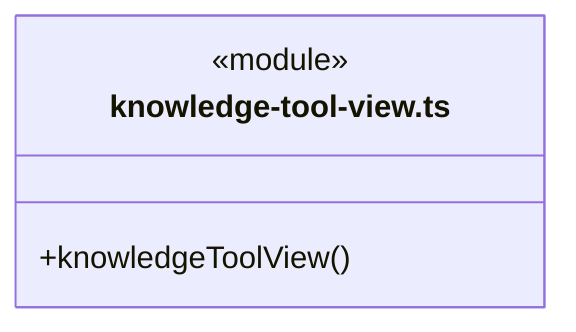

直接依赖：[../../bridge/contracts/knowledge-transactions.ts](../../bridge/contracts/knowledge-transactions.ts)。

### MarkdownMessage.tsx

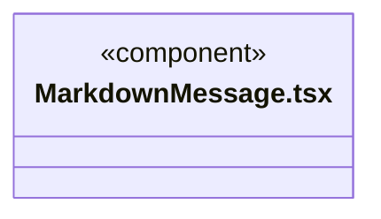
直接依赖：[repairStreamingMarkdown.ts](repairStreamingMarkdown.ts)。

### message-queue.css

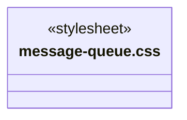

### MessageQueue.tsx

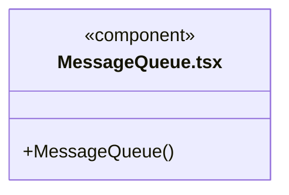

直接依赖：[../../bridge/contracts/execution.ts](../../bridge/contracts/execution.ts)、[message-queue.css](message-queue.css)。

### QuestionCard.tsx

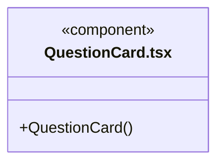

直接依赖：[../../bridge/contracts/execution.ts](../../bridge/contracts/execution.ts)、[questions.css](questions.css)。

### questions.css

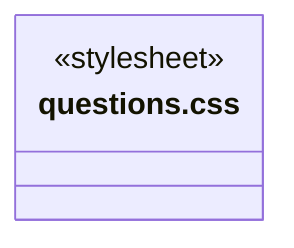

### repairStreamingMarkdown.ts

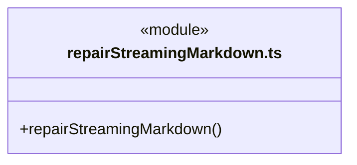

### tool-labels.ts

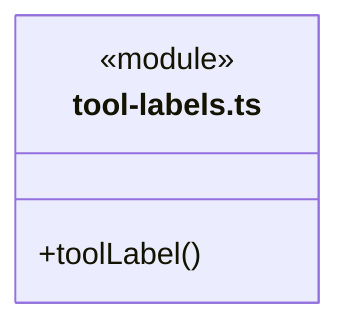

### ToolTimeline.tsx

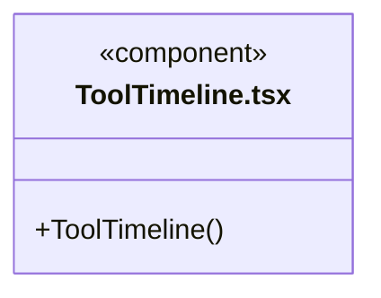

直接依赖：[tool-labels.ts](tool-labels.ts)、[../../bridge/contracts/execution.ts](../../bridge/contracts/execution.ts)、[../components/RepositoryScopeDetails.tsx](../components/RepositoryScopeDetails.tsx)、[knowledge-tool-view.ts](knowledge-tool-view.ts)、[knowledge-tool-view.css](knowledge-tool-view.css)。

### transcript.ts

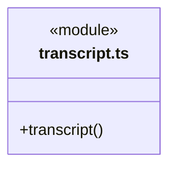

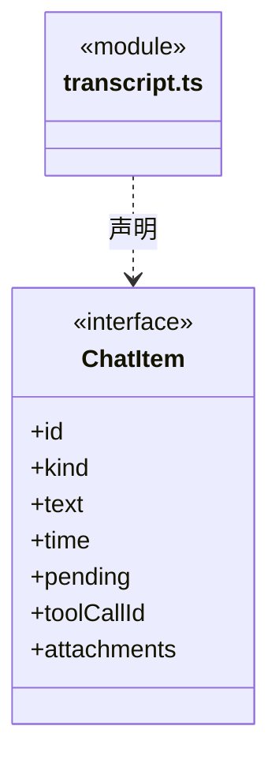

直接依赖：[../../bridge/contracts/execution.ts](../../bridge/contracts/execution.ts)、[../../bridge/contracts/models.ts](../../bridge/contracts/models.ts)。

### WorkStatus.tsx

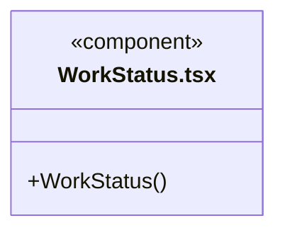

直接依赖：[../../bridge/contracts/execution.ts](../../bridge/contracts/execution.ts)、[../components/Icon.tsx](../components/Icon.tsx)、[tool-labels.ts](tool-labels.ts)、[ToolTimeline.tsx](ToolTimeline.tsx)。

### 本目录调用边界

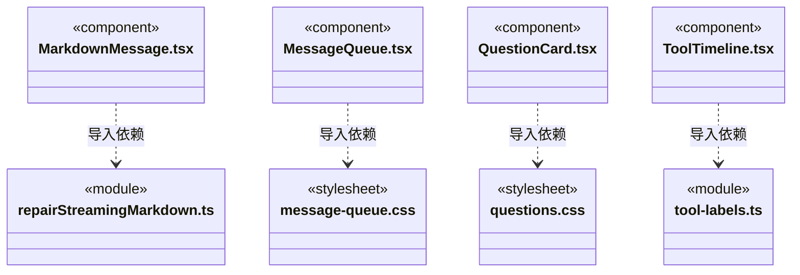

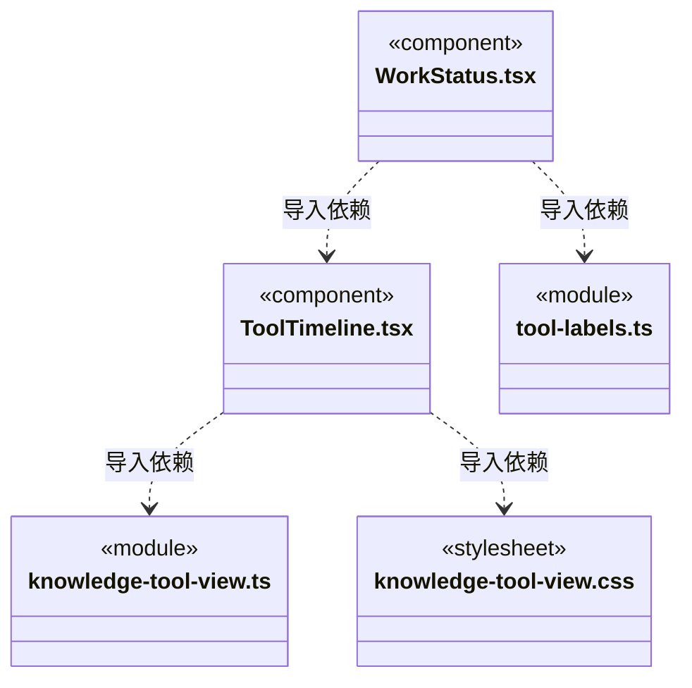

## 子目录导航

无子目录。

[返回上层](../ARCHITECTURE.md)。

每次修改本目录代码，同步维护文件头、关键契约说明及本图。未实现的治理、证据验收和自动编排能力不列入当前类图。

## 设计契约 v1 与落地范围

以下内容区分已接通能力与后续设计；以各节的实现状态为准，不将目标图当作现状图。维护源：[CONTRACT.md](CONTRACT.md)；生成类图时同步附加，勿直接修改本附录。

# 共享执行展示边界

本目录承接主对话、成员详情和团队履历的真实公共消费者。transcript 只投影公开日志；MarkdownMessage 保留流式修复、受控链接和复制；WorkStatus 与 ToolTimeline 只显示传入运行事实，回合结束不代表业务目标验收。

WorkStatus 接收可选 activityDetails，ToolTimeline 接收按原调用 ID 的 renderControls。任务领域在 tasks/ToolActivity 组合命令核实、影响观察及恢复上下文；共享层不导入任务状态或页面，不查询或启动恢复。主对话负责组合任务域控制，成员履历默认只读轨道，无伪造主来源的核实入口。

QuestionCard、ComposerAttachments 和 MessageQueue 只保持已有展示和显式交互：本地选择不提交，附件预览仅显式读取已保存快照，排队操作由调用方回调执行。原 CSS 类名、事件顺序、身份核对、错误展示和原始回执保留。

## 知识操作状态

knowledge-tool-view 仅接受原 finished 调用的完整、同工作区知识输出。预览的 structural:false 展示为警告，并逐项保留 validation.issues；提交的 committed 回执展示事务与知识版本，不能推导业务验收。缺失、异常、跨工作区和混杂文本均不推断成功。ToolTimeline 给控制插槽提供 attention；失败、中断或返回丢失突出核实入口，成功操作默认折叠。
