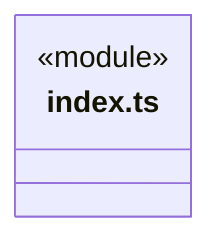
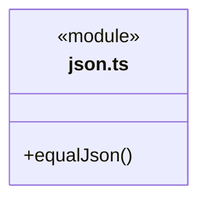
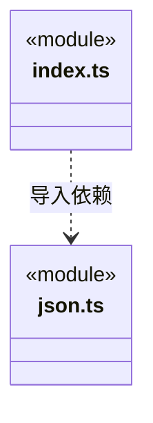

# src/frontend/foundations/utility 架构

## 目录定位

前端通用工具按类别内聚：json.ts 提供保留现有 localeCompare、undefined 与数组规则的 JSON 比较，index.ts 是公开入口。请求、预览与回执的业务判断留在消费者；与后端 utility 分别实现、测试和演进。

本文描述当前实现。通过分析目录边界后维护的 [源码架构脚本](../../../../scripts/source-architecture.mjs) 同步清单和声明；代码变更时仍须核对职责、关键成员与关系。

## 代码清单

| 文件 | 当前职责 |
| --- | --- |
| [index.ts](index.ts) | 前端域通用工具函数与数据结构的公开入口，当前提供 JSON 值比较。 |
| [json.ts](json.ts) | 前端域的 JSON 比较工具，供页面控制器核对请求、预览和回执中的值。 |

## 架构类图

### index.ts

直接依赖：[json.ts](json.ts)。

### json.ts

### 本目录调用边界

## 子目录导航

无子目录。

[返回上层](../ARCHITECTURE.md)。

每次修改本目录代码，同步维护文件头、关键契约说明及本图。未实现的治理、证据验收和自动编排能力不列入当前类图。

## 设计契约 v1 与落地范围

以下内容区分已接通能力与后续设计；以各节的实现状态为准，不将目标图当作现状图。维护源：[CONTRACT.md](CONTRACT.md)；生成类图时同步附加，勿直接修改本附录。

# 前端通用工具库

本库仅服务前端域，按数据或问题类别组织工具函数和数据结构，不采用一函数一文件。公开入口为 `index.ts`，`json.ts` 是私有实现。当前仅依赖 JavaScript 标准能力，不依赖 React、页面、通信契约、Node 或后端 `src/foundations`，没有全局可变状态。

## JSON 比较

`equalJson(left, right)` 递归复制对象并用 `localeCompare` 排列键，省略对象中的 undefined 属性，数组保序，然后比较 `JSON.stringify` 输出。不修改输入，不生成身份、授权、哈希或持久化记录，不校验字段有效性。

真实消费者为岗位登记、模块责任、目标接续、人工决定、人工继续五个控制器。它们原有的同类本地算法收敛到此入口；身份、版本、原请求匹配、回执合法性及未知结果处理仍归各控制器。

## 兼容边界

- 数组空位与 undefined 按原 JSON 序列化规则表示为 null；非有限数字同样遵循 JSON.stringify。顶层 undefined 等不可序列化值的比较沿用旧行为，不意味着合法 JSON。
- 循环、BigInt、读取属性或排序时的异常继续传播，不捕获为 false。不额外添加深度上限或危险键过滤；自有 `__proto__` 等字段按原实现保留。
- 只面向业务已约束的 JSON 形状数据，不是任意 JavaScript 对象的深相等工具。不要用于 Date、Map、自定义原型或 toJSON 的通用语义比较。
- `localeCompare` 依赖环境，可能让不同 Unicode 键比较为同序；保留稳定排序的原插入顺序，不借重构改变规则。因此不提供跨环境 canonical 保证。
- 原样 `JSON.stringify` 比较仍由原消费者保留；负责人视图的字典序及递归序列化/空值规则也未迁移，不能直接替换成此入口。

## 依赖与验证

前端业务单向导入公开入口；基础库不能反向引用页面、bridge 或后端。后端独立沉淀自己的公共库，二者不建立共享工具依赖。增加同类 JSON 算法优先放入 `json.ts`，实际语义不同时保留明确契约，不预设配置开关。

单元测试归属 `frontend/foundations/utility`，只验证比较行为。五组消费者原有测试验证回执、提交及恢复组合；基础库不加载应用或消费者夹具。源码注释、类图和三宿主 AI 工作流随实现同步。
