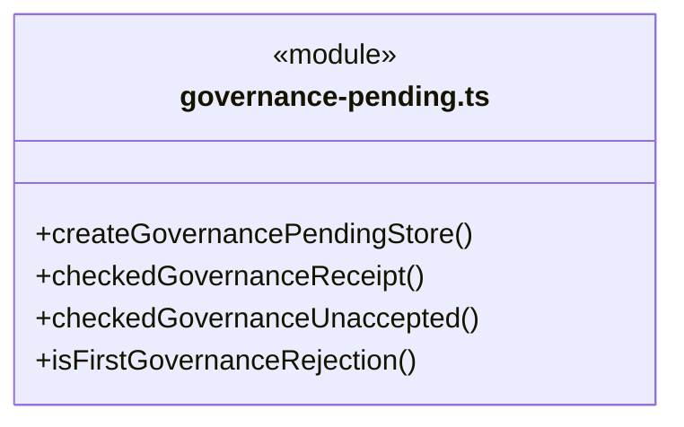
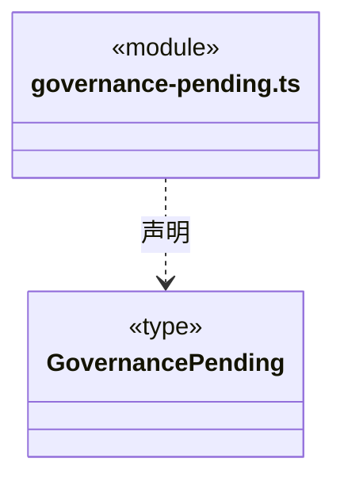
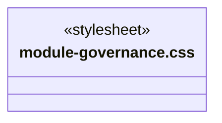
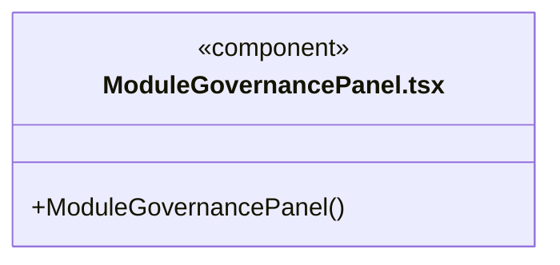
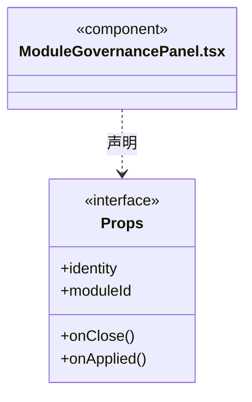
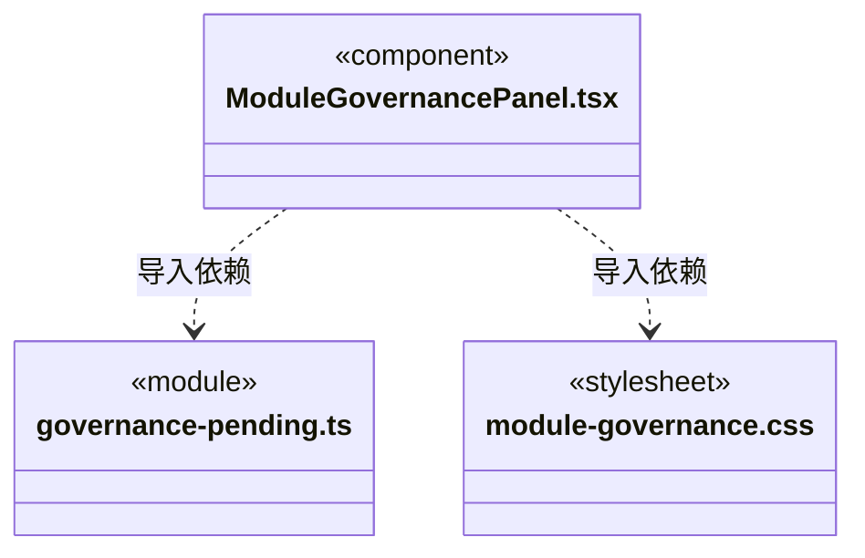

# src/frontend/governance 架构

## 目录定位

静态业务模块的知识治理面板。显式登记、观察和精确差异提案，人工决定与实施分开；原命令先保存再发送，未知只查询，迟到结果不改变新目标。

本文描述当前实现。通过分析目录边界后维护的 [源码架构脚本](../../../scripts/source-architecture.mjs) 同步清单和声明；代码变更时仍须核对职责、关键成员与关系。

## 代码清单

| 文件 | 当前职责 |
| --- | --- |
| [governance-pending.ts](governance-pending.ts) | 模块知识治理写操作的有界本地待确认元数据，供面板卸载或应用重开后查询原命令。 |
| [module-governance.css](module-governance.css) | 对应界面的布局与视觉样式。 |
| [ModuleGovernancePanel.tsx](ModuleGovernancePanel.tsx) | 业务架构节点的模块知识治理面板，展示真实观察、精确正文提案、本机决定与独立实施结果。 |

## 架构类图

### governance-pending.ts

直接依赖：[../../bridge/contracts/governance.ts](../../bridge/contracts/governance.ts)。

### module-governance.css

### ModuleGovernancePanel.tsx

直接依赖：[../../bridge/contracts/governance.ts](../../bridge/contracts/governance.ts)、[governance-pending.ts](governance-pending.ts)、[module-governance.css](module-governance.css)。

### 本目录调用边界

## 子目录导航

无子目录。

[返回上层](../ARCHITECTURE.md)。

每次修改本目录代码，同步维护文件头、关键契约说明及本图。未实现的治理、证据验收和自动编排能力不列入当前类图。

## 设计契约 v1 与落地范围

以下内容区分已接通能力与后续设计；以各节的实现状态为准，不将目标图当作现状图。维护源：[CONTRACT.md](CONTRACT.md)；生成类图时同步附加，勿直接修改本附录。

# 模块知识治理面板

界面只从明确选择的静态 Module 打开，不属于会话任务图。保护登记、观察、精确正文提案、人工决定与实施分别发送命令；批准不会自动写知识，结构验证与知识提交不会被显示为业务验收。

每个新操作清除上次的成功提示。当前回复丢失时，只显示当前错误和待确认状态，不同时保留旧命令的“已确认”提示；历史回执仍有原命令身份。

`governance-pending.ts` 只持久化公开身份和原命令元数据，不持久化知识正文或批准证明。每工作区最多一个待确认命令，整体 64 条和 256 KiB 上限；先同步保存后发送，坏数据或存储失败不覆盖旧记录。迟到结果必须匹配完整原请求才可解除。重开仅恢复记录和查看当前状态，不自动重发；查不到回执不证明未受理。

`ModuleGovernancePanel` 从真实新观察载入正文，提案基线始终使用该观察的知识/保护版本；刷新列表不替换正在编辑的草稿。明确选择历史提案后展示完整前后正文、取舍、不变量和恢复说明。保存人工决定前须明确勾选已审阅；批准后还需另一次点击实施。只有原 journal 的 committed 回执显示知识已提交，pending、未提交、回滚和恢复异常分别表达，均不写作业务验收。

跨模块的待确认请求可以核实原回执，但不能把另一模块的观察、正文或提案装到当前面板。卸载/重开仅恢复元数据并查询状态，原实例退役且服务明确核实未受理才能解除没有回执的旧请求。

仅首次 RPC 返回明确的预受理拒绝码时可解除本次元数据；接收回执或刷新之后的失败、已未知/重开请求以及 IO/损坏/实施待核实均不使用此分支。后端须保证实施意图保存后的不确定错误统一为未知或返回真实事务状态，不能伪装成前置拒绝。
