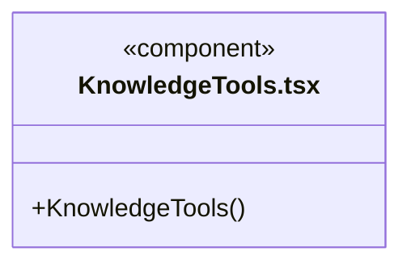
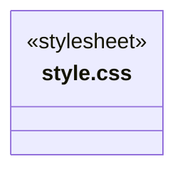
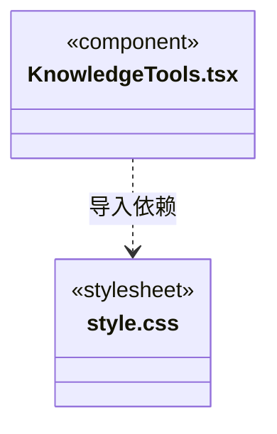

# src/frontend/knowledge 架构

## 目录定位

知识问题、预览提交和维护工具界面；业务架构展示位于 workspace。

本文描述当前实现。通过分析目录边界后维护的 [源码架构脚本](../../../scripts/source-architecture.mjs) 同步清单和声明；代码变更时仍须核对职责、关键成员与关系。

## 代码清单

| 文件 | 当前职责 |
| --- | --- |
| [KnowledgeTools.tsx](KnowledgeTools.tsx) | 知识查询、校验、预览和提交界面，维护未提交修改提示。 |
| [style.css](style.css) | 知识管理组件的布局、编辑器、问题列表与事务预览样式。 |

## 架构类图

### KnowledgeTools.tsx

直接依赖：[../../bridge/contracts/workspace.ts](../../bridge/contracts/workspace.ts)、[style.css](style.css)。

### style.css

### 本目录调用边界

## 子目录导航

无子目录。

[返回上层](../ARCHITECTURE.md)。

每次修改本目录代码，同步维护文件头、关键契约说明及本图。未实现的治理、证据验收和自动编排能力不列入当前类图。
