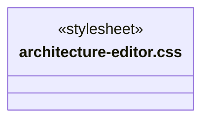
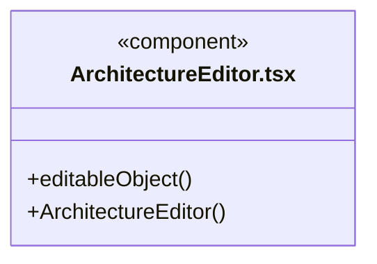
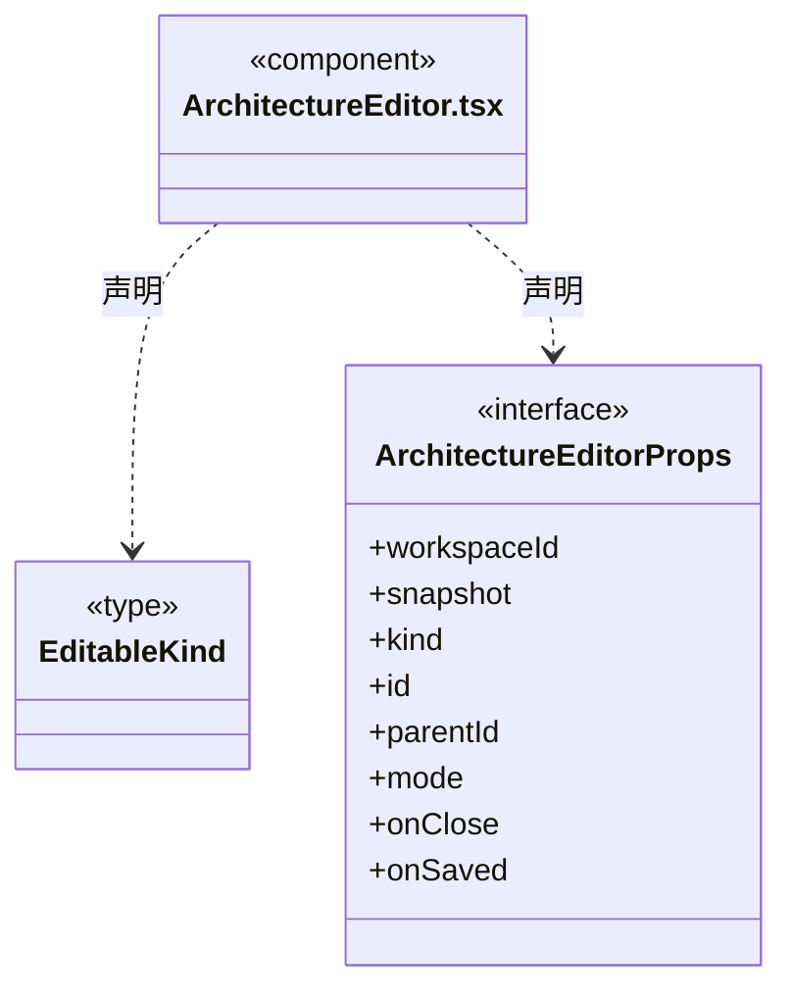
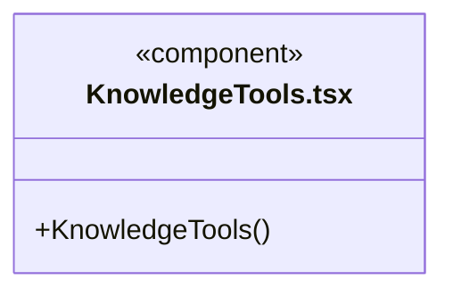
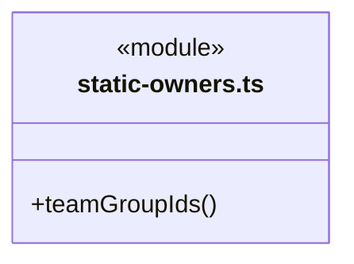
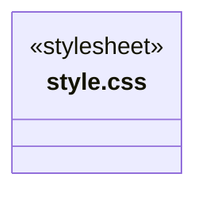
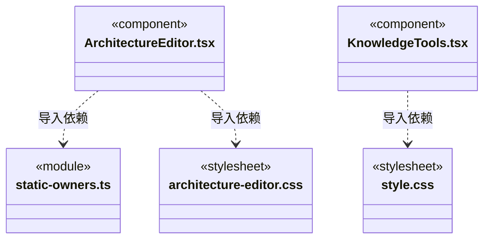

# src/frontend/knowledge 架构

## 目录定位

知识问题、预览提交和静态对象表单；固定编辑基线，模块维护人同事务确认，删除先检查影响。业务架构展示位于 workspace。

本文描述当前实现。通过分析目录边界后维护的 [源码架构脚本](../../../scripts/source-architecture.mjs) 同步清单和声明；代码变更时仍须核对职责、关键成员与关系。

## 代码清单

| 文件 | 当前职责 |
| --- | --- |
| [architecture-editor.css](architecture-editor.css) | 架构语义表单与导入/提交预览的共用布局。设计原因：在窄扩展区仍以独立对话框展示明确的变更边界，沿用应用主题与键盘表单。 */ |
| [ArchitectureEditor.tsx](ArchitectureEditor.tsx) | 团队与业务架构共用的语义对象编辑器，负责表单、删除影响预览和显式事务提交。 |
| [KnowledgeTools.tsx](KnowledgeTools.tsx) | 知识查询、校验、预览和提交界面，维护未提交修改提示。 |
| [static-owners.ts](static-owners.ts) | 为静态架构编辑和资源导入提供可选的 Team/小组归属。 |
| [style.css](style.css) | 知识管理组件的布局、编辑器、问题列表与事务预览样式。 |

## 架构类图

### architecture-editor.css

### ArchitectureEditor.tsx

直接依赖：[../../bridge/contracts/workspace.ts](../../bridge/contracts/workspace.ts)、[static-owners.ts](static-owners.ts)、[architecture-editor.css](architecture-editor.css)。

### KnowledgeTools.tsx

直接依赖：[../../bridge/contracts/workspace.ts](../../bridge/contracts/workspace.ts)、[style.css](style.css)。

### static-owners.ts

直接依赖：[../../bridge/contracts/workspace.ts](../../bridge/contracts/workspace.ts)。

### style.css

### 本目录调用边界

## 子目录导航

无子目录。

[返回上层](../ARCHITECTURE.md)。

每次修改本目录代码，同步维护文件头、关键契约说明及本图。未实现的治理、证据验收和自动编排能力不列入当前类图。

## 设计契约 v1 与落地范围

以下内容区分已接通能力与后续设计；以各节的实现状态为准，不将目标图当作现状图。维护源：[CONTRACT.md](CONTRACT.md)；生成类图时同步附加，勿直接修改本附录。

# 静态架构编辑

`ArchitectureEditor` 从打开时的知识快照填入 Agent、Module、Skill 或 Workflow 表单。草稿固定 `workspaceId / instanceId / revision`；后台刷新不能改写正在编辑的字段。每次修改使旧预览失效，提交只发送后端返回的 `planId`。知识校验和事务边界由后端维护。

新增/编辑模块时一并选择真人维护人并明确确认；必要时新增花名册条目，与模块同事务保存。确认维护责任不授予任何执行权限。删除先展示引用和文件差异，含下级对象时要求明确选择级联；业务源码不在删除范围。

`static-owners` 从静态定义路径计算 Team 和分组候选，保留没有自己 Skill 清单的祖先组，排除 Agent 叶子。团队与业务定义是工作区共享知识，不读取或创建成员实例与主会话任务图。
