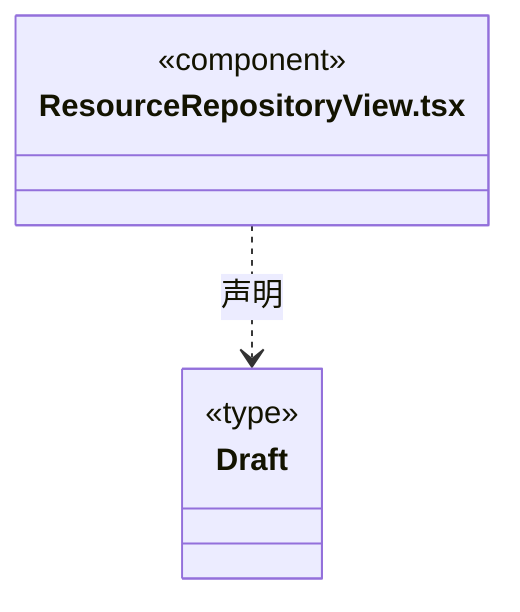

# src/frontend/resources 架构

## 目录定位

三类共享资源的查看与编辑界面。仓库设置通过统一设置入口打开。

本文描述当前实现。通过分析目录边界后维护的 [源码架构脚本](../../../scripts/source-architecture.mjs) 同步清单和声明；代码变更时仍须核对职责、关键成员与关系。

## 代码清单

| 文件 | 当前职责 |
| --- | --- |
| [ResourceRepositoryView.tsx](ResourceRepositoryView.tsx) | 三类资源共用的定义列表与编辑器。 |

## 架构类图

### ResourceRepositoryView.tsx

直接依赖：[../../bridge/contracts/resources.ts](../../bridge/contracts/resources.ts)。

## 子目录导航

无子目录。

[返回上层](../ARCHITECTURE.md)。

每次修改本目录代码，同步维护文件头、关键契约说明及本图。未实现的治理、证据验收和自动编排能力不列入当前类图。
