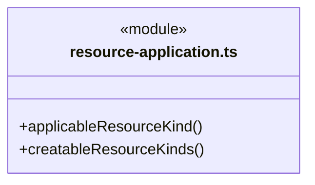
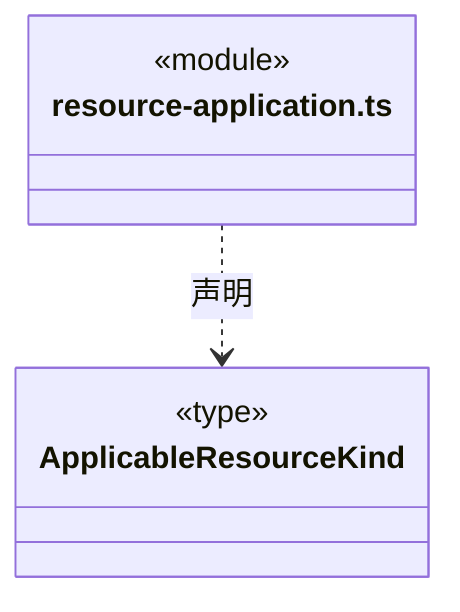
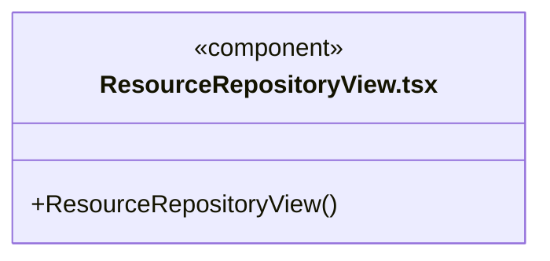
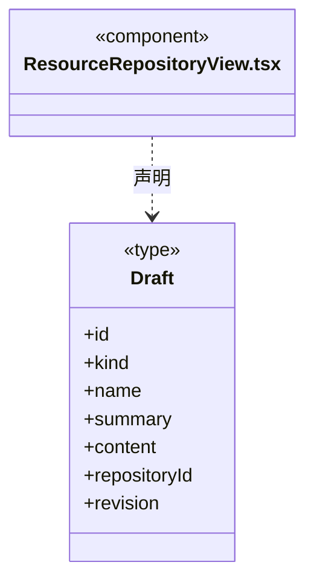
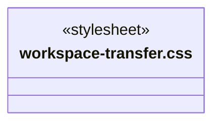
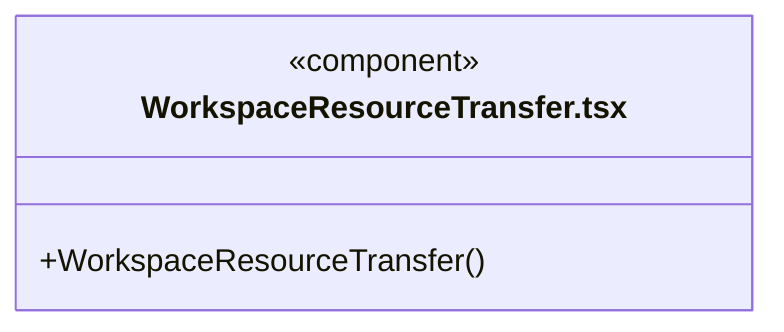
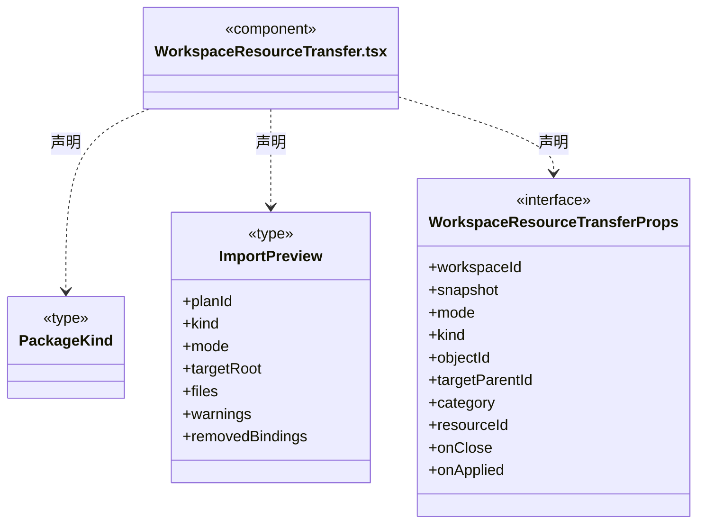
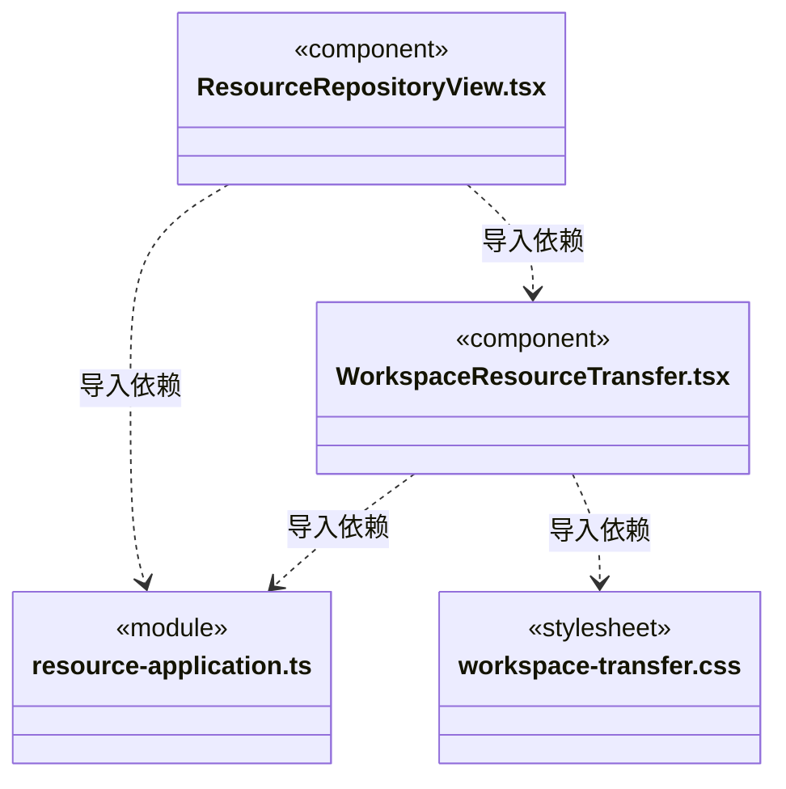

# src/frontend/resources 架构

## 目录定位

统一资源仓库的查看、编辑、静态包发布与下载应用。人才按团队/Agent/Skill复用，业务按整套架构应用；工作区身份及预览版本固定。设置通过统一入口打开。

本文描述当前实现。通过分析目录边界后维护的 [源码架构脚本](../../../scripts/source-architecture.mjs) 同步清单和声明；代码变更时仍须核对职责、关键成员与关系。

## 代码清单

| 文件 | 当前职责 |
| --- | --- |
| [resource-application.ts](resource-application.ts) | 资源列表的静态包识别与可创建种类策略，供列表和测试复用。 |
| [ResourceRepositoryView.tsx](ResourceRepositoryView.tsx) | 三类资源共用的定义列表与编辑器，并为静态人才包/完整业务架构提供选择目标工作区的应用入口。 |
| [workspace-transfer.css](workspace-transfer.css) | 静态资源发布/导入的选择列表与回执。设计原因：共享库来源、应用目标和整包替换在窄屏上仍可明确辨认。 */ |
| [WorkspaceResourceTransfer.tsx](WorkspaceResourceTransfer.tsx) | 静态团队能力与完整业务架构在当前工作区和共用仓库之间的发布、下载及应用界面。 |

## 架构类图

### resource-application.ts

直接依赖：[../../bridge/contracts/resources.ts](../../bridge/contracts/resources.ts)。

### ResourceRepositoryView.tsx

直接依赖：[../../bridge/contracts/resources.ts](../../bridge/contracts/resources.ts)、[../../bridge/contracts/workspace.ts](../../bridge/contracts/workspace.ts)、[WorkspaceResourceTransfer.tsx](WorkspaceResourceTransfer.tsx)、[resource-application.ts](resource-application.ts)。

### workspace-transfer.css

### WorkspaceResourceTransfer.tsx

直接依赖：[../../bridge/contracts/workspace.ts](../../bridge/contracts/workspace.ts)、[../../bridge/contracts/resources.ts](../../bridge/contracts/resources.ts)、[../knowledge/static-owners.ts](../knowledge/static-owners.ts)、[resource-application.ts](resource-application.ts)、[../knowledge/architecture-editor.css](../knowledge/architecture-editor.css)、[workspace-transfer.css](workspace-transfer.css)。

### 本目录调用边界

## 子目录导航

无子目录。

[返回上层](../ARCHITECTURE.md)。

每次修改本目录代码，同步维护文件头、关键契约说明及本图。未实现的治理、证据验收和自动编排能力不列入当前类图。

## 设计契约 v1 与落地范围

以下内容区分已接通能力与后续设计；以各节的实现状态为准，不将目标图当作现状图。维护源：[CONTRACT.md](CONTRACT.md)；生成类图时同步附加，勿直接修改本附录。

# 资源仓库界面契约

- 链接器、人才市场和业务模板共用同一个当前仓库；资源保存不等于应用到项目或授予执行权限。
- 全局列表只为 `format: cbim-workspace-package` 且包类型与资源条目一致的 team、agent、skill、architecture 显示“应用到工作区”。这只是界面识别，格式、指纹、正文引用和目标知识仍由后端预览校验。
- 选择应用目标时读取工作区登记清单，只允许当前已就绪的工作区。继续时取得该目标的 `Snapshot`，核对 `workspaceId` 后交给 `WorkspaceResourceTransfer`。不使用主界面当前选择隐式定位目标，也不自动打开工作区或启动 Agent。
- `WorkspaceResourceTransfer` 固定目标知识版本和资源仓库版本，先预览再由用户明确提交；整包替换必须显式选择。导入成功保留结果、移除绑定和警告说明。源项目人员、工具绑定、授权、实例、任务及会话均不作为复用资源导入。
- 人才可整体发布 Team、单独发布 Agent 或 Skill；业务模板只整体应用完整 architecture。旧 module/workflow 资源可浏览编辑和删除，不能新增、复制或直接应用单一模块/流程；已有纯文本资源也不自动转换为知识包。
- `resource-application.ts` 为纯展示策略，不能作为后端校验或权限依据。列表不会把某个资源标记为“从未应用”：同一静态包可以在多个项目被独立使用。
- 页面切换或卸载使进行中的目标选择读取失效，迟到响应不能打开另一页面的应用弹窗。对目标的知识写入仅来自随后共享弹窗的显式提交。
- 资源包正文在仓库文本编辑器中只读，仍可编辑展示名称/说明。需要定制内容时先应用到工作区，经语义编辑后重新发布，避免直接改 JSON 破坏指纹和引用关系。自由文本编辑上限与仓库的 2 Mi 字符保持一致。
