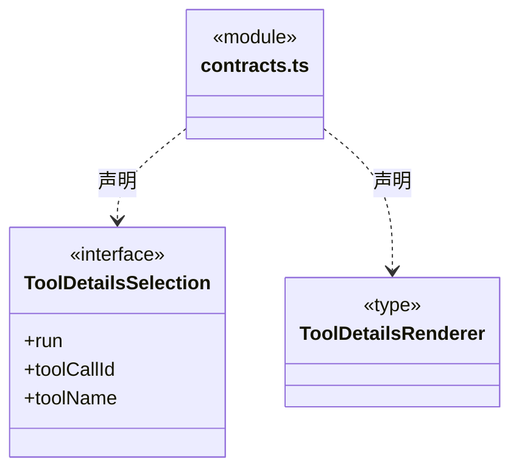
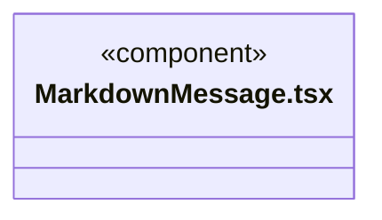
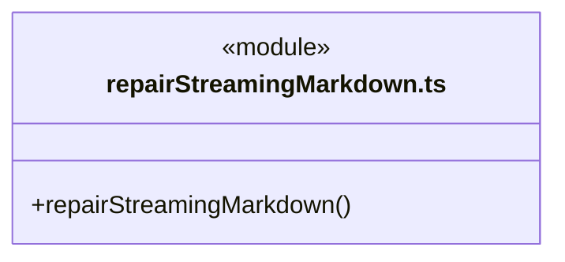
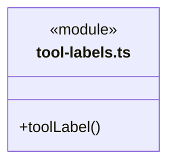
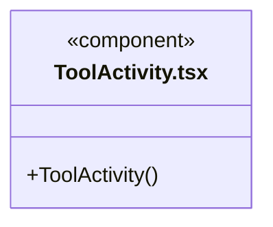
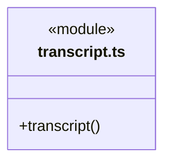
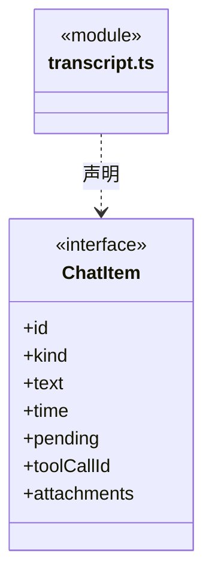
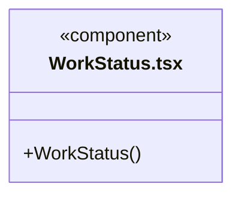
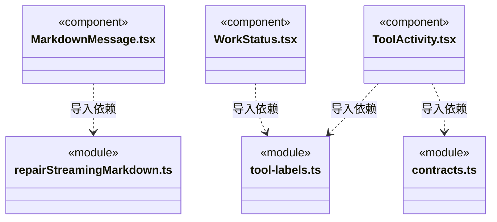
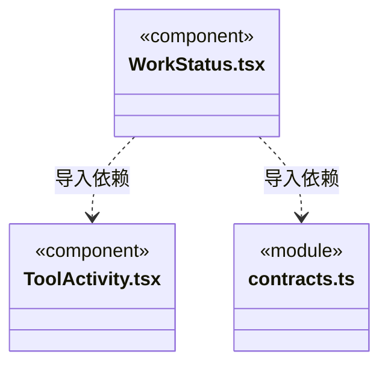

# src/frontend/run-view 架构

## 目录定位

主对话、成员与历史共用的消息、工具轨道及运行状态；只消费公开快照和最小展示插槽，不依赖任务或会话控制器。原核实与恢复由页面显式组合，Markdown 的用户链接点击继续通过固定 Bridge。

本文描述当前实现。通过分析目录边界后维护的 [源码架构脚本](../../../scripts/source-architecture.mjs) 同步清单和声明；代码变更时仍须核对职责、关键成员与关系。

## 代码清单

| 文件 | 当前职责 |
| --- | --- |
| [contracts.ts](contracts.ts) | 定义共享运行展示向外层请求补充工具详情的最小输入。 |
| [MarkdownMessage.tsx](MarkdownMessage.tsx) | 将 Agent 消息渲染成排版后的正文、列表、表格与可复制代码块。 |
| [repairStreamingMarkdown.ts](repairStreamingMarkdown.ts) | 显示正在流入的 Markdown 时临时补齐未闭合语法。 |
| [tool-labels.ts](tool-labels.ts) | 工具轨道和实时活动预览共用的公开动作名称。 |
| [ToolActivity.tsx](ToolActivity.tsx) | 把工具申请、授权、运行、输出及完成记录合并成可展开的执行时间线。 |
| [transcript.ts](transcript.ts) | 将持久化执行事件投影为对话消息、工具证据与运行错误。 |
| [WorkStatus.tsx](WorkStatus.tsx) | 移植 Cindy WorkGroupBlock 的用时和结果；主对话只显示行尾状态，成员详情仍可折叠查看执行轨道。 |

## 架构类图

### contracts.ts

直接依赖：[../../bridge/contracts/execution.ts](../../bridge/contracts/execution.ts)。

### MarkdownMessage.tsx

直接依赖：[repairStreamingMarkdown.ts](repairStreamingMarkdown.ts)。

### repairStreamingMarkdown.ts

### tool-labels.ts

### ToolActivity.tsx

直接依赖：[tool-labels.ts](tool-labels.ts)、[contracts.ts](contracts.ts)、[../../bridge/contracts/execution.ts](../../bridge/contracts/execution.ts)、[../components/RepositoryScopeDetails.tsx](../components/RepositoryScopeDetails.tsx)。

### transcript.ts

直接依赖：[../../bridge/contracts/execution.ts](../../bridge/contracts/execution.ts)、[../../bridge/contracts/models.ts](../../bridge/contracts/models.ts)。

### WorkStatus.tsx

直接依赖：[../../bridge/contracts/execution.ts](../../bridge/contracts/execution.ts)、[../components/Icon.tsx](../components/Icon.tsx)、[tool-labels.ts](tool-labels.ts)、[ToolActivity.tsx](ToolActivity.tsx)、[contracts.ts](contracts.ts)。

### 本目录调用边界

## 子目录导航

无子目录。

[返回上层](../ARCHITECTURE.md)。

每次修改本目录代码，同步维护文件头、关键契约说明及本图。未实现的治理、证据验收和自动编排能力不列入当前类图。

## 设计契约 v1 与落地范围

以下内容区分已接通能力与后续设计；以各节的实现状态为准，不将目标图当作现状图。维护源：[CONTRACT.md](CONTRACT.md)；生成类图时同步附加，勿直接修改本附录。

# 共享运行展示契约

`WorkStatus`、`ToolActivity`、`MarkdownMessage`、`transcript`、`tool-labels` 和 `repairStreamingMarkdown` 由主对话、成员任务与历史页面共用。只消费公开运行快照、原始文本和明确的展示输入，不导入 conversation/tasks/team 的控制器、Hook 或内部类型；逻辑边界检查同时覆盖类型依赖。

- `ToolDetailsSelection` 只包含原 run、toolCallId 和 toolName。外层可用 `renderDetails` / `renderToolDetails` 组合业务面板，共享展示不会取得恢复上下文。单调用筛选只生成对应插槽，inline 行尾状态不生成隐藏业务面板。
- `conversation/RunToolDetails` 校验真实主来源后装配原命令核实与影响观察。主对话和任务根显式传递自己的恢复上下文；成员历史沿用原主身份判定，不伪造恢复权。选择、刷新、停止、核实与恢复仍归原业务控制者。
- 失败、拒绝、未知和原工具回执均按原日志展示；终态用时取日志末尾，结束不等于验收。相同输入共用同一展示实现，无第二份任务状态。
- Markdown 的复制和展开为本地展示状态；用户点击链接仍走固定 `chat.openLink`，由 Main 核实工作区及目标。渲染不读取业务文件、不发送执行命令；它不是完全无交互的纯函数。
- transcript 沿原事件和可信反馈回执投影，私有推理过滤与消息排序不因迁移改变。样式继续使用应用既有全局样式。

旧 conversation 中六个文件已退役，仓库内消费者均改为直接导入本目录；无外部公开包兼容承诺，不保留会重新引入业务依赖的转发层。
