# src/frontend/runtime 架构

## 目录定位

全局只读运行管理。分别呈现目标周期、人员、任务、准入等待和已报告消耗；单次在途游标读取保留未变行，隐藏时退订，按真实身份定位既有会话而不执行任务。

本文描述当前实现。通过分析目录边界后维护的 [源码架构脚本](../../../scripts/source-architecture.mjs) 同步清单和声明；代码变更时仍须核对职责、关键成员与关系。

## 代码清单

| 文件 | 当前职责 |
| --- | --- |
| [runtime-feed.ts](runtime-feed.ts) | 维护窗口内只读监管游标、最近确认快照和增量发布，供运行管理页面订阅。 |
| [runtime-overview.css](runtime-overview.css) | 只读全局监管的自适应列表与统计。设计原因：沿用主题变量并在窄屏换行，身份长串不挤压原会话操作。 */ |
| [runtime-view-state.ts](runtime-view-state.ts) | 全局运行页面的纯筛选、状态说明与原会话定位契约。 |
| [RuntimeOverview.tsx](RuntimeOverview.tsx) | 全局只读运行总览，集中显示周期、人员、任务、准入等待及已报告消耗。 |
| [RuntimeRows.tsx](RuntimeRows.tsx) | 全局监管中的独立只读行，分别呈现周期、任务、成员和运行，不混淆各自终态。 |
| [useRuntime.ts](useRuntime.ts) | 把窗口共享的监管快照接入 React，并跟随文档可见性暂停后台读取。 |

## 架构类图

### runtime-feed.ts

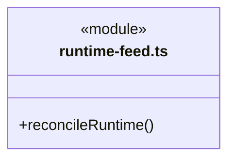

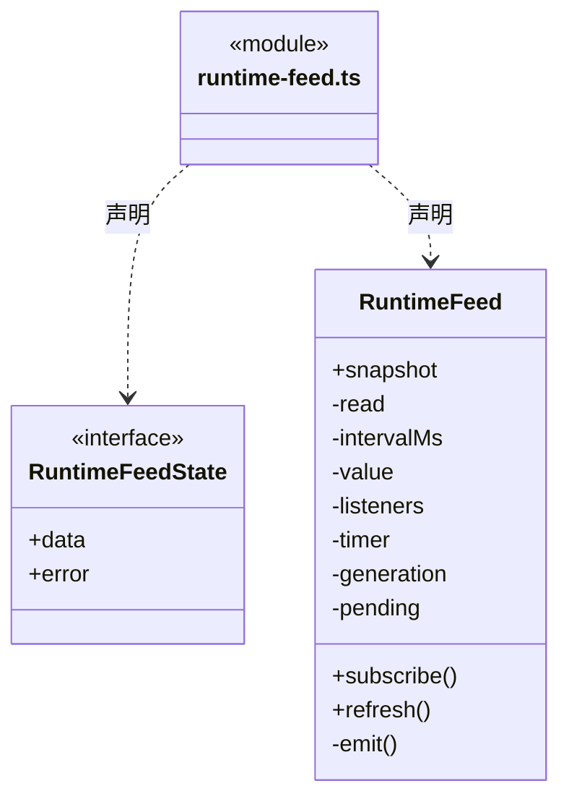

直接依赖：[../foundations/utility/index.ts](../foundations/utility/index.ts)、[../../bridge/contracts/runtime.ts](../../bridge/contracts/runtime.ts)、[runtime-view-state.ts](runtime-view-state.ts)。

### runtime-overview.css

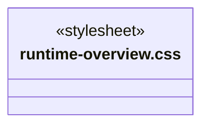

### runtime-view-state.ts

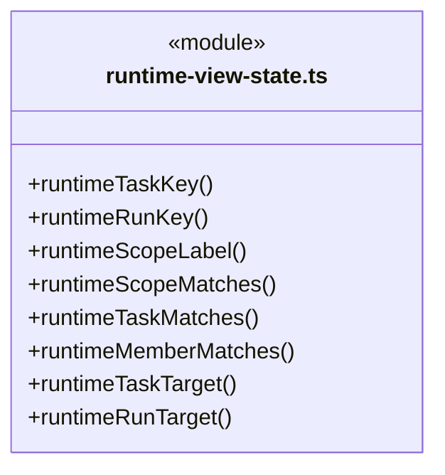

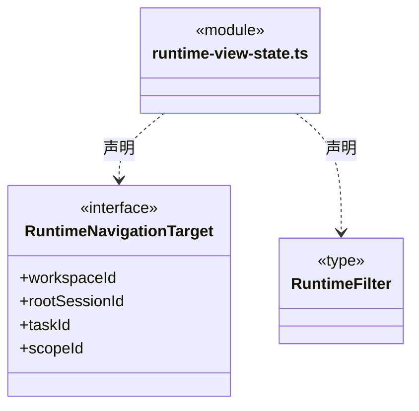

直接依赖：[../../bridge/contracts/runtime.ts](../../bridge/contracts/runtime.ts)。

### RuntimeOverview.tsx

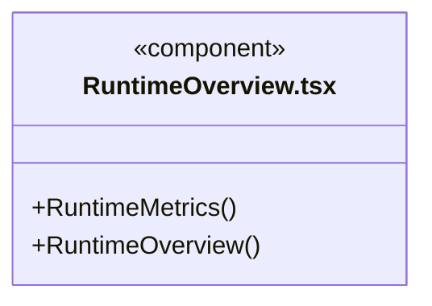

直接依赖：[../../bridge/contracts/runtime.ts](../../bridge/contracts/runtime.ts)、[../../bridge/contracts/usage.ts](../../bridge/contracts/usage.ts)、[../tasks/useAdmission.ts](../tasks/useAdmission.ts)、[useRuntime.ts](useRuntime.ts)、[runtime-view-state.ts](runtime-view-state.ts)、[RuntimeRows.tsx](RuntimeRows.tsx)、[runtime-overview.css](runtime-overview.css)。

### RuntimeRows.tsx

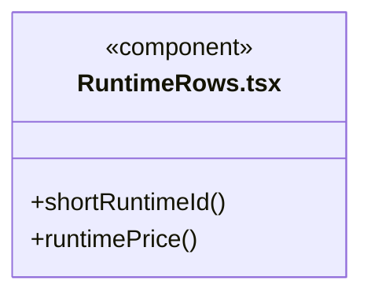

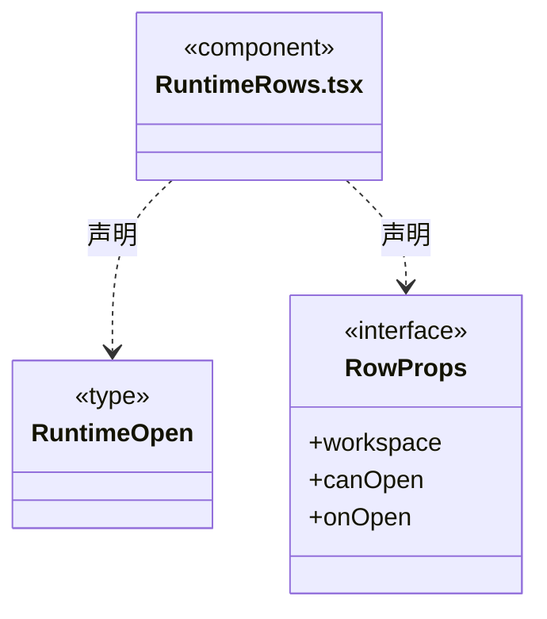

直接依赖：[../../bridge/contracts/runtime.ts](../../bridge/contracts/runtime.ts)、[../../bridge/contracts/admission.ts](../../bridge/contracts/admission.ts)、[../../bridge/contracts/usage.ts](../../bridge/contracts/usage.ts)、[runtime-view-state.ts](runtime-view-state.ts)。

### useRuntime.ts

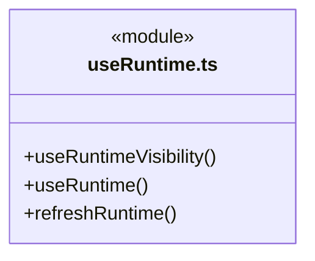

直接依赖：[runtime-feed.ts](runtime-feed.ts)。

### 本目录调用边界

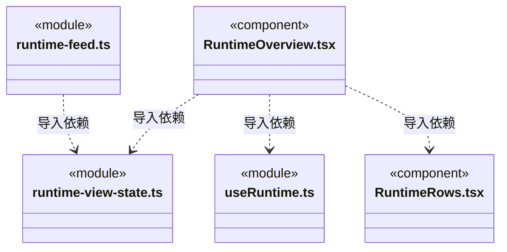

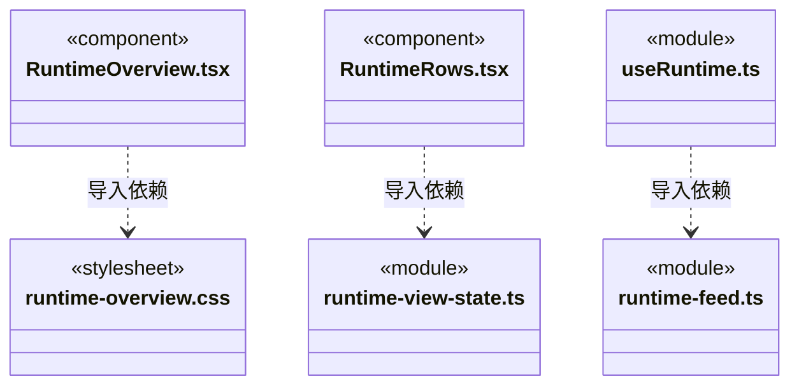

## 子目录导航

无子目录。

[返回上层](../ARCHITECTURE.md)。

每次修改本目录代码，同步维护文件头、关键契约说明及本图。未实现的治理、证据验收和自动编排能力不列入当前类图。

## 设计契约 v1 与落地范围

以下内容区分已接通能力与后续设计；以各节的实现状态为准，不将目标图当作现状图。维护源：[CONTRACT.md](CONTRACT.md)；生成类图时同步附加，勿直接修改本附录。

# 全局运行总览

只消费 runtime.read 与现有独立 admission.read，不启动或恢复模型。监管的 scope、派发 task、模型 run、成员与用户消息队列分别展示；模型轮次 completed 标为“本轮结束”，closed/completed 但没有完成审阅仅表示周期结束；实际完成审阅和周期结算同时存在才显示“目标周期完成”。这些系统事实仍不代表人工业务验收。

RuntimeFeed 持有窗口唯一在途读取与独立游标，noop 保持快照引用，变化快照重用未变行；同游标矛盾内容拒绝，错误保留旧值并明确可能过期，关闭/隐藏页面停止订阅与计时。新进程 stream 换入新快照，退订代际屏蔽迟到结果。没有轮询全部日志或正文。

统计始终为全局观察值；筛选仅作用下方列表。已报告消耗、价格缺失、未报告运行与不完整来源各自表达，不把缺失变成免费或零压力。准入与监管来自各自游标，不承诺跨快照原子一致。

原会话定位只传真实 workspaceId/rootSessionId，可附 scopeId/taskId；Shell 和 Conversation 核验既有绑定后定位，不按角色或最近运行猜测身份，不修改权限、任务或知识。独立运行的旧无绑定记录不提供伪造跳转。

派发列表与缓存键包含 workspace/root/task，逐运行键包含 workspace/task/run；不能因历史标识重名复用另一会话的行。

### 运行监管订阅边界

RuntimeFeed 的 listeners 使用前端 SubscriptionSet，通知保持同步实时遍历、按身份去重和异常原样传播。首订阅触发 refresh、末退订停止计时、generation 隔离迟到结果以及 pending 合并读取仍由 RuntimeFeed 负责。集合清空或退订不代表后端请求已取消。
