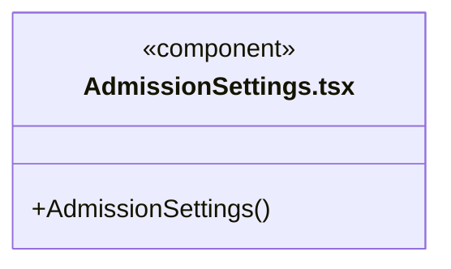
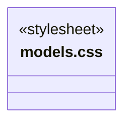
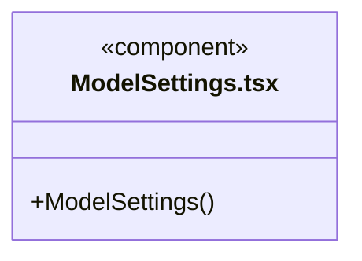
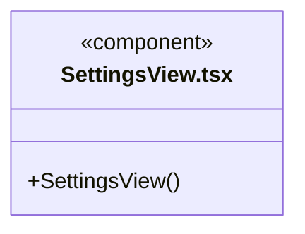
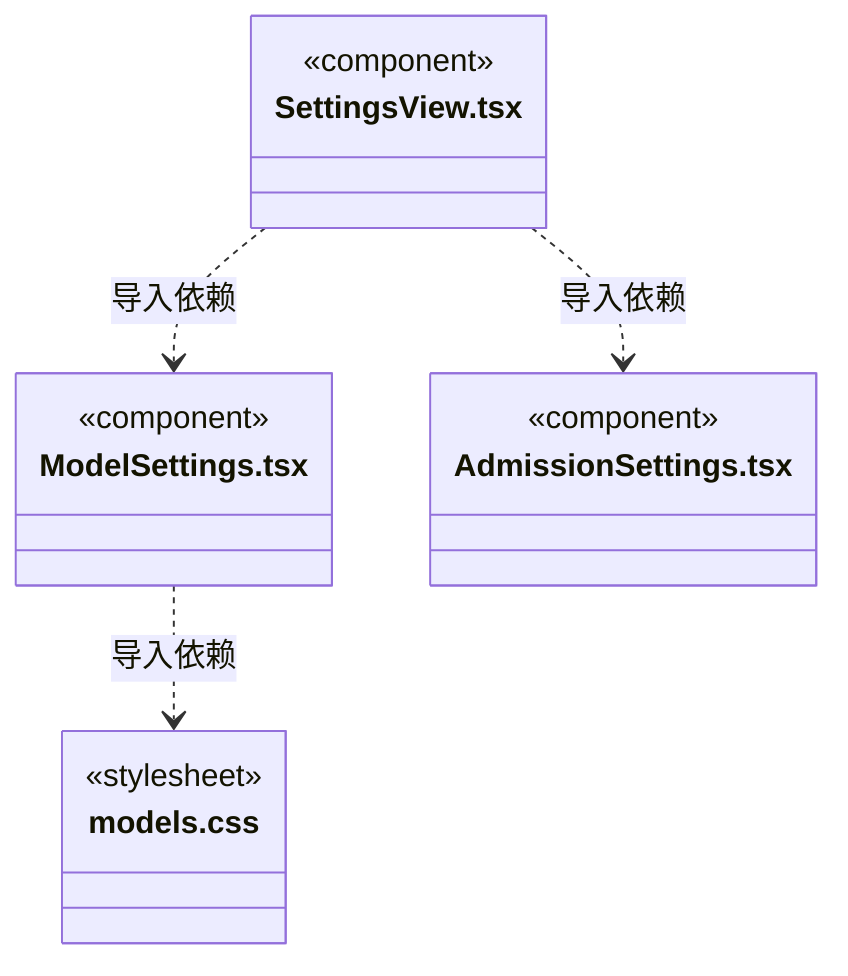

# src/frontend/settings 架构

## 目录定位

模型、仓库及全局运行并发配置。并发设置显式版本化保存，显示实际占用与等待，实时刷新不覆盖草稿；凭据仅提交主进程，账户仍按当前占位语义处理。

本文描述当前实现。通过分析目录边界后维护的 [源码架构脚本](../../../scripts/source-architecture.mjs) 同步清单和声明；代码变更时仍须核对职责、关键成员与关系。

## 代码清单

| 文件 | 当前职责 |
| --- | --- |
| [AdmissionSettings.tsx](AdmissionSettings.tsx) | 配置应用级 Agent 并发上限，展示真实准入占用与等待数量。 |
| [models.css](models.css) | 供应商列表和模型表单布局。 |
| [ModelSettings.tsx](ModelSettings.tsx) | 设置页的自定义供应商、连接表单与模型目录编辑器。 |
| [SettingsView.tsx](SettingsView.tsx) | 模型供应商、运行并发、仓库目录、共享服务和账号服务器占位设置。 |

## 架构类图

### AdmissionSettings.tsx

直接依赖：[../../bridge/contracts/admission.ts](../../bridge/contracts/admission.ts)、[../tasks/useAdmission.ts](../tasks/useAdmission.ts)、[../tasks/admission.css](../tasks/admission.css)。

### models.css

### ModelSettings.tsx

直接依赖：[../../bridge/contracts/models.ts](../../bridge/contracts/models.ts)、[models.css](models.css)。

### SettingsView.tsx

直接依赖：[../../bridge/contracts/resources.ts](../../bridge/contracts/resources.ts)、[ModelSettings.tsx](ModelSettings.tsx)、[AdmissionSettings.tsx](AdmissionSettings.tsx)。

### 本目录调用边界

## 子目录导航

无子目录。

[返回上层](../ARCHITECTURE.md)。

每次修改本目录代码，同步维护文件头、关键契约说明及本图。未实现的治理、证据验收和自动编排能力不列入当前类图。

## 设计契约 v1 与落地范围

以下内容区分已接通能力与后续设计；以各节的实现状态为准，不将目标图当作现状图。维护源：[CONTRACT.md](CONTRACT.md)；生成类图时同步附加，勿直接修改本附录。

# 设置界面

`SettingsView` 独立装配模型、执行并发和资源仓库设置，仓库服务失败不阻止配置模型与并发。

`AdmissionSettings` 从可靠设置读取版本，显式保存 1～32 的全局运行上限。输入草稿不随占用变化重置；版本冲突后由用户刷新确认。`useAdmission` 与会话共用一个窗口级游标订阅，显示实际占用/上限和等待数量；降低上限可以暂时出现占用高于上限，不结束已有任务。读取失败保留旧数据并明确可能过期。

此处不领取运行、不解除审批、不恢复历史或配置预算。设置保存只影响新准入；真实启动仍须经过调度、知识基线、成员及工作区租约检查。
